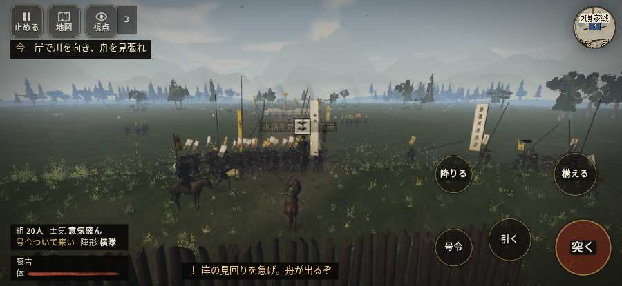

# テストプレイヤーの感想：歴史好きの大人

- 人：ミチオ（62歳・郷土史の会）（1番）
- 変わり目：台詞を全部読む・iPhone 横 932×430・新しく始める通し・速い・身分 中ほど・問屋:馬・三人称・感度 敏感・途中で止める
- 時：2026/10/12 7:28:04（186秒かかった）
- 画面：iPhone の横向き 932×430・倍率3・指で触る操作（touch.js の釦・棒・なぞり）・画質 低
- 遊んだ戦：長島一向一揆（失敗）
- 機械の混み具合：4（load average）

## ひとこと

> 長島一向一揆を、一人称で歩いて見て回りました。務めは果たせませんでしたが、それより気になる所があります。敵が近いのに、まわりの兵の多くが棒立ち。細かい事ですが、こういう所で嘘っぽくなる。前へ進もうとしても進めない所があった。史実を知る者としては、ここは看過できません。

## 見つけた問題（3件・困った順）

### 1. 敵が近いのに、まわりの兵の多くが棒立ち
- どこで：長島一向一揆・100秒・sally
- 何が：100秒：まわり35mの49人のうち28人が止まったまま（段 sally）
- どれくらい困ったか：★★ かなり困った（4回）
- 直し方の目安：敵が30m内に入ったら、構える・にじり寄る・槍を揃えるなど体を動かす
- 画面：（その戦の山場の一枚）

### 2. 敵が近いのに、まわりの兵の多くが棒立ち
- どこで：長島一向一揆・215秒・enclose
- 何が：215秒：まわり35mの39人のうち16人が止まったまま（段 enclose）
- どれくらい困ったか：★★ かなり困った（4回）
- 直し方の目安：敵が30m内に入ったら、構える・にじり寄る・槍を揃えるなど体を動かす
- 画面：（その戦の山場の一枚）

### 3. 前へ進もうとしても進めない所があった
- どこで：長島一向一揆・33秒・build
- 何が：(0, -12)・段 build
- どれくらい困ったか：★★ かなり困った（2回）
- 直し方の目安：当たり（柵・建物・地形）と道のつながりを見直す
- 画面：

## 遊んだ記録

- 長島一向一揆：304秒・任務失敗・戦功45・組20/20・討ち取り5・突き10/当たり10・号令0回・指で押した数26・読み込み2.0秒・戦の前の札142字・1コマ20.8ms（実時間159秒・内訳 brain 0.1・pad 0.1・tf 0.2・upd 20.4・eye 0.1）
  - 任務の流れ：0s 柴田の一手を率い、岸の柵を守れ → 5s 矢を柵で避け、味方と横木を直せ → 25s 岸で川を向き、舟を見張れ → 55s 岸の柵へ戻り、退く舟を見張れ → 71s 柵の内で、斬り込む門徒を受け止めよ → 185s 危ない！　槍組の後ろへ下がれ → 200s 柵の内で、味方と門徒を止めよ → 204s 東の柵へ下がり、三つの印を見回れ → 304s 持ち場を守り切れなかった〔失〕
  - 味方の隊：隊10・動いた計584m・味方の討ち取り29・敵を前に20秒止まった45回・本物の味方5人未満0秒
  - 受けた傷：侍 93・足軽 2
  - 開戦：
  - 山場：
