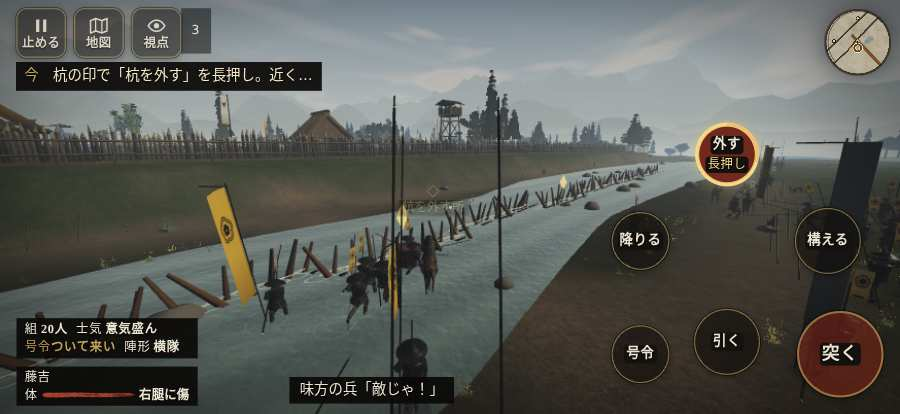

# テストプレイヤーの感想：アクション好き

- 人：ソウタ（24歳・アクションゲーム好き）（122番）
- 変わり目：台詞を全部読む・iPhone 横 874×402・新しく始める通し・ゆっくり・身分 中ほど・問屋:馬・一人称・感度 鈍い・途中で止める
- 時：2026/10/12 7:31:29（223秒かかった）
- 画面：iPhone の横向き 874×402・倍率3・指で触る操作（touch.js の釦・棒・なぞり）・画質 低
- 遊んだ戦：雑賀攻め・小雑賀川（失敗・倒れた）
- 機械の混み具合：4（load average）

## ひとこと

> とにかく突っ込んだ。4分で1人斬った。3回突いて3回当たり。当たりはいい感じ。押せる所が小さい、ストレスたまる。前へ進もうとしても進めない所があった、ストレスたまる。倒れて戦が終わった、ここは爽快感が死んでる。1回やられた。難しいのはいいけど、何でやられたか分かるようにしてほしい。

## 見つけた問題（6件・困った順）

### 1. 押せる所が小さい（28px 未満）
- どこで：雑賀攻め・小雑賀川・開戦
- 何が：#battle-notices > #objectives.goal-changed > #obj-list：281×20「「今」の任務を進めよう。」／#battle-notices > #objectives.goal-changed > #obj-list：209×20「「今」の任務を進めよう。」
- どれくらい困ったか：★★ かなり困った（39回）
- 直し方の目安：押せる大きさを 28px 以上に
- 画面：（その戦の山場の一枚）

### 2. 前へ進もうとしても進めない所があった
- どこで：雑賀攻め・小雑賀川・35秒・stakes
- 何が：(-3, 14)・段 stakes
- どれくらい困ったか：★★ かなり困った（1回）
- 直し方の目安：当たり（柵・建物・地形）と道のつながりを見直す
- 画面：

### 3. 倒れて戦が終わった
- どこで：雑賀攻め・小雑賀川・233秒・hold
- 何が：217秒で倒れた（受けた傷：足軽 109・侍 19）
- どれくらい困ったか：★★ かなり困った（1回）
- 直し方の目安：初めの戦は受ける傷を減らす・危ない時に字幕で構えを教える
- 画面：（その戦の山場の一枚）

### 4. HUD の札どうしが重なって読めない
- どこで：雑賀攻め・小雑賀川・60秒・stakes
- 何が：#mobfx と .mk.near（874×402）／#mobfx と .bl（874×402）
- どれくらい困ったか：★ 少し気になった（6回）
- 直し方の目安：置き場所をずらすか、片方を出している間はもう片方を隠す
- 画面：（その戦の山場の一枚）

### 5. 斬り合う相手が少なくて退屈
- どこで：雑賀攻め・小雑賀川・233秒・hold
- 何が：4分で1人
- どれくらい困ったか：★ 少し気になった（1回）
- 画面：（その戦の山場の一枚）

### 6. 行き先があるのに20秒動かない兵
- どこで：雑賀攻め・小雑賀川・150秒・regroup
- 何が：味方の堀秀政：味方の堀秀政（号令：path・堀秀政の先手・頭：無/―・守り・近い敵20m逃）at (-18,-8)
- どれくらい困ったか：★ 少し気になった（1回）
- 直し方の目安：道が塞がれていないか、行き先に着いたと見なせているかを見る
- 画面：（その戦の山場の一枚）

## 遊んだ記録

- 雑賀攻め・小雑賀川：217秒・任務失敗（倒れた）・戦功40・組19/20・討ち取り1・突き3/当たり3・号令0回・指で押した数32・読み込み2.0秒・戦の前の札146字・1コマ32ms（実時間189秒・内訳 brain 0.1・pad 0.1・tf 0.3・upd 31.3・eye 0.2）
  - 任務の流れ：0s 川の杭の印へ。そばで「杭を外す」を長押し → 5s 杭の印で「杭を外す」を長押し。近くの敵を払え → 88s 中央の渡り口から西岸へ進め → 104s 中央の渡り口を戻り、東岸の旗へ引け → 127s 竹束へ寄り、守りを確かめよ → 164s 東岸を守り、川上・川下の敵を払え
  - 味方の隊：隊19・動いた計2333m・味方の討ち取り48・敵を前に20秒止まった17回・本物の味方5人未満0秒
  - 受けた傷：足軽 109・侍 19
  - 開戦：
  - 山場：
