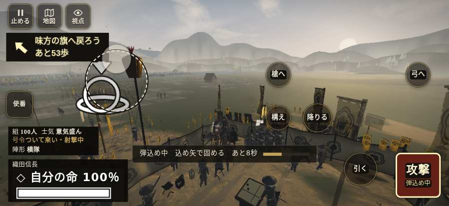

# テストプレイヤーの感想：はじめての中学生

- 人：ハルト（13歳・中学一年）（205番）
- 変わり目：連打・iPhone 横 874×402・信長で出陣・速い・身分 上・問屋:馬・三人称・感度 鈍い・止めない
- 時：2026/10/22 5:09:37（306秒かかった）
- 画面：iPhone の横向き 874×402・倍率3・指で触る操作（touch.js の釦・棒・なぞり）・画質 高
- 遊んだ戦：姉川の戦い（信長で出陣）（試験の持ち時間で打ち切り）（失敗）
- 機械の混み具合：2（load average）

## ひとこと

> とりあえずやってみた。姉川（信長で出陣）（試験の持ち時間で打ち切り）をやった。よく分かんないまま終わった。「前へ進もうとしても進めない所があった」のとこ、ムリ。「次に何をすればいいか分からない時間が続いた」のとこ、マジで意味わかんない。「この戦のあいだ、迷っていた時間が長い」のとこ、マジで意味わかんない。槍でつくのはちょっと楽しい。

## 見つけた問題（4件・困った順）

### 1. 前へ進もうとしても進めない所があった
- どこで：姉川の戦い（信長で出陣）・34秒・charge
- 何が：(-15, 161)・段 charge
- どれくらい困ったか：★★ かなり困った（3回）
- 直し方の目安：当たり（柵・建物・地形）と道のつながりを見直す
- 画面：

### 2. 次に何をすればいいか分からない時間が続いた
- どこで：姉川の戦い（信長で出陣）・88秒・charge
- 何が：88秒ごろ、段「charge」。任務「磯野の寄せを受け、押し返せ」のまま30秒、印は204m先、近くに敵もいない
- どれくらい困ったか：★★ かなり困った（2回）
- 直し方の目安：印を近くに出す・台詞で次の行き先を言う・進み具合を見せる
- 画面：（その戦の山場の一枚）

### 3. この戦のあいだ、迷っていた時間が長い
- どこで：姉川の戦い（信長で出陣）・324秒・charge
- 何が：姉川の戦い（信長で出陣）：合わせて98秒
- どれくらい困ったか：★★ かなり困った（1回）
- 直し方の目安：最初の任務の印を近くに・大きく。長い説明は戦の中で一つずつ
- 画面：（その戦の山場の一枚）

### 4. 戦場が札に食われている（画面の3分の1超）
- どこで：姉川の戦い（信長で出陣）・開戦
- 何が：874×402 で 100%
- どれくらい困ったか：★ 少し気になった（1回）
- 直し方の目安：札を小さくするか、平時は薄く・畳む
- 画面：（その戦の山場の一枚）

## 遊んだ記録

- 姉川の戦い（信長で出陣）（試験の持ち時間で打ち切り）（戦の任務とは別に、試験全体の持ち時間が尽きた）：324秒・任務失敗・戦功0・組91/100・討ち取り0・突き0/当たり0・号令0回・指で押した数1961・読み込み10.7秒・戦の前の札115字・1コマ36ms（実時間249秒・内訳 brain 0.3・pad 1.9・tf 0.8・upd 32.7・eye 0.2）
  - 任務の流れ：0s 浅井の寄せを受け、押し返せ → 18s 磯野の寄せを受け、押し返せ → 92s 浅井の新手を受け止めよ → 240s 正面を守れ。東を受ける者は東の印へ
  - 味方の隊：隊15・動いた計1171m・味方の討ち取り42・敵を前に20秒止まった44回・本物の味方5人未満0秒
  - 開戦：
  - 山場：
