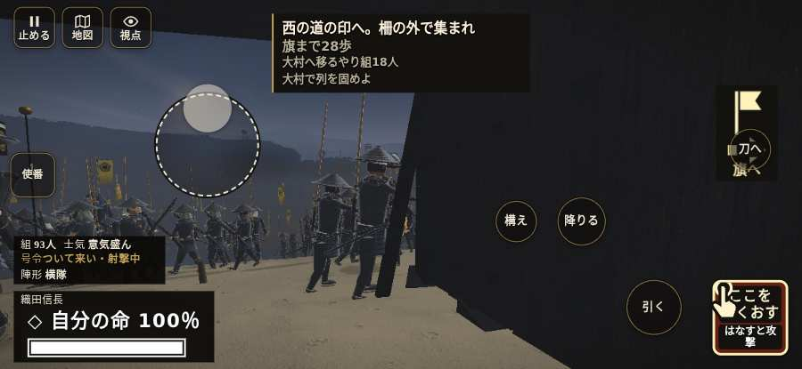

# テストプレイヤーの感想：指揮好きの戦略家

- 人：ケイコ（45歳・将棋と戦略ゲーム好き）（218番）
- 変わり目：迷子になりやすい・iPhone 横 932×430・信長で出陣・ふつう・身分 中ほど・問屋:買わない・一人称・感度 ふつう・止めない
- 時：2026/10/22 5:17:51（303秒かかった）
- 画面：iPhone の横向き 932×430・倍率3・指で触る操作（touch.js の釦・棒・なぞり）・画質 高
- 遊んだ戦：三木城・大村の合戦（信長で出陣）（試験の持ち時間で打ち切り）（失敗）
- 機械の混み具合：2（load average）

## ひとこと

> 三木城・大村の合戦（信長で出陣）（試験の持ち時間で打ち切り）で、号令を12回かけました。信長でも出陣して、軍配も触りました。号令「focus」が、指の号令の輪から出せない。命令が信用できないと、策が立てられません。号令「follow」が、指の号令の輪から出せない。指揮官としてはもどかしい。号令「attack」が、指の号令の輪から出せない。采配の上で、これは痛い。采配で負けたのか、操作で負けたのか分からないのが一番困ります。

## 見つけた問題（6件・困った順）

### 1. 号令「focus」が、指の号令の輪から出せない
- どこで：三木城・大村の合戦（信長で出陣）・29秒・convoy
- 何が：号令の輪（RADIAL）に無い、または身分が足りず選べない（三木城・大村の合戦（信長で出陣）・29秒・convoy）
- どれくらい困ったか：★★★ やめたくなった（11回）
- 直し方の目安：号令の輪に足すか、短く押した時の指揮の札（数字の号令）を指で押せるようにする
- 画面：（その戦の山場の一枚）

### 2. 号令「follow」が、指の号令の輪から出せない
- どこで：三木城・大村の合戦（信長で出陣）・10秒・brief
- 何が：号令の輪（RADIAL）に無い、または身分が足りず選べない（三木城・大村の合戦（信長で出陣）・10秒・brief）
- どれくらい困ったか：★★★ やめたくなった（5回）
- 直し方の目安：号令の輪に足すか、短く押した時の指揮の札（数字の号令）を指で押せるようにする
- 画面：（その戦の山場の一枚）

### 3. 号令「attack」が、指の号令の輪から出せない
- どこで：三木城・大村の合戦（信長で出陣）・25秒・convoy
- 何が：号令の輪（RADIAL）に無い、または身分が足りず選べない（三木城・大村の合戦（信長で出陣）・25秒・convoy）
- どれくらい困ったか：★★★ やめたくなった（5回）
- 直し方の目安：号令の輪に足すか、短く押した時の指揮の札（数字の号令）を指で押せるようにする
- 画面：（その戦の山場の一枚）

### 4. 号令「陣形」が、指の号令の輪から出せない
- どこで：三木城・大村の合戦（信長で出陣）・1秒・brief
- 何が：号令の輪（RADIAL）に無い、または身分が足りず選べない（三木城・大村の合戦（信長で出陣）・1秒・brief）
- どれくらい困ったか：★★★ やめたくなった（4回）
- 直し方の目安：号令の輪に足すか、短く押した時の指揮の札（数字の号令）を指で押せるようにする
- 画面：（その戦の山場の一枚）

### 5. 前へ進もうとしても進めない所があった
- どこで：三木城・大村の合戦（信長で出陣）・188秒・omura
- 何が：(-83, -48)・段 omura
- どれくらい困ったか：★★ かなり困った（1回）
- 直し方の目安：当たり（柵・建物・地形）と道のつながりを見直す
- 画面：

### 6. 戦場が札に食われている（画面の3分の1超）
- どこで：三木城・大村の合戦（信長で出陣）・開戦
- 何が：932×430 で 100%
- どれくらい困ったか：★ 少し気になった（2回）
- 直し方の目安：札を小さくするか、平時は薄く・畳む
- 画面：（その戦の山場の一枚）

## 遊んだ記録

- 三木城・大村の合戦（信長で出陣）（試験の持ち時間で打ち切り）（戦の任務とは別に、試験全体の持ち時間が尽きた）：223秒・任務失敗・戦功45・組90/100・討ち取り2・突き8/当たり8・号令12回・指で押した数12・読み込み32.3秒・戦の前の札110字・1コマ48.9ms（実時間233秒・内訳 brain 0.4・pad 0.2・tf 0.9・upd 47.2・eye 0.2）
  - 任務の流れ：0s 西の槍組で護衛を退けよ → 12s 味方の槍組で荷の護衛を退けよ → 12s 南の曲がり道から西の槍組に加われ → 13s 槍組と構え、護衛を退けよ → 50s 味方と木戸を守れ → 51s 木戸で味方と城兵を受けよ → 120s 城兵が近づく。味方と木戸を守れ → 158s 味方と木戸の城兵を退けよ → 159s 味方と木戸を守れ → 163s 城兵が近づく。味方と木戸を守れ → 174s 平田の味方の印へ戻れ。共に城兵を受けよ → 178s 西の道の印へ。柵の外で集まれ
  - 味方の隊：隊15・動いた計621m・味方の討ち取り38・敵を前に20秒止まった29回・本物の味方5人未満0秒
  - 受けた傷：侍 0
  - 開戦：
  - 山場：
