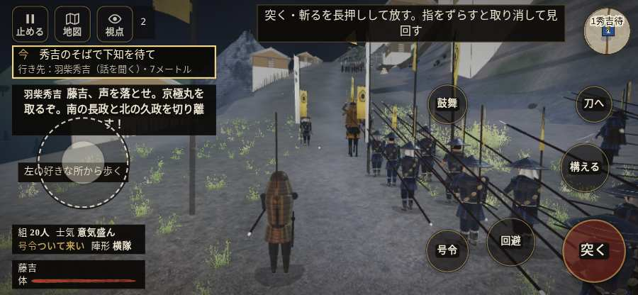

# テストプレイヤーの感想：歴史好きの大人

- 人：ミチオ（62歳・郷土史の会）（226番）
- 変わり目：連打・iPhone 横 844×390・新しく始める通し・速い・身分 少し上・問屋:買わない・一人称・感度 ふつう・止めない
- 時：2026/10/12 18:21:55（261秒かかった）
- 画面：iPhone の横向き 844×390・倍率3・指で触る操作（touch.js の釦・棒・なぞり）・画質 低
- 遊んだ戦：小谷城の戦い（失敗）
- 機械の混み具合：3（load average）

## ひとこと

> 小谷城を、一人称で歩いて見て回りました。務めは果たせませんでしたが、それより気になる所があります。行き先があるのに20秒動かない兵。これでは興が醒めます。兵が一息で飛んだ。史実を知る者としては、ここは看過できません。「親指の棒（歩く）」を押そうとしたら、別の物に当たった。これでは興が醒めます。

## 見つけた問題（4件・困った順）

### 1. 行き先があるのに20秒動かない兵
- どこで：小谷城の戦い・156秒・climb
- 何が：敵の足軽：敵の足軽（号令：attack・物見の足軽・頭：full/approach・近い敵41m）at (-38,38)／敵の足軽：敵の足軽（号令：attack・物見の足軽・頭：full/approach・近い敵46m）at (-38,41)
- どれくらい困ったか：★★★ やめたくなった（16回）
- 直し方の目安：道が塞がれていないか、行き先に着いたと見なせているかを見る
- 画面：（その戦の山場の一枚）

### 2. 兵が一息で飛んだ（6m 超）
- どこで：小谷城の戦い・20秒・climb
- 何が：敵の侍：敵の侍：(-79,38) → (-86,52)／敵の侍：敵の侍：(-52,-41) → (-81,44)
- どれくらい困ったか：★★★ やめたくなった（14回）
- 直し方の目安：位置を直接書き換えている所を探す（出し直し・押し出し）
- 画面：（その戦の山場の一枚）

### 3. 「親指の棒（歩く）」を押そうとしたら、別の物に当たった
- どこで：小谷城の戦い・0秒・brief
- 何が：指の下にあったのは #battle-notices > #battle-message > #subtitle「羽柴秀吉藤吉、声を落とせ。京」
- どれくらい困ったか：★★ かなり困った（1回）
- 直し方の目安：重ねている札の置き場所をずらすか、pointer-events:none にする
- 画面：

### 4. console.error：THREE.Object3D.add: object not an instance of THREE.Object3D.
- どこで：小谷城の戦い・戦の前の札
- 何が：—
- どれくらい困ったか：★ 少し気になった（3回）
- 直し方の目安：出どころを突き止める
- 画面：（その戦の山場の一枚）

## 遊んだ記録

- 小谷城の戦い：480秒・任務失敗・戦功55・組15/20・討ち取り1・突き3/当たり3・号令0回・指で押した数23・読み込み3.0秒・戦の前の札136字・1コマ20.5ms（実時間224秒・内訳 brain 0.1・pad 0.1・tf 0.4・upd 19.8・eye 0.1）
  - 任務の流れ：0s 秀吉のそばで下知を待て → 5s 一隊を率いて清水谷を登れ → 201s 京極丸の下、大野木屋敷を奪え → 357s 西木戸を破り、京極丸を奪え → 480s 西木戸を破り、京極丸を奪え〔失〕
  - 味方の隊：隊20・動いた計2686m・味方の討ち取り42・敵を前に20秒止まった2回・本物の味方5人未満0秒
  - 受けた傷：足軽 50・侍 2
  - 開戦：
  - 一人称で見回す（45秒）：
