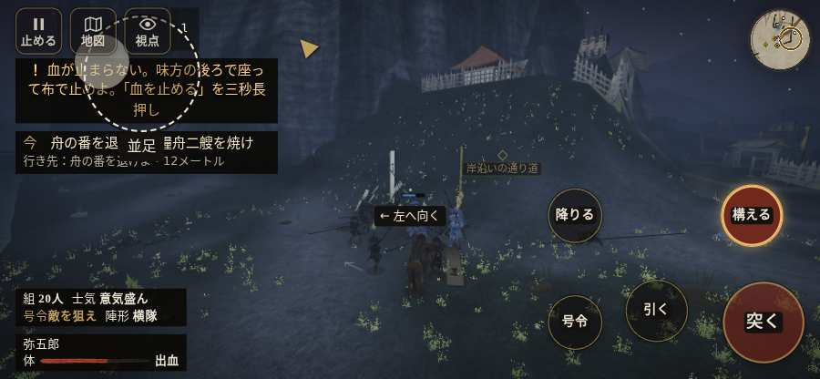

# テストプレイヤーの感想：アクション好き

- 人：ソウタ（24歳・アクションゲーム好き）（227番）
- 変わり目：構え多め・iPhone 横 844×390・織田家編の戦を一つ・ゆっくり・身分 上・問屋:馬・一人称・感度 ふつう・止めない
- 時：2026/10/12 18:26:20（83秒かかった）
- 画面：iPhone の横向き 844×390・倍率3・指で触る操作（touch.js の釦・棒・なぞり）・画質 低
- 遊んだ戦：鳥取城の戦い（失敗・倒れた）
- 機械の混み具合：3（load average）

## ひとこと

> とにかく突っ込んだ。1分で0人斬った。「親指の棒（歩く）」を押そうとしたら、別の物に当たった、もったいない。倒れて戦が終わった、ここは爽快感が死んでる。始まってすぐやられる、ストレスたまる。1回やられた。難しいのはいいけど、何でやられたか分かるようにしてほしい。

## 見つけた問題（5件・困った順）

### 1. 「親指の棒（歩く）」を押そうとしたら、別の物に当たった
- どこで：鳥取城の戦い・43秒・boats
- 何が：指の下にあったのは #hud.battle-active.hudmin > #battle-notices > #objectives「任務の一覧を開く。残り 1件・済 0件・失敗 0件」
- どれくらい困ったか：★★ かなり困った（1回）
- 直し方の目安：重ねている札の置き場所をずらすか、pointer-events:none にする
- 画面：

### 2. 倒れて戦が終わった
- どこで：鳥取城の戦い・77秒・boats
- 何が：61秒で倒れた（受けた傷：足軽 118・侍 43）
- どれくらい困ったか：★★ かなり困った（1回）
- 直し方の目安：初めの戦は受ける傷を減らす・危ない時に字幕で構えを教える
- 画面：（その戦の山場の一枚）

### 3. 始まってすぐやられる（難しすぎ）
- どこで：鳥取城の戦い・77秒・boats
- 何が：61秒で倒れた（足軽 118・侍 43）
- どれくらい困ったか：★★ かなり困った（1回）
- 画面：（その戦の山場の一枚）

### 4. HUD の札どうしが重なって読めない
- どこで：鳥取城の戦い・50秒・boats
- 何が：#brinkfx と .mk.quiet（844×390）／#brinkfx と .mk.edge（844×390）
- どれくらい困ったか：★ 少し気になった（8回）
- 直し方の目安：置き場所をずらすか、片方を出している間はもう片方を隠す
- 画面：（その戦の山場の一枚）

### 5. 自分のすぐそばの敵が6秒以上なにもしない
- どこで：鳥取城の戦い・16秒・boats
- 何が：敵の足軽：敵の足軽
- どれくらい困ったか：★ 少し気になった（1回）
- 直し方の目安：近くの敵（遊び手）を狙いに入れる
- 画面：（その戦の山場の一枚）

## 遊んだ記録

- 鳥取城の戦い：61秒・任務失敗（倒れた）・戦功0・組20/20・討ち取り0・突き0/当たり0・号令0回・指で押した数4・読み込み3.0秒・戦の前の札155字・1コマ19.6ms（実時間49秒・内訳 brain 0.1・pad 0.1・tf 0.1・upd 19.2・eye 0.1）
  - 任務の流れ：0s 川岸の組へ進み、一手をそろえよ → 2s 舟の番を退け、兵糧舟二艘を焼け
  - 味方の隊：隊17・動いた計151m・味方の討ち取り3・敵を前に20秒止まった15回・本物の味方5人未満0秒
  - 受けた傷：足軽 118・侍 43
  - 開戦：
  - 山場：
