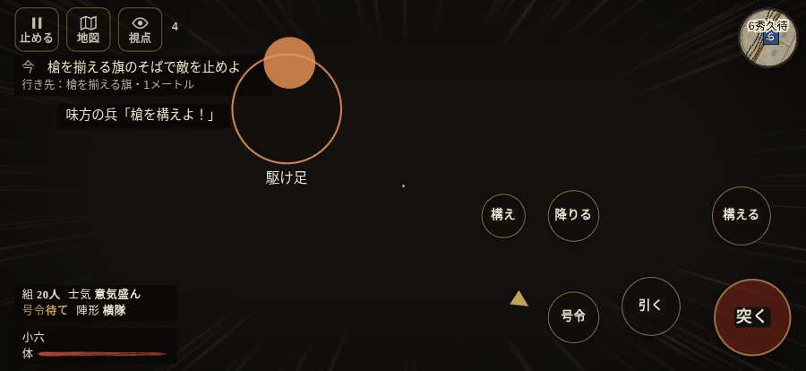

# テストプレイヤーの感想：せっかちな社会人

- 人：ユウキ（35歳・昼休みに遊ぶ会社員）（239番）
- 変わり目：迷子になりやすい・iPhone 横 874×402・新しく始める通し・ふつう・身分 中ほど・問屋:馬・一人称・感度 ふつう・止めない
- 時：2026/10/12 18:35:36（288秒かかった）
- 画面：iPhone の横向き 874×402・倍率3・指で触る操作（touch.js の釦・棒・なぞり）・画質 低
- 遊んだ戦：設楽原の決戦（失敗・倒れた）
- 機械の混み具合：3（load average）

## ひとこと

> 昼休みに5分ほど。設楽原。「親指の棒（歩く）」を押そうとしたら、別の物に当たった。待ってられない。何もする事が無いまま待たされた。ここで閉じる人は多いと思う。HUD の札どうしが重なって読めない。ここで閉じる人は多いと思う。結局、何分遊べば一区切りなのかが分からない。

## 見つけた問題（6件・困った順）

### 1. HUD の札どうしが重なって読めない
- どこで：設楽原の決戦・200秒・pursuit
- 何が：#mobfx と .mk.edge（874×402）／#mobfx と .bl（874×402）
- どれくらい困ったか：★★ かなり困った（27回）
- 直し方の目安：置き場所をずらすか、片方を出している間はもう片方を隠す
- 画面：（その戦の山場の一枚）

### 2. 押せる所が小さい（28px 未満）
- どこで：設楽原の決戦・5秒・brief
- 何が：#battle-notices > #objectives > #obj-list：264×20「「今」の任務を進めよう。」／#battle-notices.choosing > #objectives > #obj-list：304×20「「今」の任務を進めよう。」
- どれくらい困ったか：★★ かなり困った（8回）
- 直し方の目安：押せる大きさを 28px 以上に
- 画面：（その戦の山場の一枚）

### 3. 「親指の棒（歩く）」を押そうとしたら、別の物に当たった
- どこで：設楽原の決戦・34秒・defend
- 何が：指の下にあったのは #choice > .opt > b「内側の柵の脇で受ける」
- どれくらい困ったか：★★ かなり困った（1回）
- 直し方の目安：重ねている札の置き場所をずらすか、pointer-events:none にする
- 画面：

### 4. 何もする事が無いまま待たされた
- どこで：設楽原の決戦・252秒・pursuit
- 何が：64秒、任務札が変わらず敵もいない（段 pursuit）
- どれくらい困ったか：★★ かなり困った（1回）
- 直し方の目安：飛ばせる（canSkip）ようにするか、待つ間にする事を置く
- 画面：（その戦の山場の一枚）

### 5. 戦場が札に食われている（画面の3分の1超）
- どこで：設楽原の決戦・200秒・pursuit
- 何が：874×402 で 100%
- どれくらい困ったか：★ 少し気になった（4回）
- 直し方の目安：札を小さくするか、平時は薄く・畳む
- 画面：（その戦の山場の一枚）

### 6. 倒れて戦が終わった
- どこで：設楽原の決戦・309秒・pursuit
- 何が：293秒で倒れた（受けた傷：侍 111・鉄砲 22・足軽 13）
- どれくらい困ったか：★ 少し気になった（1回）
- 直し方の目安：初めの戦は受ける傷を減らす・危ない時に字幕で構えを教える
- 画面：（その戦の山場の一枚）

## 遊んだ記録

- 設楽原の決戦：293秒・任務失敗（倒れた）・戦功110・組19/20・討ち取り6・突き18/当たり21・号令0回・指で押した数126・読み込み5.0秒・戦の前の札151字・1コマ34.3ms（実時間245秒・内訳 brain 0.3・pad 0.2・tf 0.2・upd 33.4・eye 0.2）
  - 任務の流れ：0s 目の前の柵の口で敵を止めよ → 34s 槍を揃える旗のそばで敵を止めよ → 74s 槍を揃え、柵内の敵を押し返せ → 93s 北の柵を守った。弾を込め直し、中央への下知を待て → 97s 槍を揃える旗のそばで敵を止めよ → 127s 柵前の敵を撃ち、突破を止めよ → 151s 組を集め、追い討ちの下知を待て → 168s 下知じゃ。大宮前の虎口から出て、退く武田勢を追え → 172s 連吾川の浅瀬を渡れ。組と東へ追え → 188s 野を東へ進み、逃げる武田勢を追え
  - 味方の隊：隊83・動いた計3240m・味方の討ち取り25・敵を前に20秒止まった38回・本物の味方5人未満0秒
  - 受けた傷：侍 111・鉄砲 22・足軽 13
  - 開戦：
  - 山場：
