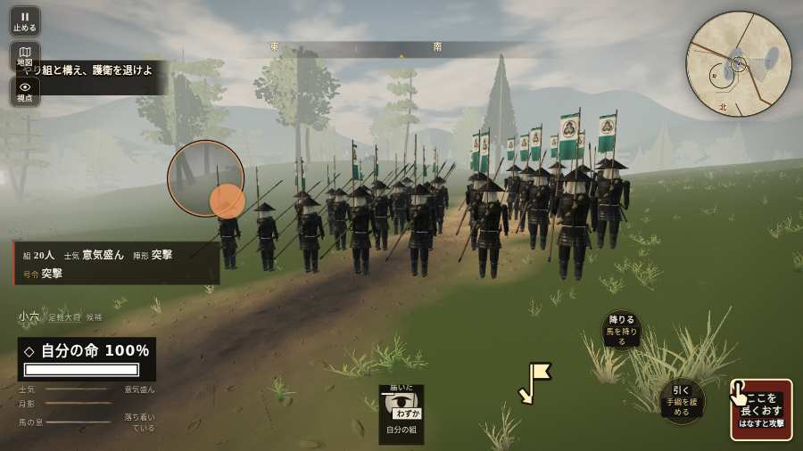

# テストプレイヤーの感想：アクション好き

- 人：ソウタ（24歳・アクションゲーム好き）（362番）
- 変わり目：走りっぱなし・パソコン 1280×720・織田家編の戦を一つ・ゆっくり・身分 上・問屋:刀・槍・具足・三人称・感度 鈍い・途中で止める
- 時：2026/10/22 10:22:33（249秒かかった）
- 画面：パソコン 1280×720・鍵盤とマウス・画質 高
- 遊んだ戦：三木城・大村の合戦（試験の持ち時間で打ち切り）（失敗）
- 機械の混み具合：3（load average）

## ひとこと

> とにかく突っ込んだ。3分で0人斬った。1回突いて1回当たり。当たりはいい感じ。前へ進もうとしても進めない所があった、ストレスたまる。号令「attack」が、指の号令の輪から出せない、ここは爽快感が死んでる。斬り合う相手が少なくて退屈、ここは爽快感が死んでる。もっと派手に、じゃなくて重く斬り合いたい。

## 見つけた問題（5件・困った順）

### 1. 前へ進もうとしても進めない所があった
- どこで：三木城・大村の合戦・66秒・convoy
- 何が：(-77, -48)・段 convoy
- どれくらい困ったか：★★ かなり困った（4回）
- 直し方の目安：当たり（柵・建物・地形）と道のつながりを見直す
- 画面：

### 2. HUD の札どうしが重なって読めない
- どこで：三木城・大村の合戦・開戦
- 何が：#minimap と #battle-opening（1280×720）／#h-units と #battle-opening（1280×720）
- どれくらい困ったか：★ 少し気になった（7回）
- 直し方の目安：置き場所をずらすか、片方を出している間はもう片方を隠す
- 画面：（その戦の山場の一枚）

### 3. 字が枠から切れている
- どこで：三木城・大村の合戦・45秒・convoy
- 何が：#h-units > .uc.ally > .nm「1 羽柴秀吉」
- どれくらい困ったか：★ 少し気になった（6回）
- 直し方の目安：枠を広げるか、字を折り返す
- 画面：（その戦の山場の一枚）

### 4. 号令「attack」が、指の号令の輪から出せない
- どこで：三木城・大村の合戦・28秒・convoy
- 何が：号令の輪（RADIAL）に無い、または身分が足りず選べない（三木城・大村の合戦・28秒・convoy）
- どれくらい困ったか：★ 少し気になった（2回）
- 直し方の目安：号令の輪に足すか、短く押した時の指揮の札（数字の号令）を指で押せるようにする
- 画面：（その戦の山場の一枚）

### 5. 斬り合う相手が少なくて退屈
- どこで：三木城・大村の合戦・206秒・omura
- 何が：3分で0人
- どれくらい困ったか：★ 少し気になった（1回）
- 画面：（その戦の山場の一枚）

## 遊んだ記録

- 三木城・大村の合戦（試験の持ち時間で打ち切り）（戦の任務とは別に、試験全体の持ち時間が尽きた）：206秒・任務失敗・戦功20・組20/20・討ち取り0・突き1/当たり1・号令2回・指で押した数4・読み込み36.9秒・戦の前の札186字・1コマ32.5ms（実時間157秒・内訳 brain 0.2・pad 0.1・tf 0.6・upd 31.4・eye 0.2）
  - 任務の流れ：0s 西の槍組で護衛を退けよ → 12s 味方の槍組で荷の護衛を退けよ → 12s 南の曲がり道から西の槍組に加われ → 13s 槍組と構え、護衛を退けよ → 41s 味方と木戸を守れ → 42s 構えて平田の口へ進め → 42s 木戸で味方と城兵を受けよ → 83s 城兵が近づく。味方と木戸を守れ → 108s 木戸で味方と城兵を受けよ → 157s 城兵が近づく。味方と木戸を守れ → 165s 味方と木戸の城兵を退けよ → 172s 味方と木戸を守れ → 173s 味方と木戸の城兵を退けよ → 177s 味方と木戸を守れ
  - 味方の隊：隊14・動いた計856m・味方の討ち取り53・敵を前に20秒止まった31回・本物の味方5人未満0秒
  - 受けた傷：侍 17
  - 開戦：
  - 山場：
