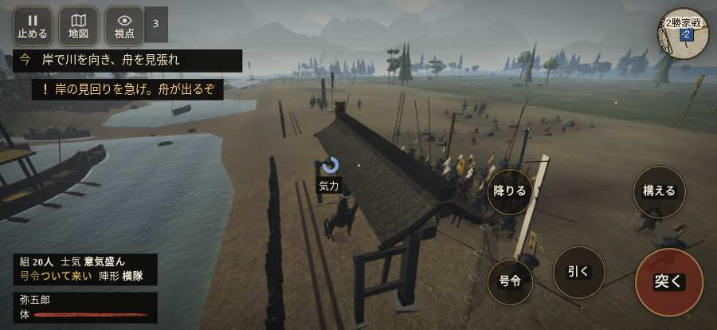

# テストプレイヤーの感想：はじめての中学生

- 人：ハルト（13歳・中学一年）（370番）
- 変わり目：台詞を全部読む・iPhone 横 874×402・新しく始める通し・ゆっくり・身分 中ほど・問屋:鉄砲・一人称・感度 ふつう・止めない
- 時：2026/10/13 0:43:36（249秒かかった）
- 画面：iPhone の横向き 874×402・倍率3・指で触る操作（touch.js の釦・棒・なぞり）・画質 低
- 遊んだ戦：長島一向一揆（試験の持ち時間で打ち切り）（失敗）
- 機械の混み具合：3（load average）

## ひとこと

> とりあえずやってみた。長島一向一揆（試験の持ち時間で打ち切り）をやった。よく分かんないまま終わった。「押せる所が小さい」のとこ、ふつうに困った。「前へ進もうとしても進めない所があった」のとこ、ムリ。「「親指の棒（歩く）」を押そうとしたら、別の物に当たった」のとこ、ムリ。ぶっちゃけ、ここで一回やめかけた。

## 見つけた問題（3件・困った順）

### 1. 押せる所が小さい（28px 未満）
- どこで：長島一向一揆・開戦
- 何が：#battle-notices > #objectives.goal-changed > #obj-list：264×20「「今」の任務を進めよう。」／#battle-notices > #objectives > #obj-list：264×20「「今」の任務を進めよう。」
- どれくらい困ったか：★★★ やめたくなった（25回）
- 直し方の目安：押せる大きさを 28px 以上に
- 画面：（その戦の山場の一枚）

### 2. 前へ進もうとしても進めない所があった
- どこで：長島一向一揆・33秒・build
- 何が：(0, -12)・段 build
- どれくらい困ったか：★★ かなり困った（2回）
- 直し方の目安：当たり（柵・建物・地形）と道のつながりを見直す
- 画面：

### 3. 「親指の棒（歩く）」を押そうとしたら、別の物に当たった
- どこで：長島一向一揆・132秒・sally
- 何が：指の下にあったのは #battle-notices > #battle-message > #subtitle「物見後の舟が動いた！　東の岸」
- どれくらい困ったか：★★ かなり困った（1回）
- 直し方の目安：重ねている札の置き場所をずらすか、pointer-events:none にする
- 画面：（その戦の山場の一枚）

## 遊んだ記録

- 長島一向一揆（試験の持ち時間で打ち切り）（戦の任務とは別に、試験全体の持ち時間が尽きた）：197秒・任務失敗・戦功0・組20/20・討ち取り15・突き183/当たり28・号令0回・指で押した数276・読み込み3.7秒・戦の前の札143字・1コマ43.8ms（実時間200秒・内訳 brain 0.1・pad 0.4・tf 0.2・upd 42.9・eye 0.1）
  - 任務の流れ：0s 柴田の一手を率い、岸の柵を守れ → 5s 矢を柵で避け、味方と横木を直せ → 25s 岸で川を向き、舟を見張れ → 55s 岸の柵へ戻り、退く舟を見張れ → 71s 柵の内で、斬り込む門徒を受け止めよ → 155s 危ない！　槍組の後ろへ下がれ → 170s 柵の内で、味方と門徒を止めよ
  - 味方の隊：隊10・動いた計502m・味方の討ち取り18・敵を前に20秒止まった34回・本物の味方5人未満0秒
  - 受けた傷：侍 1
  - 開戦：
  - 山場：
