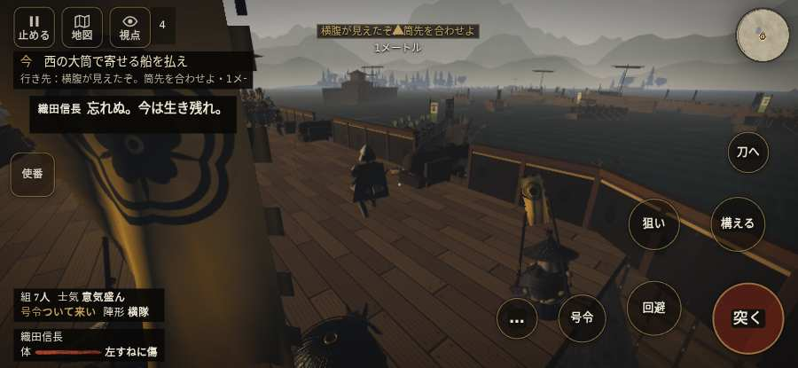

# テストプレイヤーの感想：アクション好き

- 人：ソウタ（24歳・アクションゲーム好き）（417番）
- 変わり目：連打・iPhone 横 932×430・信長で出陣・速い・身分 中ほど・問屋:鉄砲・一人称・感度 敏感・途中で止める
- 時：2026/10/13 1:11:02（53秒かかった）
- 画面：iPhone の横向き 932×430・倍率3・指で触る操作（touch.js の釦・棒・なぞり）・画質 低
- 遊んだ戦：第二次木津川口の戦い（信長で出陣）（失敗・倒れた）
- 機械の混み具合：4（load average）

## ひとこと

> とにかく突っ込んだ。1分で1人斬った。1回突いて1回当たり。当たりはいい感じ。倒れて戦が終わった、ここは爽快感が死んでる。始まってすぐやられる、もったいない。死んだ相手を3秒以上狙い続けている、もったいない。1回やられた。難しいのはいいけど、何でやられたか分かるようにしてほしい。

## 見つけた問題（3件・困った順）

### 1. 死んだ相手を3秒以上狙い続けている
- どこで：第二次木津川口の戦い（信長で出陣）・56秒・cannon
- 何が：敵の鉄砲：敵の鉄砲／敵の弓：敵の弓
- どれくらい困ったか：★★ かなり困った（12回）
- 直し方の目安：相手が倒れたら狙いを外す
- 画面：（その戦の山場の一枚）

### 2. 倒れて戦が終わった
- どこで：第二次木津川口の戦い（信長で出陣）・56秒・cannon
- 何が：56秒で倒れた（受けた傷：足軽 4）
- どれくらい困ったか：★★ かなり困った（1回）
- 直し方の目安：初めの戦は受ける傷を減らす・危ない時に字幕で構えを教える
- 画面：（その戦の山場の一枚）

### 3. 始まってすぐやられる（難しすぎ）
- どこで：第二次木津川口の戦い（信長で出陣）・56秒・cannon
- 何が：56秒で倒れた（足軽 4）
- どれくらい困ったか：★★ かなり困った（1回）
- 画面：（その戦の山場の一枚）

## 遊んだ記録

- 第二次木津川口の戦い（信長で出陣）：56秒・任務失敗（倒れた）・戦功0・組7/107・討ち取り1・突き1/当たり1・号令0回・指で押した数7・読み込み1.3秒・戦の前の札106字・1コマ16.6ms（実時間33秒・内訳 brain 0.1・pad 0.1・tf 0.3・upd 16.0・eye 0.1）
  - 任務の流れ：0s 西の大筒で敵船を迎えよ → 9s 西の大筒で寄せる船を払え
  - 味方の隊：隊37・動いた計111m・味方の討ち取り7・敵を前に20秒止まった1回・本物の味方5人未満0秒
  - 受けた傷：足軽 4
  - 開戦：
  - 山場：
  - 勝ち負けが決まった所：
