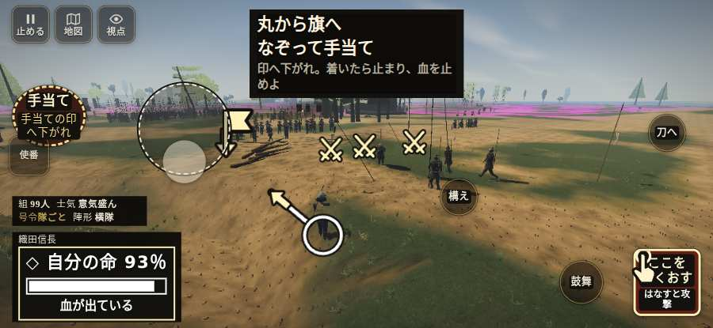

# テストプレイヤーの感想：歴史好きの大人

- 人：ミチオ（62歳・郷土史の会）（421番）
- 変わり目：台詞を全部読む・iPhone 横 932×430・信長で出陣・ゆっくり・身分 少し上・問屋:供・三人称・感度 ふつう・途中で止める
- 時：2026/10/22 10:19:30（245秒かかった）
- 画面：iPhone の横向き 932×430・倍率3・指で触る操作（touch.js の釦・棒・なぞり）・画質 高
- 遊んだ戦：天王寺の戦い（信長で出陣）（試験の持ち時間で打ち切り）（失敗）
- 機械の混み具合：2（load average）

## ひとこと

> 天王寺（信長で出陣）（試験の持ち時間で打ち切り）を、一人称で歩いて見て回りました。務めは果たせませんでしたが、それより気になる所があります。「回避」をしたいのに、押す丸が出ていない。当時の人が見たら首を傾げるでしょう。号令「follow」が、指の号令の輪から出せない。これでは興が醒めます。号令「槍衾」が、指の号令の輪から出せない。細かい事ですが、こういう所で嘘っぽくなる。

## 見つけた問題（4件・困った順）

### 1. 「回避」をしたいのに、押す丸が出ていない
- どこで：天王寺の戦い（信長で出陣）・26秒・siege
- 何が：欲しかった時：天王寺の戦い（信長で出陣）・26秒・siege
- どれくらい困ったか：★ 少し気になった（3回）
- 直し方の目安：その時に使える釦は出す（touchFrame の出し入れ）
- 画面：（その戦の山場の一枚）

### 2. 号令「follow」が、指の号令の輪から出せない
- どこで：天王寺の戦い（信長で出陣）・38秒・break
- 何が：号令の輪（RADIAL）に無い、または身分が足りず選べない（天王寺の戦い（信長で出陣）・38秒・break）
- どれくらい困ったか：★ 少し気になった（3回）
- 直し方の目安：号令の輪に足すか、短く押した時の指揮の札（数字の号令）を指で押せるようにする
- 画面：（その戦の山場の一枚）

### 3. 号令「槍衾」が、指の号令の輪から出せない
- どこで：天王寺の戦い（信長で出陣）・145秒・regroup
- 何が：号令の輪（RADIAL）に無い、または身分が足りず選べない（天王寺の戦い（信長で出陣）・145秒・regroup）
- どれくらい困ったか：★ 少し気になった（1回）
- 直し方の目安：号令の輪に足すか、短く押した時の指揮の札（数字の号令）を指で押せるようにする
- 画面：（その戦の山場の一枚）

### 4. 行き先があるのに20秒動かない兵
- どこで：天王寺の戦い（信長で出陣）・131秒・break
- 何が：敵の足軽：敵の足軽（号令：attack・囲みの新手・頭：full/rally・守り・近い敵2m）at (24,-13)
- どれくらい困ったか：★ 少し気になった（1回）
- 直し方の目安：道が塞がれていないか、行き先に着いたと見なせているかを見る
- 画面：（その戦の山場の一枚）

## 遊んだ記録

- 天王寺の戦い（信長で出陣）（試験の持ち時間で打ち切り）（戦の任務とは別に、試験全体の持ち時間が尽きた）：243秒・任務失敗・戦功121・組81/100・討ち取り0・突き3/当たり3・号令3回・指で押した数7・読み込み12.4秒・戦の前の札105字・1コマ37.1ms（実時間194秒・内訳 brain 0.2・pad 0.1・tf 1.1・upd 35.5・eye 0.2）
  - 任務の流れ：0s 先手の列で住吉口へ時を待て → 23s 先手の列を保ち、砦への攻めに備えよ → 31s 先手と南の門へ進み、囲みを破れ → 141s 南の門内の脇で、信長の入城を迎えよ → 145s 南の門内で組をそろえ、時を待て
  - 味方の隊：隊8・動いた計585m・味方の討ち取り40・敵を前に20秒止まった21回・本物の味方5人未満0秒
  - 受けた傷：侍 24・足軽 5
  - 開戦：
  - 山場：
  - 一人称で見回す（59秒）：
