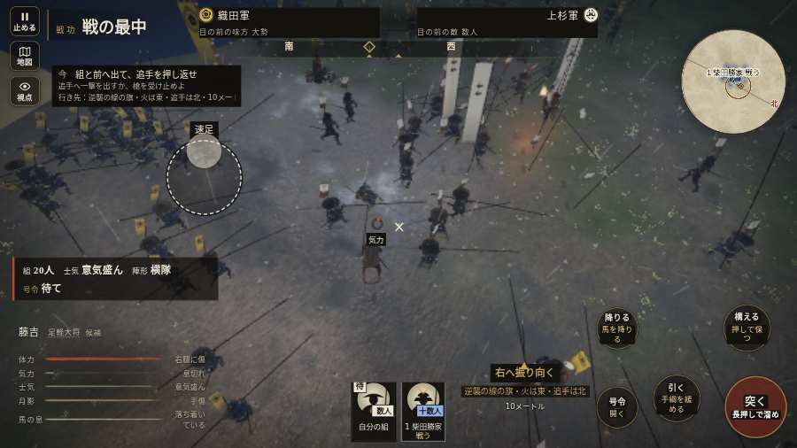

# テストプレイヤーの感想：はじめての中学生

- 人：ハルト（13歳・中学一年）（430番）
- 変わり目：構え多め・パソコン 1280×720・織田家編の戦を一つ・ふつう・身分 上・問屋:刀・槍・具足・一人称・感度 敏感・止めない
- 時：2026/10/13 0:43:38（248秒かかった）
- 画面：パソコン 1280×720・鍵盤とマウス・画質 低
- 遊んだ戦：手取川の戦い（試験の持ち時間で打ち切り）（失敗）
- 機械の混み具合：3（load average）

## ひとこと

> とりあえずやってみた。手取川（試験の持ち時間で打ち切り）をやった。よく分かんないまま終わった。「字が枠から切れている」のとこ、だるい。「前へ進もうとしても進めない所があった」のとこ、だるい。ぶっちゃけ、ここで一回やめかけた。

## 見つけた問題（3件・困った順）

### 1. 字が枠から切れている
- どこで：手取川の戦い・5秒・brief
- 何が：#h-units > .uc.ally > .nm「1 柴田勝家」
- どれくらい困ったか：★★★ やめたくなった（34回）
- 直し方の目安：枠を広げるか、字を折り返す
- 画面：（その戦の山場の一枚）

### 2. 前へ進もうとしても進めない所があった
- どこで：手取川の戦い・33秒・retreat
- 何が：(12, -69)・段 retreat
- どれくらい困ったか：★★ かなり困った（1回）
- 直し方の目安：当たり（柵・建物・地形）と道のつながりを見直す
- 画面：

### 3. 前へ進もうとしても進めない所があった
- どこで：手取川の戦い・251秒・rear
- 何が：(6, -47)・段 rear
- どれくらい困ったか：★★ かなり困った（1回）
- 直し方の目安：当たり（柵・建物・地形）と道のつながりを見直す
- 画面：（その戦の山場の一枚）

## 遊んだ記録

- 手取川の戦い（試験の持ち時間で打ち切り）（戦の任務とは別に、試験全体の持ち時間が尽きた）：266秒・任務失敗・戦功60・組19/20・討ち取り1・突き267/当たり5・号令0回・指で押した数1287・読み込み5.3秒・戦の前の札161字・1コマ31ms（実時間196秒・内訳 brain 0.3・pad 1.1・tf 0.3・upd 29.1・eye 0.2）
  - 任務の流れ：0s 一手をまとめ、柴田勝家の旗へ集まれ → 22s 組頭に続き、北岸の火へ退け → 61s 一手を率い、北岸で追手を止めよ／火のそばで北を向き、追手へ槍を出せ → 85s 一手を率い、北岸で追手を止めよ／北岸の火で、組と次の追手を止めよ → 113s 一手を率い、北岸で追手を止めよ／組と前へ出て、追手を押し返せ → 235s 一手を率い、北岸で追手を止めよ／追手を食い止め、本隊を渡せ
  - 味方の隊：隊43・動いた計2865m・味方の討ち取り43・敵を前に20秒止まった125回・本物の味方5人未満0秒
  - 受けた傷：足軽 16
  - 開戦：
  - 山場：
