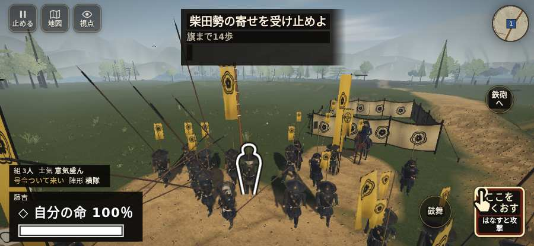

# テストプレイヤーの感想：アクション好き

- 人：ソウタ（24歳・アクションゲーム好き）（432番）
- 変わり目：構え多め・iPhone 横 932×430・織田家編の戦を一つ・速い・足軽から・問屋:供・三人称・感度 敏感・止めない
- 時：2026/10/22 10:20:37（116秒かかった）
- 画面：iPhone の横向き 932×430・倍率3・指で触る操作（touch.js の釦・棒・なぞり）・画質 高
- 遊んだ戦：稲生の戦い（失敗・切り上げ）
- 機械の混み具合：3（load average）

## ひとこと

> とにかく突っ込んだ。3分で0人斬った。HUD の札どうしが重なって読めない、手応えがスカスカ。戦場が札に食われている、ここは爽快感が死んでる。「回避」をしたいのに、押す丸が出ていない、もったいない。もっと派手に、じゃなくて重く斬り合いたい。

## 見つけた問題（4件・困った順）

### 1. HUD の札どうしが重なって読めない
- どこで：稲生の戦い・202秒・shibata
- 何が：.bl.full と svg（932×430）／#h-squad と svg（932×430）
- どれくらい困ったか：★★ かなり困った（282回）
- 直し方の目安：置き場所をずらすか、片方を出している間はもう片方を隠す
- 画面：（その戦の山場の一枚）

### 2. 戦場が札に食われている（画面の3分の1超）
- どこで：稲生の戦い・開戦
- 何が：932×430 で 100%
- どれくらい困ったか：★★ かなり困った（142回）
- 直し方の目安：札を小さくするか、平時は薄く・畳む
- 画面：（その戦の山場の一枚）

### 3. 「回避」をしたいのに、押す丸が出ていない
- どこで：稲生の戦い・155秒・shibata
- 何が：欲しかった時：稲生の戦い・155秒・shibata
- どれくらい困ったか：★ 少し気になった（2回）
- 直し方の目安：その時に使える釦は出す（touchFrame の出し入れ）
- 画面：（その戦の山場の一枚）

### 4. 斬り合う相手が少なくて退屈
- どこで：稲生の戦い・202秒・shibata
- 何が：3分で0人
- どれくらい困ったか：★ 少し気になった（1回）
- 画面：（その戦の山場の一枚）

## 遊んだ記録

- 稲生の戦い：202秒・任務失敗・戦功0・組3/3・討ち取り0・突き0/当たり0・号令0回・指で押した数0・読み込み8.3秒・戦の前の札0字・1コマ3.1ms（実時間68秒・内訳 brain 0.1・pad 0.0・tf 0.5・upd 2.4・eye 0.1）
  - 任務の流れ：0s 信長の旗のそばで、槍をそろえよ → 100s 柴田勢の寄せを受け止めよ
  - 味方の隊：隊8・動いた計311m・味方の討ち取り19・敵を前に20秒止まった12回・本物の味方5人未満0秒
  - 開戦：
  - 山場：
  - 終わり近く：
