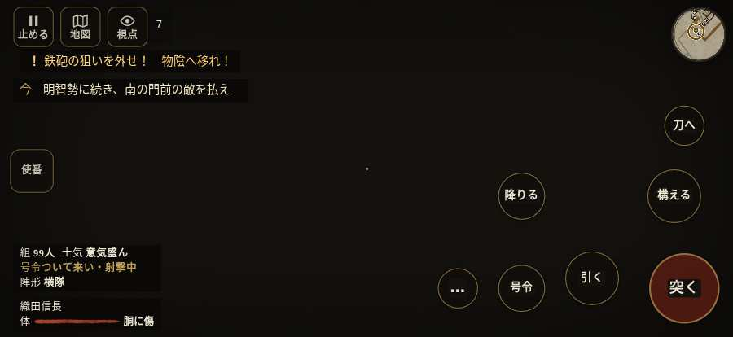

# テストプレイヤーの感想：せっかちな社会人

- 人：ユウキ（35歳・昼休みに遊ぶ会社員）（434番）
- 変わり目：迷子になりやすい・iPhone 横 874×402・信長で出陣・ゆっくり・身分 中ほど・問屋:刀・槍・具足・一人称・感度 鈍い・途中で止める
- 時：2026/10/13 0:59:29（277秒かかった）
- 画面：iPhone の横向き 874×402・倍率3・指で触る操作（touch.js の釦・棒・なぞり）・画質 低
- 遊んだ戦：天王寺の戦い（信長で出陣）（失敗・倒れた）
- 機械の混み具合：2（load average）

## ひとこと

> 昼休みに4分ほど。天王寺（信長で出陣）。前へ進もうとしても進めない所があった。正直、飛ばしたい。押せる所が小さい。正直、飛ばしたい。HUD の札どうしが重なって読めない。時間がもったいない。結局、何分遊べば一区切りなのかが分からない。

## 見つけた問題（7件・困った順）

### 1. 押せる所が小さい（28px 未満）
- どこで：天王寺の戦い（信長で出陣）・開戦
- 何が：#battle-notices > #objectives > #obj-list：264×20「「今」の任務を進めよう。」／#battle-notices > #objectives.goal-changed > #obj-list：264×20「「今」の任務を進めよう。」
- どれくらい困ったか：★★ かなり困った（41回）
- 直し方の目安：押せる大きさを 28px 以上に
- 画面：（その戦の山場の一枚）

### 2. HUD の札どうしが重なって読めない
- どこで：天王寺の戦い（信長で出陣）・15秒・break
- 何が：#aimwarn と .bl.full（874×402）／#aimwarn と #h-squad（874×402）
- どれくらい困ったか：★★ かなり困った（12回）
- 直し方の目安：置き場所をずらすか、片方を出している間はもう片方を隠す
- 画面：（その戦の山場の一枚）

### 3. 前へ進もうとしても進めない所があった
- どこで：天王寺の戦い（信長で出陣）・33秒・break
- 何が：(25, -27)・段 break
- どれくらい困ったか：★★ かなり困った（2回）
- 直し方の目安：当たり（柵・建物・地形）と道のつながりを見直す
- 画面：

### 4. 戦場が札に食われている（画面の3分の1超）
- どこで：天王寺の戦い（信長で出陣）・15秒・break
- 何が：874×402 で 100%
- どれくらい困ったか：★ 少し気になった（2回）
- 直し方の目安：札を小さくするか、平時は薄く・畳む
- 画面：（その戦の山場の一枚）

### 5. 号令「槍衾」が、指の号令の輪から出せない
- どこで：天王寺の戦い（信長で出陣）・169秒・regroup
- 何が：号令の輪（RADIAL）に無い、または身分が足りず選べない（天王寺の戦い（信長で出陣）・169秒・regroup）
- どれくらい困ったか：★ 少し気になった（1回）
- 直し方の目安：号令の輪に足すか、短く押した時の指揮の札（数字の号令）を指で押せるようにする
- 画面：（その戦の山場の一枚）

### 6. 号令「続け」から3秒たっても、組の7割が動かない
- どこで：天王寺の戦い（信長で出陣）・228秒・sortie
- 何が：86人のうち動いたのは0人（天王寺の戦い（信長で出陣）・228秒・sortie）
- どれくらい困ったか：★ 少し気になった（1回）
- 直し方の目安：号令を受けた兵がすぐ向きを変えて動き出すようにする（行き先・狙いの付け直し）
- 画面：（その戦の山場の一枚）

### 7. 倒れて戦が終わった
- どこで：天王寺の戦い（信長で出陣）・251秒・sortie
- 何が：235秒で倒れた（受けた傷：侍 65・鉄砲 48・足軽 10）
- どれくらい困ったか：★ 少し気になった（1回）
- 直し方の目安：初めの戦は受ける傷を減らす・危ない時に字幕で構えを教える
- 画面：（その戦の山場の一枚）

## 遊んだ記録

- 天王寺の戦い（信長で出陣）：235秒・任務失敗（倒れた）・戦功71・組86/100・討ち取り2・突き8/当たり9・号令9回・指で押した数40・読み込み2.5秒・戦の前の札98字・1コマ43ms（実時間247秒・内訳 brain 0.2・pad 0.1・tf 0.4・upd 42.2・eye 0.1）
  - 任務の流れ：0s 先手の列で住吉口へ時を待て → 3s 先手の列を保ち、砦への攻めに備えよ → 15s 明智勢に続き、南の門前の敵を払え → 150s 天王寺砦の門へ入れ → 169s 南の門内で組をそろえ、時を待て → 181s 南門を出て、北の本隊を崩せ
  - 味方の隊：隊10・動いた計1120m・味方の討ち取り30・敵を前に20秒止まった37回・本物の味方5人未満0秒
  - 受けた傷：侍 65・鉄砲 48・足軽 10
  - 開戦：
  - 山場：
