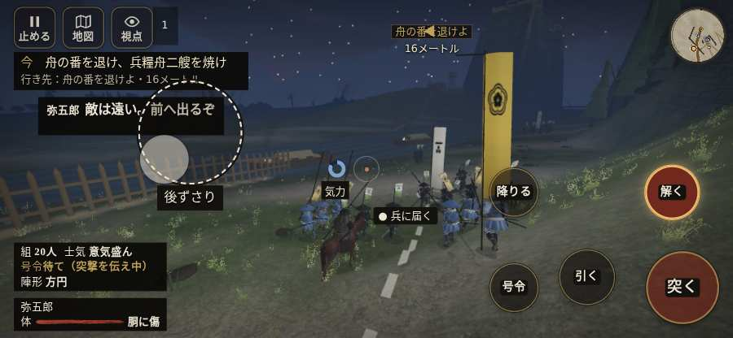

# テストプレイヤーの感想：指揮好きの戦略家

- 人：ケイコ（45歳・将棋と戦略ゲーム好き）（438番）
- 変わり目：走りっぱなし・iPhone 横 844×390・新しく始める通し・速い・身分 上・問屋:供・三人称・感度 ふつう・止めない
- 時：2026/10/13 1:16:46（128秒かかった）
- 画面：iPhone の横向き 844×390・倍率3・指で触る操作（touch.js の釦・棒・なぞり）・画質 低
- 遊んだ戦：鳥取城の戦い（失敗・倒れた）
- 機械の混み具合：3（load average）

## ひとこと

> 鳥取城で、号令を15回かけました。HUD の札どうしが重なって読めない。指揮官としてはもどかしい。号令「陣形」が、指の号令の輪から出せない。指揮官としてはもどかしい。号令「突撃」から3秒たっても、組の7割が動かない。ここが直れば、ぐっと指揮が楽しくなる。采配で負けたのか、操作で負けたのか分からないのが一番困ります。問屋で若党雇い賃 8貫を揃えました。

## 見つけた問題（9件・困った順）

### 1. HUD の札どうしが重なって読めない
- どこで：鳥取城の戦い・35秒・boats
- 何が：#mobfx と .mk.edge（844×390）／#mobfx と .bl（844×390）
- どれくらい困ったか：★★★ やめたくなった（47回）
- 直し方の目安：置き場所をずらすか、片方を出している間はもう片方を隠す
- 画面：（その戦の山場の一枚）

### 2. 号令「陣形」が、指の号令の輪から出せない
- どこで：鳥取城の戦い・1秒・brief
- 何が：号令の輪（RADIAL）に無い、または身分が足りず選べない（鳥取城の戦い・1秒・brief）
- どれくらい困ったか：★★★ やめたくなった（1回）
- 直し方の目安：号令の輪に足すか、短く押した時の指揮の札（数字の号令）を指で押せるようにする
- 画面：（その戦の山場の一枚）

### 3. 城下から出陣できなかった
- どこで：高遠城の戦いの前・城下
- 何が：「出陣」の釦が見つからない・押しても戦の前の札が出ない
- どれくらい困ったか：★★★ やめたくなった（1回）
- 画面：（その戦の山場の一枚）

### 4. 押せる所が画面の外にある
- どこで：高遠城の戦いの前・城下
- 何が：.tabs.tw-tabg > .grp > #tw-tab-inn「宿傷」 at 810,136／.tabs.tw-tabg > .grp > #tw-tab-stable「馬屋」 at 899,136
- どれくらい困ったか：★★ かなり困った（8回）
- 直し方の目安：画面の内に収めるか、スクロールできるようにする
- 画面：（その戦の山場の一枚）

### 5. 号令「突撃」から3秒たっても、組の7割が動かない
- どこで：鳥取城の戦い・18秒・boats
- 何が：20人のうち動いたのは1人（鳥取城の戦い・18秒・boats）
- どれくらい困ったか：★★ かなり困った（7回）
- 直し方の目安：号令を受けた兵がすぐ向きを変えて動き出すようにする（行き先・狙いの付け直し）
- 画面：

### 6. 戦場が札に食われている（画面の3分の1超）
- どこで：鳥取城の戦い・35秒・boats
- 何が：844×390 で 100%
- どれくらい困ったか：★★ かなり困った（7回）
- 直し方の目安：札を小さくするか、平時は薄く・畳む
- 画面：（その戦の山場の一枚）

### 7. 「親指の棒（歩く）」を押そうとしたら、別の物に当たった
- どこで：鳥取城の戦い・19秒・boats
- 何が：指の下にあったのは #battle-notices > #battle-message > #subtitle「足軽川下から舟の番が来たがや」
- どれくらい困ったか：★★ かなり困った（1回）
- 直し方の目安：重ねている札の置き場所をずらすか、pointer-events:none にする
- 画面：

### 8. 「任務を受けて出陣」を押そうとしたら、別の物に当たった
- どこで：高遠城の戦いの前・城下
- 何が：指の下にあったのは #screen-notices「！ 城下の記録を保存できませ」
- どれくらい困ったか：★★ かなり困った（1回）
- 直し方の目安：重ねている札の置き場所をずらすか、pointer-events:none にする
- 画面：（その戦の山場の一枚）

### 9. 倒れて戦が終わった
- どこで：鳥取城の戦い・169秒・boats
- 何が：153秒で倒れた（受けた傷：足軽 71・侍 33）
- どれくらい困ったか：★ 少し気になった（1回）
- 直し方の目安：初めの戦は受ける傷を減らす・危ない時に字幕で構えを教える
- 画面：（その戦の山場の一枚）

## 遊んだ記録

- 鳥取城の戦い：153秒・任務失敗（倒れた）・戦功0・組20/20・討ち取り2・突き3/当たり3・号令15回・指で押した数24・読み込み3.2秒・戦の前の札155字・1コマ20.5ms（実時間88秒・内訳 brain 0.1・pad 0.1・tf 0.1・upd 20.1・eye 0.1）
  - 任務の流れ：0s 川岸の組へ進み、一手をそろえよ → 2s 舟の番を退け、兵糧舟二艘を焼け
  - 味方の隊：隊22・動いた計682m・味方の討ち取り1・敵を前に20秒止まった39回・本物の味方5人未満0秒
  - 受けた傷：足軽 71・侍 33
  - 開戦：
