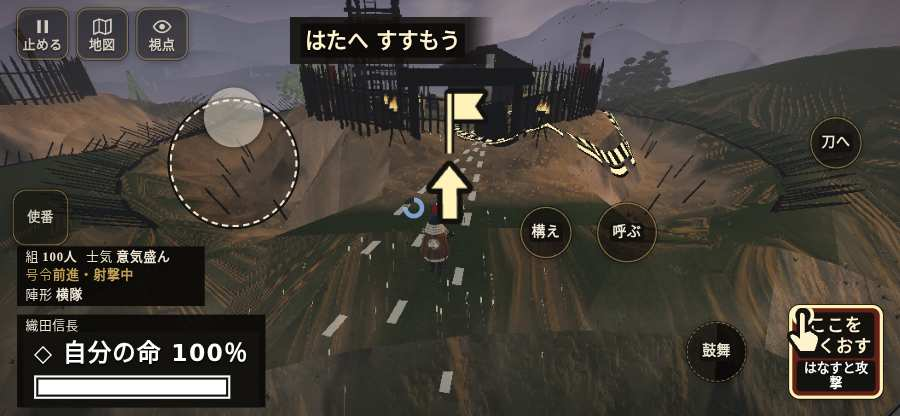
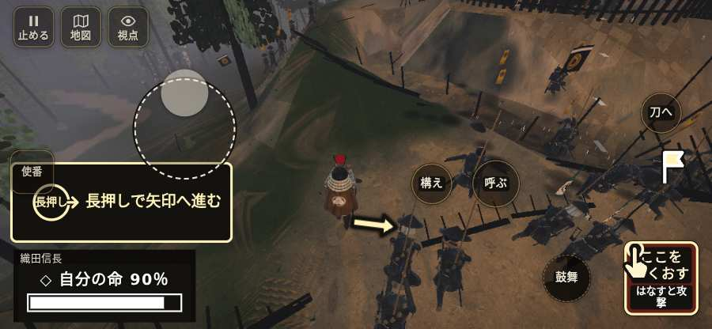

# テストプレイヤーの感想：指揮好きの戦略家

- 人：ケイコ（45歳・将棋と戦略ゲーム好き）（628番）
- 変わり目：連打・iPhone 横 844×390・信長で出陣・ふつう・足軽から・問屋:刀・槍・具足・一人称・感度 鈍い・途中で止める
- 時：2026/10/22 16:01:43（304秒かかった）
- 画面：iPhone の横向き 844×390・倍率3・指で触る操作（touch.js の釦・棒・なぞり）・画質 高
- 遊んだ戦：鳶ヶ巣山砦夜襲（信長で出陣）（試験の持ち時間で打ち切り）（失敗）
- 機械の混み具合：1（load average）

## ひとこと

> 鳶ヶ巣山砦夜襲（信長で出陣）（試験の持ち時間で打ち切り）で、号令を47回かけました。信長でも出陣して、軍配も触りました。号令「follow」が、指の号令の輪から出せない。ここが直れば、ぐっと指揮が楽しくなる。号令「attack」が、指の号令の輪から出せない。命令が信用できないと、策が立てられません。号令「陣形」が、指の号令の輪から出せない。采配の上で、これは痛い。采配で負けたのか、操作で負けたのか分からないのが一番困ります。

## 見つけた問題（14件・困った順）

### 1. 号令「follow」が、指の号令の輪から出せない
- どこで：鳶ヶ巣山砦夜襲（信長で出陣）・2秒・march
- 何が：号令の輪（RADIAL）に無い、または身分が足りず選べない（鳶ヶ巣山砦夜襲（信長で出陣）・2秒・march）
- どれくらい困ったか：★★★ やめたくなった（41回）
- 直し方の目安：号令の輪に足すか、短く押した時の指揮の札（数字の号令）を指で押せるようにする
- 画面：（その戦の山場の一枚）

### 2. 号令「attack」が、指の号令の輪から出せない
- どこで：鳶ヶ巣山砦夜襲（信長で出陣）・61秒・assault
- 何が：号令の輪（RADIAL）に無い、または身分が足りず選べない（鳶ヶ巣山砦夜襲（信長で出陣）・61秒・assault）
- どれくらい困ったか：★★★ やめたくなった（13回）
- 直し方の目安：号令の輪に足すか、短く押した時の指揮の札（数字の号令）を指で押せるようにする
- 画面：（その戦の山場の一枚）

### 3. 号令「陣形」が、指の号令の輪から出せない
- どこで：鳶ヶ巣山砦夜襲（信長で出陣）・2秒・march
- 何が：号令の輪（RADIAL）に無い、または身分が足りず選べない（鳶ヶ巣山砦夜襲（信長で出陣）・2秒・march）
- どれくらい困ったか：★★★ やめたくなった（8回）
- 直し方の目安：号令の輪に足すか、短く押した時の指揮の札（数字の号令）を指で押せるようにする
- 画面：（その戦の山場の一枚）

### 4. 号令「focus」が、指の号令の輪から出せない
- どこで：鳶ヶ巣山砦夜襲（信長で出陣）・89秒・assault
- 何が：号令の輪（RADIAL）に無い、または身分が足りず選べない（鳶ヶ巣山砦夜襲（信長で出陣）・89秒・assault）
- どれくらい困ったか：★★★ やめたくなった（1回）
- 直し方の目安：号令の輪に足すか、短く押した時の指揮の札（数字の号令）を指で押せるようにする
- 画面：（その戦の山場の一枚）

### 5. 同じ知らせが20秒に4回以上
- どこで：鳶ヶ巣山砦夜襲（信長で出陣）・32秒・assault
- 何が：「者ども、ついて来い！」（台詞）
- どれくらい困ったか：★★ かなり困った（10回）
- 直し方の目安：一度出したら、しばらく同じ物を出さない
- 画面：（その戦の山場の一枚）

### 6. 指の端末では「火縄銃に持ち替え（鍵盤の 3）」ができない（押す丸が無い）
- どこで：鳶ヶ巣山砦夜襲（信長で出陣）・19秒・assault
- 何が：bot の頭が Digit3 を押したがった（鳶ヶ巣山砦夜襲（信長で出陣）・19秒・assault）
- どれくらい困ったか：★★ かなり困った（8回）
- 直し方の目安：touch.js に釦を足すか、戦の方で要らなくする
- 画面：（その戦の山場の一枚）

### 7. 号令「続け」から3秒たっても、組の7割が動かない
- どこで：鳶ヶ巣山砦夜襲（信長で出陣）・193秒・assault
- 何が：97人のうち動いたのは9人（鳶ヶ巣山砦夜襲（信長で出陣）・193秒・assault）
- どれくらい困ったか：★★ かなり困った（3回）
- 直し方の目安：号令を受けた兵がすぐ向きを変えて動き出すようにする（行き先・狙いの付け直し）
- 画面：

### 8. 行き先があるのに20秒動かない兵
- どこで：鳶ヶ巣山砦夜襲（信長で出陣）・68秒・assault
- 何が：味方の足軽：味方の足軽（号令：assault・三の槍組・頭：無/―・近い敵64m）at (6,29)／味方の足軽：味方の足軽（号令：assault・三の槍組・頭：無/―・近い敵65m）at (6,29)
- どれくらい困ったか：★★ かなり困った（2回）
- 直し方の目安：道が塞がれていないか、行き先に着いたと見なせているかを見る
- 画面：（その戦の山場の一枚）

### 9. 号令「突撃」から3秒たっても、組の7割が動かない
- どこで：鳶ヶ巣山砦夜襲（信長で出陣）・203秒・assault
- 何が：97人のうち動いたのは9人（鳶ヶ巣山砦夜襲（信長で出陣）・203秒・assault）
- どれくらい困ったか：★★ かなり困った（1回）
- 直し方の目安：号令を受けた兵がすぐ向きを変えて動き出すようにする（行き先・狙いの付け直し）
- 画面：（その戦の山場の一枚）

### 10. 「親指の棒（歩く）」を押そうとしたら、別の物に当たった
- どこで：鳶ヶ巣山砦夜襲（信長で出陣）・242秒・assault
- 何が：指の下にあったのは #hud.battle-active.single-guide > #battle-notices.choosing.has-more > #objectives.touch-retreat-coach「任務の一覧を開く。残り 4件・済 0件・失敗 1件」
- どれくらい困ったか：★★ かなり困った（1回）
- 直し方の目安：重ねている札の置き場所をずらすか、pointer-events:none にする
- 画面：（その戦の山場の一枚）

### 11. 「狙い」をしたいのに、押す丸が出ていない
- どこで：鳶ヶ巣山砦夜襲（信長で出陣）・53秒・assault
- 何が：欲しかった時：鳶ヶ巣山砦夜襲（信長で出陣）・53秒・assault
- どれくらい困ったか：★ 少し気になった（15回）
- 直し方の目安：その時に使える釦は出す（touchFrame の出し入れ）
- 画面：（その戦の山場の一枚）

### 12. 「回避」をしたいのに、押す丸が出ていない
- どこで：鳶ヶ巣山砦夜襲（信長で出陣）・36秒・assault
- 何が：欲しかった時：鳶ヶ巣山砦夜襲（信長で出陣）・36秒・assault
- どれくらい困ったか：★ 少し気になった（13回）
- 直し方の目安：その時に使える釦は出す（touchFrame の出し入れ）
- 画面：（その戦の山場の一枚）

### 13. 戦場が札に食われている（画面の3分の1超）
- どこで：鳶ヶ巣山砦夜襲（信長で出陣）・開戦
- 何が：844×390 で 100%
- どれくらい困ったか：★ 少し気になった（2回）
- 直し方の目安：札を小さくするか、平時は薄く・畳む
- 画面：（その戦の山場の一枚）

### 14. HUD の札どうしが重なって読めない
- どこで：鳶ヶ巣山砦夜襲（信長で出陣）・110秒・assault
- 何が：.bl と svg（844×390）／#h-squad と svg（844×390）
- どれくらい困ったか：★ 少し気になった（2回）
- 直し方の目安：置き場所をずらすか、片方を出している間はもう片方を隠す
- 画面：（その戦の山場の一枚）

## 遊んだ記録

- 鳶ヶ巣山砦夜襲（信長で出陣）（試験の持ち時間で打ち切り）（戦の任務とは別に、試験全体の持ち時間が尽きた）：311秒・任務失敗・戦功20・組95/100・討ち取り3・突き216/当たり4・号令47回・指で押した数2786・読み込み11.2秒・戦の前の札115字・1コマ37.3ms（実時間250秒・内訳 brain 0.6・pad 3.0・tf 1.3・upd 32.1・eye 0.3）
  - 任務の流れ：0s すぐ先の寄せ場へ、声を立てずに寄れ → 5s 尾根の砦を落とせ（0/5） → 97s 尾根の砦を落とせ（1/5） → 217s 尾根の砦を落とせ（2/5）
  - 味方の隊：隊46・動いた計5530m・味方の討ち取り40・敵を前に20秒止まった91回・本物の味方5人未満0秒
  - 受けた傷：弓 8
  - 開戦：
  - 山場：
