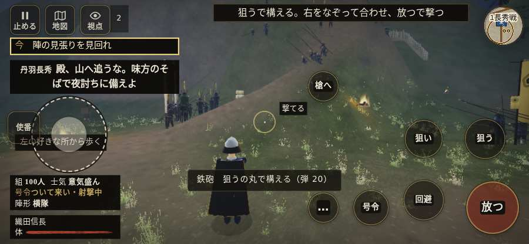

# テストプレイヤーの感想：指揮好きの戦略家

- 人：ケイコ（45歳・将棋と戦略ゲーム好き）（628番）
- 変わり目：連打・iPhone 横 844×390・信長で出陣・ふつう・足軽から・問屋:刀・槍・具足・一人称・感度 鈍い・途中で止める
- 時：2026/10/13 8:20:06（206秒かかった）
- 画面：iPhone の横向き 844×390・倍率3・指で触る操作（touch.js の釦・棒・なぞり）・画質 低
- 遊んだ戦：天正伊賀の乱・比自山城（信長で出陣）（失敗）
- 機械の混み具合：3（load average）

## ひとこと

> 天正伊賀の乱・比自山城（信長で出陣）で、号令を14回かけました。信長でも出陣して、軍配も触りました。号令「陣形」が、指の号令の輪から出せない。指揮官としてはもどかしい。号令「射撃／停止」が、指の号令の輪から出せない。命令が信用できないと、策が立てられません。指の端末では「火縄銃に持ち替え（鍵盤の 3）」ができない。指揮官としてはもどかしい。采配で負けたのか、操作で負けたのか分からないのが一番困ります。

## 見つけた問題（12件・困った順）

### 1. 号令「陣形」が、指の号令の輪から出せない
- どこで：天正伊賀の乱・比自山城（信長で出陣）・52秒・raid
- 何が：号令の輪（RADIAL）に無い、または身分が足りず選べない（天正伊賀の乱・比自山城（信長で出陣）・52秒・raid）
- どれくらい困ったか：★★★ やめたくなった（2回）
- 直し方の目安：号令の輪に足すか、短く押した時の指揮の札（数字の号令）を指で押せるようにする
- 画面：（その戦の山場の一枚）

### 2. 号令「射撃／停止」が、指の号令の輪から出せない
- どこで：天正伊賀の乱・比自山城（信長で出陣）・1秒・brief
- 何が：号令の輪（RADIAL）に無い、または身分が足りず選べない（天正伊賀の乱・比自山城（信長で出陣）・1秒・brief）
- どれくらい困ったか：★★★ やめたくなった（1回）
- 直し方の目安：号令の輪に足すか、短く押した時の指揮の札（数字の号令）を指で押せるようにする
- 画面：（その戦の山場の一枚）

### 3. HUD の札どうしが重なって読めない
- どこで：天正伊賀の乱・比自山城（信長で出陣）・140秒・raid
- 何が：#brinkfx と .mk.edge（844×390）／#brinkfx と .bl（844×390）
- どれくらい困ったか：★★ かなり困った（7回）
- 直し方の目安：置き場所をずらすか、片方を出している間はもう片方を隠す
- 画面：（その戦の山場の一枚）

### 4. console.error：THREE.WebGLProgram: Shader Error 1282 - VALIDATE_STATUS false

Program Info Log:
- どこで：天正伊賀の乱・比自山城（信長で出陣）・開戦
- 何が：—
- どれくらい困ったか：★★ かなり困った（4回）
- 直し方の目安：出どころを突き止める
- 画面：（その戦の山場の一枚）

### 5. 指の端末では「火縄銃に持ち替え（鍵盤の 3）」ができない（押す丸が無い）
- どこで：天正伊賀の乱・比自山城（信長で出陣）・38秒・raid
- 何が：bot の頭が Digit3 を押したがった（天正伊賀の乱・比自山城（信長で出陣）・38秒・raid）
- どれくらい困ったか：★★ かなり困った（2回）
- 直し方の目安：touch.js に釦を足すか、戦の方で要らなくする
- 画面：（その戦の山場の一枚）

### 6. 「親指の棒（歩く）」を押そうとしたら、別の物に当たった
- どこで：天正伊賀の乱・比自山城（信長で出陣）・23秒・raid
- 何が：指の下にあったのは #battle-notices > #battle-message > #subtitle「織田信長敵が逃げる。深追いす」
- どれくらい困ったか：★★ かなり困った（1回）
- 直し方の目安：重ねている札の置き場所をずらすか、pointer-events:none にする
- 画面：

### 7. 前へ進もうとしても進めない所があった
- どこで：天正伊賀の乱・比自山城（信長で出陣）・33秒・raid
- 何が：(2, 47)・段 raid
- どれくらい困ったか：★★ かなり困った（1回）
- 直し方の目安：当たり（柵・建物・地形）と道のつながりを見直す
- 画面：

### 8. 号令「続け」から3秒たっても、組の7割が動かない
- どこで：天正伊賀の乱・比自山城（信長で出陣）・40秒・raid
- 何が：100人のうち動いたのは10人（天正伊賀の乱・比自山城（信長で出陣）・40秒・raid）
- どれくらい困ったか：★★ かなり困った（1回）
- 直し方の目安：号令を受けた兵がすぐ向きを変えて動き出すようにする（行き先・狙いの付け直し）
- 画面：（その戦の山場の一枚）

### 9. 押せる所が小さい（28px 未満）
- どこで：天正伊賀の乱・比自山城（信長で出陣）・開戦
- 何が：#battle-notices > #objectives.goal-changed > #obj-list：254×20「「今」の任務を進めよう。」／#battle-notices > #objectives > #obj-list：254×20「「今」の任務を進めよう。」
- どれくらい困ったか：★ 少し気になった（2回）
- 直し方の目安：押せる大きさを 28px 以上に
- 画面：（その戦の山場の一枚）

### 10. 「鼓舞」をしたいのに、押す丸が出ていない
- どこで：天正伊賀の乱・比自山城（信長で出陣）・102秒・raid
- 何が：欲しかった時：天正伊賀の乱・比自山城（信長で出陣）・102秒・raid
- どれくらい困ったか：★ 少し気になった（1回）
- 直し方の目安：その時に使える釦は出す（touchFrame の出し入れ）
- 画面：（その戦の山場の一枚）

### 11. 行き先があるのに20秒動かない兵
- どこで：天正伊賀の乱・比自山城（信長で出陣）・90秒・raid
- 何が：味方の足軽：味方の足軽（号令：attack・木戸を破る組・頭：無/―・近い敵16m）at (43,9)
- どれくらい困ったか：★ 少し気になった（1回）
- 直し方の目安：道が塞がれていないか、行き先に着いたと見なせているかを見る
- 画面：（その戦の山場の一枚）

### 12. 戦場が札に食われている（画面の3分の1超）
- どこで：天正伊賀の乱・比自山城（信長で出陣）・140秒・raid
- 何が：844×390 で 100%
- どれくらい困ったか：★ 少し気になった（1回）
- 直し方の目安：札を小さくするか、平時は薄く・畳む
- 画面：（その戦の山場の一枚）

## 遊んだ記録

- 天正伊賀の乱・比自山城（信長で出陣）：156秒・任務失敗・戦功20・組64/100・討ち取り0・突き0/当たり0・号令14回・指で押した数128・読み込み3.0秒・戦の前の札105字・1コマ38.3ms（実時間169秒・内訳 brain 0.2・pad 0.3・tf 0.7・upd 36.9・eye 0.2）
  - 任務の流れ：0s 陣の見張りを見回れ → 6s 火の印へ進み、まず一軒の火を消せ → 70s 桶の組を守り、夜討ちを退けよ → 156s 桶の組を守り、夜討ちを退けよ〔失〕
  - 味方の隊：隊23・動いた計550m・味方の討ち取り28・敵を前に20秒止まった3回・本物の味方5人未満0秒
  - 受けた傷：侍 89・足軽 25
  - 開戦：
