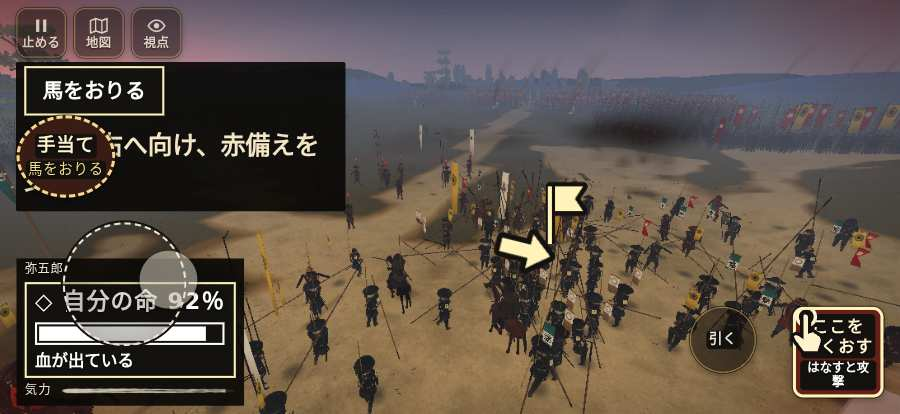

# テストプレイヤーの感想：アクション好き

- 人：ソウタ（24歳・アクションゲーム好き）（632番）
- 変わり目：迷子になりやすい・iPhone 横 874×402・新しく始める通し・速い・身分 少し上・問屋:買わない・一人称・感度 鈍い・途中で止める
- 時：2026/10/22 15:27:47（163秒かかった）
- 画面：iPhone の横向き 874×402・倍率3・指で触る操作（touch.js の釦・棒・なぞり）・画質 高
- 遊んだ戦：三方ヶ原の戦い（失敗）、三方ヶ原の戦い（途中で打ち切り）（失敗）
- 機械の混み具合：3（load average）

## ひとこと

> とにかく突っ込んだ。5分で5人斬った。19回突いて18回当たり。当たりはいい感じ。「回避」をしたいのに、押す丸が出ていない、ストレスたまる。「親指の棒（歩く）」を押そうとしたら、別の物に当たった、手応えがスカスカ。console.error：THREE.BufferGeometry.computeBoundingBox(): Computed min/max have NaN values. The、手応えがスカスカ。もっと派手に、じゃなくて重く斬り合いたい。

## 見つけた問題（7件・困った順）

### 1. console.error：THREE.BufferGeometry.computeBoundingBox(): Computed min/max have NaN values. The
- どこで：三方ヶ原の戦い・166秒・crash
- 何が：—
- どれくらい困ったか：★★ かなり困った（6回）
- 直し方の目安：出どころを突き止める

### 2. console.error：THREE.BufferGeometry.computeBoundingSphere(): Computed radius is NaN. The "posit
- どこで：三方ヶ原の戦い・166秒・crash
- 何が：—
- どれくらい困ったか：★★ かなり困った（6回）
- 直し方の目安：出どころを突き止める

### 3. 「親指の棒（歩く）」を押そうとしたら、別の物に当たった
- どこで：三方ヶ原の戦い・141秒・crash
- 何が：指の下にあったのは #hud.battle-active.mikata-guide > #battle-notices.choosing > #objectives.task-details.keep-combat-task「任務の一覧を開く。残り 1件・済 0件・失敗 0件」
- どれくらい困ったか：★★ かなり困った（1回）
- 直し方の目安：重ねている札の置き場所をずらすか、pointer-events:none にする
- 画面：

### 4. 「回避」をしたいのに、押す丸が出ていない
- どこで：三方ヶ原の戦い・176秒・crash
- 何が：欲しかった時：三方ヶ原の戦い・176秒・crash
- どれくらい困ったか：★ 少し気になった（81回）
- 直し方の目安：その時に使える釦は出す（touchFrame の出し入れ）

### 5. 兵が一息で飛んだ（6m 超）
- どこで：三方ヶ原の戦い・89秒・first
- 何が：敵の騎馬：敵の騎馬：(-10,-163) → (-12,-157)／敵の騎馬：敵の騎馬：(20,-21) → (13,-19)
- どれくらい困ったか：★ 少し気になった（6回）
- 直し方の目安：位置を直接書き換えている所を探す（出し直し・押し出し）

### 6. HUD の札どうしが重なって読めない
- どこで：三方ヶ原の戦い・50秒・first
- 何が：.bl と svg（874×402）／#h-squad と svg（874×402）
- どれくらい困ったか：★ 少し気になった（5回）
- 直し方の目安：置き場所をずらすか、片方を出している間はもう片方を隠す

### 7. 行き先があるのに20秒動かない兵
- どこで：三方ヶ原の戦い・243秒・retreat
- 何が：味方の徳川家康：味方の徳川家康（号令：path・徳川家康の本陣・頭：無/―・近い敵3m）at (7,-5)
- どれくらい困ったか：★ 少し気になった（1回）
- 直し方の目安：道が塞がれていないか、行き先に着いたと見なせているかを見る

## 遊んだ記録

- 三方ヶ原の戦い：0秒・任務失敗・戦功0・組—・討ち取り—・突き—/当たり—・号令0回・指で押した数—・読み込み0.0秒・戦の前の札0字
  - 不具合：TypeError: Cannot read properties of null (reading 'u')     at Auditor.endCheck (http://localhost:8765/v202610211801/src/audit.js:371:24)     at playPersona (http://localhost:8765/v202610211801/src/playbot.js:2364:19)
- 三方ヶ原の戦い（途中で打ち切り）：274秒・任務失敗・戦功184・組—・討ち取り5・突き19/当たり18・号令0回・指で押した数—・読み込み9.4秒・戦の前の札162字・1コマ18.6ms（実時間117秒・内訳 brain 0.3・pad 0.7・tf 0.9・upd 16.6・eye 0.2）
  - 任務の流れ：0s 目の前の槍の持ち場へ進め → 21s 平手の列で敵へ構えよ → 56s 味方の槍の列をそろえ直せ → 62s 平手の槍列を守れ → 124s 右の森へ槍を向け直せ → 130s 一手を右へ向け、赤備えを支えよ → 144s 味方と右へ槍を向け、馬を受けよ → 158s 味方と南の坂へ退け → 164s 佐久間の手と南の坂へ退け → 171s 坂に着いた。追手へ構えよ → 175s 坂で追手を支え、味方を先に通せ → 181s 一手で殿を務め、味方を坂へ通せ → 219s 一手を率い、浜松城へ退け → 257s 一手を率い、浜松城へ退け〔済〕
  - 味方の隊：隊20・動いた計1232m・味方の討ち取り68・敵を前に20秒止まった37回・本物の味方5人未満0秒
  - 不具合：TypeError: Cannot read properties of null (reading 'units')     at Auditor.tick (http://localhost:8765/v202610211801/src/audit.js:162:26)     at playPersona (http://localhost:8765/v202610211801/src/playbot.js:2320:11)
  - 開戦：
  - 山場：
