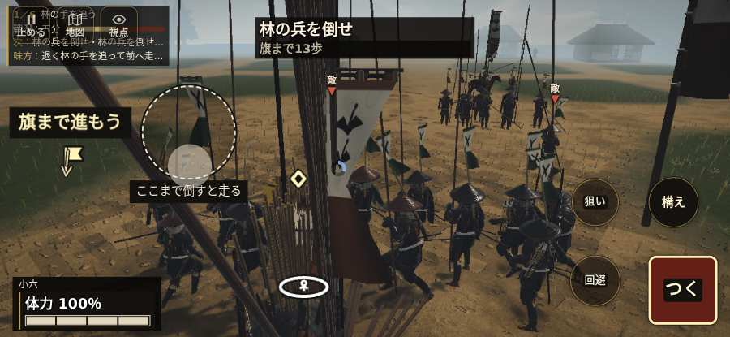

# テストプレイヤーの感想：歴史好きの大人

- 人：ミチオ（62歳・郷土史の会）（811番）
- 変わり目：連打・iPhone 横 932×430・新しく始める通し・ふつう・足軽から・問屋:刀・槍・具足・一人称・感度 敏感・止めない
- 時：2026/10/22 20:13:42（197秒かかった）
- 画面：iPhone の横向き 932×430・倍率3・指で触る操作（touch.js の釦・棒・なぞり）・画質 高
- 遊んだ戦：稲生の戦い（失敗・切り上げ）
- 機械の混み具合：2（load average）

## ひとこと

> 稲生を、一人称で歩いて見て回りました。務めは果たせませんでしたが、それより気になる所があります。前へ進もうとしても進めない所があった。これでは興が醒めます。「乗る」をしたいのに、押す丸が出ていない。これでは興が醒めます。「鼓舞」をしたいのに、押す丸が出ていない。細かい事ですが、こういう所で嘘っぽくなる。

## 見つけた問題（7件・困った順）

### 1. 前へ進もうとしても進めない所があった
- どこで：稲生の戦い・187秒・hayashiSkirmish
- 何が：(9, 4)・段 hayashiSkirmish
- どれくらい困ったか：★★ かなり困った（19回）
- 直し方の目安：当たり（柵・建物・地形）と道のつながりを見直す
- 画面：（その戦の山場の一枚）

### 2. 敵が近いのに、まわりの兵の多くが棒立ち
- どこで：稲生の戦い・15秒・brief
- 何が：15秒：まわり35mの13人のうち7人が止まったまま（段 brief）
- どれくらい困ったか：★★ かなり困った（1回）
- 直し方の目安：敵が30m内に入ったら、構える・にじり寄る・槍を揃えるなど体を動かす
- 画面：

### 3. 字が枠から切れている
- どこで：稲生の戦い・開戦
- 何が：#hud.battle-active.opening > #h-prog > .pg-ally「退く林の手を追って前へ走っている」／#hud.battle-active.single-guide > #h-prog > .pg-ally「退く林の手を追って前へ走っている」
- どれくらい困ったか：★ 少し気になった（170回）
- 直し方の目安：枠を広げるか、字を折り返す
- 画面：（その戦の山場の一枚）

### 4. 「乗る」をしたいのに、押す丸が出ていない
- どこで：稲生の戦い・12秒・brief
- 何が：欲しかった時：稲生の戦い・12秒・brief
- どれくらい困ったか：★ 少し気になった（67回）
- 直し方の目安：その時に使える釦は出す（touchFrame の出し入れ）
- 画面：（その戦の山場の一枚）

### 5. 「鼓舞」をしたいのに、押す丸が出ていない
- どこで：稲生の戦い・72秒・march
- 何が：欲しかった時：稲生の戦い・72秒・march
- どれくらい困ったか：★ 少し気になった（57回）
- 直し方の目安：その時に使える釦は出す（touchFrame の出し入れ）
- 画面：（その戦の山場の一枚）

### 6. 兵が一息で飛んだ（6m 超）
- どこで：稲生の戦い・34秒・march
- 何が：味方の騎馬：味方の騎馬：(2,24) → (1,17)
- どれくらい困ったか：★ 少し気になった（1回）
- 直し方の目安：位置を直接書き換えている所を探す（出し直し・押し出し）
- 画面：（その戦の山場の一枚）

### 7. 15分たっても戦が終わらない
- どこで：稲生の戦い・終わり（187秒）
- 何が：段：hayashiSkirmish・任務「味方と並び、畦道の林勢を押し返そう」
- どれくらい困ったか：★ 少し気になった（1回）
- 直し方の目安：進みが止まる条件（待つ相手が死んでいる・着いたと見なせない など）を探す
- 画面：（その戦の山場の一枚）

## 遊んだ記録

- 稲生の戦い：187秒・任務失敗・戦功0・組—・討ち取り4・突き134/当たり10・号令0回・指で押した数7522・読み込み6.0秒・戦の前の札0字・1コマ7.6ms（実時間156秒・内訳 brain 0.2・pad 2.5・tf 0.3・upd 4.5・eye 0.1）
  - 任務の流れ：0s 退く林の手を、味方と追おう → 15s 林軍を追いかけろ → 33s 林の兵を倒せ → 118s 敵の攻撃を防ぎ、反撃しよう → 160s 武者の攻撃を横へかわそう → 184s 味方と並び、畦道の林勢を押し返そう
  - 味方の隊：隊10・動いた計573m・味方の討ち取り2・敵を前に20秒止まった26回・本物の味方5人未満0秒
  - 開戦：
  - 山場：
