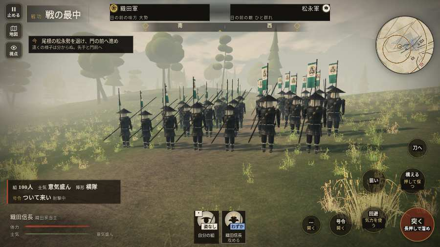

# テストプレイヤーの感想：せっかちな社会人

- 人：ユウキ（35歳・昼休みに遊ぶ会社員）（834番）
- 変わり目：連打・パソコン 1280×720・信長で出陣・ゆっくり・身分 中ほど・問屋:供・三人称・感度 ふつう・途中で止める
- 時：2026/10/13 17:01:46（315秒かかった・6分で打ち切った）
- 画面：パソコン 1280×720・鍵盤とマウス・画質 低
- 遊んだ戦：信貴山城の戦い（信長で出陣）（途中で打ち切り）（失敗）
- 機械の混み具合：3（load average）

## ひとこと

> 昼休みに3分ほど。信貴山城（信長で出陣）（途中で打ち切り）。前へ進もうとしても進めない所があった。正直、飛ばしたい。字が枠から切れている。ここで閉じる人は多いと思う。console.error：THREE.WebGLProgram: Shader Error 1282 - VALIDATE_STATUS false

Program Info Log:。待ってられない。結局、何分遊べば一区切りなのかが分からない。

## 見つけた問題（3件・困った順）

### 1. 字が枠から切れている
- どこで：信貴山城の戦い（信長で出陣）・開戦
- 何が：#h-units > .uc.ally > .nm「織田信長」
- どれくらい困ったか：★★ かなり困った（40回）
- 直し方の目安：枠を広げるか、字を折り返す

### 2. console.error：THREE.WebGLProgram: Shader Error 1282 - VALIDATE_STATUS false

Program Info Log:
- どこで：信貴山城の戦い（信長で出陣）・開戦
- 何が：—
- どれくらい困ったか：★★ かなり困った（10回）
- 直し方の目安：出どころを突き止める

### 3. 前へ進もうとしても進めない所があった
- どこで：信貴山城の戦い（信長で出陣）・33秒・climb
- 何が：(10, -55)・段 climb
- どれくらい困ったか：★★ かなり困った（5回）
- 直し方の目安：当たり（柵・建物・地形）と道のつながりを見直す
- 画面：

## 遊んだ記録

- 信貴山城の戦い（信長で出陣）（途中で打ち切り）：193秒・任務失敗・戦功20・組—・討ち取り0・突き1/当たり0・号令0回・指で押した数—・読み込み5.6秒・戦の前の札117字
  - 任務の流れ：0s 先手と尾根道へ進め → 5s 尾根の松永勢を退け、門の前へ進め → 72s 門脇に立ち、打ち手を守れ → 170s 打ち手を守り、門を破れ
  - 味方の隊：隊6・動いた計131m・味方の討ち取り5・敵を前に20秒止まった13回・本物の味方5人未満0秒
  - 開戦：
