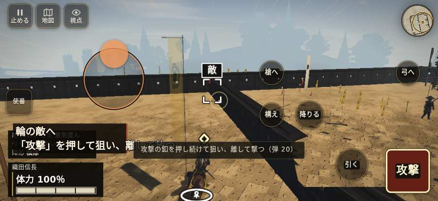

# テストプレイヤーの感想：せっかちな社会人

- 人：ユウキ（35歳・昼休みに遊ぶ会社員）（839番）
- 変わり目：構え多め・iPhone 横 874×402・信長で出陣・ふつう・身分 上・問屋:鉄砲・三人称・感度 ふつう・途中で止める
- 時：2026/10/22 20:50:39（100秒かかった）
- 画面：iPhone の横向き 874×402・倍率3・指で触る操作（touch.js の釦・棒・なぞり）・画質 高
- 遊んだ戦：長篠城籠城（信長で出陣）（失敗）
- 機械の混み具合：3（load average）

## ひとこと

> 昼休みに1分ほど。長篠城籠城（信長で出陣）。遊んでいる途中でゲームが落ちた。正直、飛ばしたい。戦が始まるまでの読み込みが長い。時間がもったいない。console.error：THREE.Object3D.add: object not an instance of THREE.Object3D.。待ってられない。読み込みも8秒待たされた。結局、何分遊べば一区切りなのかが分からない。

## 見つけた問題（4件・困った順）

### 1. 遊んでいる途中でゲームが落ちた（例外）
- どこで：長篠城籠城（信長で出陣）・68秒・w1
- 何が：TypeError: Cannot read properties of undefined (reading 'x')     at priority (http://localhost:8765/v202610221305/src/army_budget.js:17:60)     at ThinkBudget.run (http://localhost:8765/v202610221305/src/army_budget.js:46:46)
- どれくらい困ったか：★★★ やめたくなった（1回）
- 直し方の目安：この行の前提（値が無い・死んだ兵など）を確かめる
- 画面：（その戦の山場の一枚）

### 2. console.error：THREE.Object3D.add: object not an instance of THREE.Object3D.
- どこで：長篠城籠城（信長で出陣）・戦の前の札
- 何が：—
- どれくらい困ったか：★★ かなり困った（14回）
- 直し方の目安：出どころを突き止める
- 画面：（その戦の山場の一枚）

### 3. 戦場が札に食われている（画面の3分の1超）
- どこで：長篠城籠城（信長で出陣）・開戦
- 何が：874×402 で 100%
- どれくらい困ったか：★★ かなり困った（10回）
- 直し方の目安：札を小さくするか、平時は薄く・畳む
- 画面：（その戦の山場の一枚）

### 4. 戦が始まるまでの読み込みが長い
- どこで：長篠城籠城（信長で出陣）
- 何が：長篠城籠城（信長で出陣）：押してから 8.3秒（機械が混んでいる時の値）
- どれくらい困ったか：★★ かなり困った（1回）
- 直し方の目安：読み込みの間に、戦の心得を読ませる／重い物を後から足す
- 画面：（その戦の山場の一枚）

## 遊んだ記録

- 長篠城籠城（信長で出陣）：68秒・任務失敗・戦功0・組100/100・討ち取り6・突き10/当たり10・号令0回・指で押した数34・読み込み8.3秒・戦の前の札108字・1コマ24.5ms（実時間51秒・内訳 brain 0.5・pad 0.6・tf 0.4・upd 22.7・eye 0.2）
  - 任務の流れ：0s 長篠城を守り抜け（本丸の館を守る）
  - 味方の隊：隊14・動いた計190m・味方の討ち取り0・敵を前に20秒止まった17回・本物の味方5人未満0秒
  - 不具合：TypeError: Cannot read properties of undefined (reading 'x')     at priority (http://localhost:8765/v202610221305/src/army_budget.js:17:60)     at ThinkBudget.run (http://localhost:8765/v202610221305/src/army_budget.js:46:46)
  - 開戦：
  - 山場：
  - 終わり近く：
