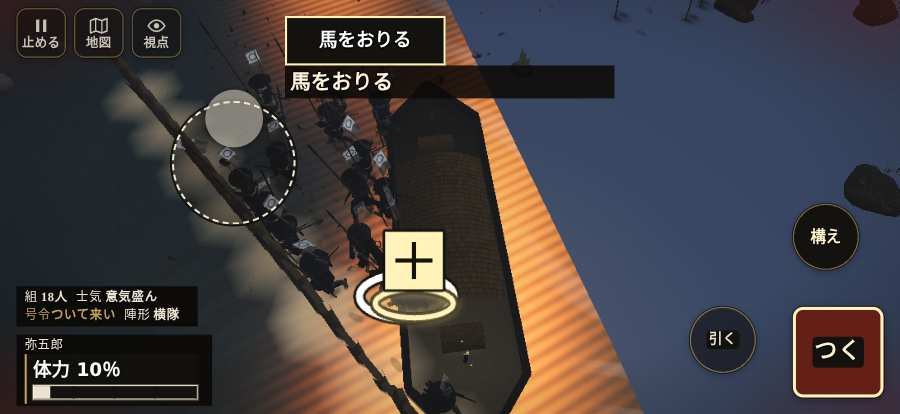

# テストプレイヤーの感想：はじめての中学生

- 人：ハルト（13歳・中学一年）（1070番）
- 変わり目：連打・iPhone 横 874×402・織田家編の戦を一つ・ふつう・身分 上・問屋:鉄砲・三人称・感度 ふつう・止めない
- 時：2026/10/22 23:44:16（212秒かかった）
- 画面：iPhone の横向き 874×402・倍率3・指で触る操作（touch.js の釦・棒・なぞり）・画質 高
- 遊んだ戦：鳥取城の戦い（失敗）、鳥取城の戦い（途中で打ち切り）（失敗）
- 機械の混み具合：2（load average）

## ひとこと

> 友だちにすすめられて、やってみた。鳥取城と鳥取城（途中で打ち切り）をやった。よく分かんないまま終わった。「HUD の札どうしが重なって読めない」のとこ、ムリ。「前へ進もうとしても進めない所があった」のとこ、ふつうに困った。「戦場が札に食われている」のとこ、ムリ。ぶっちゃけ、ここで一回やめかけた。

## 見つけた問題（4件・困った順）

### 1. HUD の札どうしが重なって読めない
- どこで：鳥取城の戦い・15秒・boats
- 何が：.bl と svg（874×402）／#h-squad と svg（874×402）
- どれくらい困ったか：★★★ やめたくなった（8回）
- 直し方の目安：置き場所をずらすか、片方を出している間はもう片方を隠す

### 2. 戦場が札に食われている（画面の3分の1超）
- どこで：鳥取城の戦い・開戦
- 何が：874×402 で 100%
- どれくらい困ったか：★★★ やめたくなった（4回）
- 直し方の目安：札を小さくするか、平時は薄く・畳む

### 3. 前へ進もうとしても進めない所があった
- どこで：鳥取城の戦い・466秒・boats
- 何が：(-59, -7)・段 boats
- どれくらい困ったか：★★ かなり困った（1回）
- 直し方の目安：当たり（柵・建物・地形）と道のつながりを見直す
- 画面：

### 4. 3Dの上の字に下地も影も無い（景色に溶ける恐れ）
- どこで：鳥取城の戦い・15秒・boats
- 何が：svg > g > text「ここからなぞって にげる」
- どれくらい困ったか：★ 少し気になった（1回）
- 直し方の目安：字に影をつけるか、半透明の下地を敷く

## 遊んだ記録

- 鳥取城の戦い：0秒・任務失敗・戦功0・組—・討ち取り—・突き—/当たり—・号令0回・指で押した数—・読み込み0.0秒・戦の前の札0字
  - 不具合：TypeError: Cannot read properties of null (reading 'u')     at Auditor.endCheck (http://localhost:8765/v202610221610/src/audit.js:371:24)     at playPersona (http://localhost:8765/v202610221610/src/playbot.js:2365:19)
- 鳥取城の戦い（途中で打ち切り）：484秒・任務失敗・戦功25・組—・討ち取り1・突き481/当たり6・号令0回・指で押した数—・読み込み14.0秒・戦の前の札155字・1コマ14.9ms（実時間163秒・内訳 brain 0.2・pad 1.5・tf 0.7・upd 12.3・eye 0.1）
  - 任務の流れ：0s 川岸の組へ進み、一手をそろえよ → 2s 味方と番を退け、舟二艘を焼け → 2s 岸の道へ戻れ → 3s 味方と舟二艘を焼け → 7s 岸の道へ戻れ → 8s 味方と舟二艘を焼け → 19s 岸の道へ戻れ → 24s 味方と舟二艘を焼け → 34s 岸の道へ戻れ → 38s 味方と舟二艘を焼け → 147s 岸の道へ戻れ → 162s 味方と舟二艘を焼け → 190s 岸の道へ戻れ → 205s 味方と舟二艘を焼け
  - 味方の隊：隊16・動いた計773m・味方の討ち取り11・敵を前に20秒止まった16回・本物の味方5人未満0秒
  - 不具合：TypeError: Cannot read properties of null (reading 'units')     at Auditor.tick (http://localhost:8765/v202610221610/src/audit.js:162:26)     at playPersona (http://localhost:8765/v202610221610/src/playbot.js:2321:11)
  - 開戦：
  - 山場：
