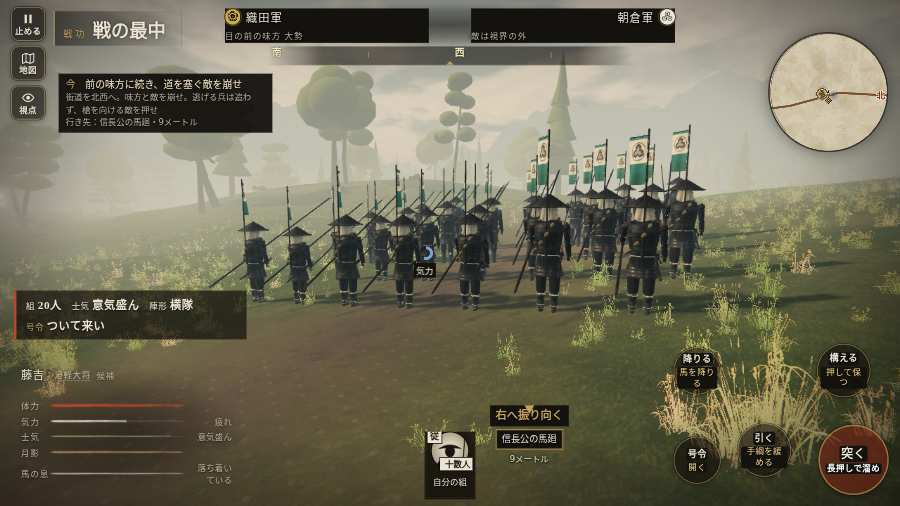

# テストプレイヤーの感想：はじめての中学生

- 人：ハルト（13歳・中学一年）（1185番）
- 変わり目：台詞を全部読む・パソコン 1280×720・織田家編の戦を一つ・ふつう・身分 少し上・問屋:買わない・一人称・感度 ふつう・止めない
- 時：2026/10/14 1:30:05（148秒かかった）
- 画面：パソコン 1280×720・鍵盤とマウス・画質 低
- 遊んだ戦：刀根坂の戦い（達成）
- 機械の混み具合：4（load average）

## ひとこと

> えっと、遊んでみた。刀根坂をやった。1回はなんかクリアできた。「字が枠から切れている」のとこ、マジで意味わかんない。「前へ進もうとしても進めない所があった」のとこ、ムリ。「「突く」を押そうとしたら、別の物に当たった」のとこ、だるい。ぶっちゃけ、ここで一回やめかけた。

## 見つけた問題（6件・困った順）

### 1. 字が枠から切れている
- どこで：刀根坂の戦い・20秒・chase
- 何が：#h-units > .uc.ally > .nm「1 織田信長」／#h-units > .uc.ally > .nm「2 柴田勝家」
- どれくらい困ったか：★★★ やめたくなった（18回）
- 直し方の目安：枠を広げるか、字を折り返す
- 画面：（その戦の山場の一枚）

### 2. 前へ進もうとしても進めない所があった
- どこで：刀根坂の戦い・34秒・chase
- 何が：(-1, 72)・段 chase
- どれくらい困ったか：★★ かなり困った（2回）
- 直し方の目安：当たり（柵・建物・地形）と道のつながりを見直す
- 画面：

### 3. 押せる所が小さい（28px 未満）
- どこで：刀根坂の戦い・240秒・road
- 何が：#battle-notices > #objectives > #obj-list：284×20「「今」の任務を進めよう。」
- どれくらい困ったか：★★ かなり困った（2回）
- 直し方の目安：押せる大きさを 28px 以上に
- 画面：（その戦の山場の一枚）

### 4. 「突く」を押そうとしたら、別の物に当たった
- どこで：刀根坂の戦い・237秒・road
- 何が：指の下にあったのは div「越前への追撃　数日の道のり八」
- どれくらい困ったか：★★ かなり困った（1回）
- 直し方の目安：重ねている札の置き場所をずらすか、pointer-events:none にする
- 画面：（その戦の山場の一枚）

### 5. 「回避」を押そうとしたら、別の物に当たった
- どこで：刀根坂の戦い・248秒・road
- 何が：指の下にあったのは div「八月十八日八月十八日以後、柴」
- どれくらい困ったか：★★ かなり困った（1回）
- 直し方の目安：重ねている札の置き場所をずらすか、pointer-events:none にする
- 画面：（その戦の山場の一枚）

### 6. HUD の札どうしが重なって読めない
- どこで：刀根坂の戦い・315秒・fire
- 何が：.mk.edge と #armybar（1280×720）
- どれくらい困ったか：★ 少し気になった（1回）
- 直し方の目安：置き場所をずらすか、片方を出している間はもう片方を隠す
- 画面：（その戦の山場の一枚）

## 遊んだ記録

- 刀根坂の戦い：337秒・任務達成・戦功110・組20/20・討ち取り3・突き345/当たり14・号令18回・指で押した数1671・読み込み2.5秒・戦の前の札170字・1コマ13.8ms（実時間111秒・内訳 brain 0.1・pad 0.8・tf 0.2・upd 12.6・eye 0.1）
  - 任務の流れ：0s 組を率い、馬廻を支えよ → 5s 前の味方に続き、道を塞ぐ敵を崩せ → 80s 味方と坂を上り、敵の槍を崩せ → 181s 峠口の敵を崩し、味方と峠へ → 236s 数日の道のりを略図でたどる → 248s 勝家の手に続き、城下の敵を退けよ → 302s 勝家の手と共に、奥の道を守れ → 337s 勝家の手と共に、奥の道を守れ〔済〕
  - 味方の隊：隊13・動いた計2384m・味方の討ち取り22・敵を前に20秒止まった10回・本物の味方5人未満0秒
  - 受けた傷：足軽 12
  - 開戦：
  - 山場：
