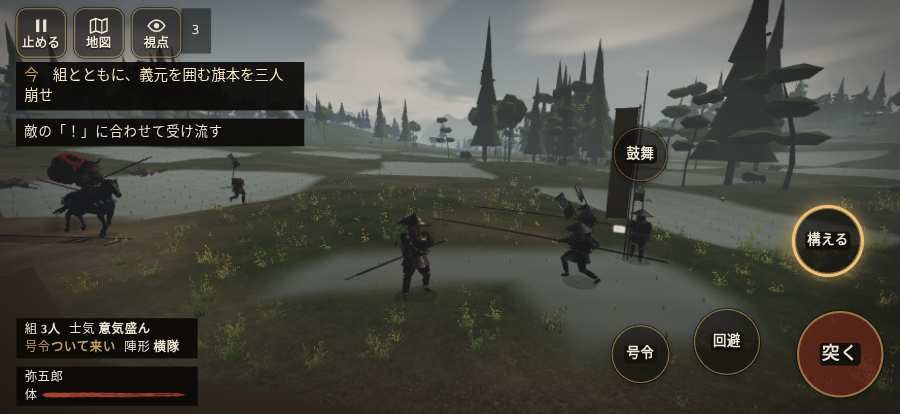

# テストプレイヤーの感想：せっかちな社会人

- 人：ユウキ（35歳・昼休みに遊ぶ会社員）（1189番）
- 変わり目：迷子になりやすい・iPhone 横 874×402・新しく始める通し・ゆっくり・足軽から・問屋:鉄砲・一人称・感度 敏感・途中で止める
- 時：2026/10/14 1:43:17（173秒かかった）
- 画面：iPhone の横向き 874×402・倍率3・指で触る操作（touch.js の釦・棒・なぞり）・画質 低
- 遊んだ戦：桶狭間の戦い（失敗・切り上げ）
- 機械の混み具合：2（load average）

## ひとこと

> 昼休みに8分ほど。桶狭間。前へ進もうとしても進めない所があった。正直、飛ばしたい。押せる所が小さい。時間がもったいない。「親指の棒（歩く）」を押そうとしたら、別の物に当たった。時間がもったいない。結局、何分遊べば一区切りなのかが分からない。

## 見つけた問題（7件・困った順）

### 1. 押せる所が小さい（28px 未満）
- どこで：桶狭間の戦い・5秒・march
- 何が：#battle-notices > #objectives > #obj-list：264×20「「今」の任務を進めよう。」／#battle-notices > #objectives.goal-changed > #obj-list：264×20「「今」の任務を進めよう。」
- どれくらい困ったか：★★ かなり困った（56回）
- 直し方の目安：押せる大きさを 28px 以上に
- 画面：（その戦の山場の一枚）

### 2. HUD の札どうしが重なって読めない
- どこで：桶狭間の戦い・230秒・assault
- 何が：#mobfx と .bl（874×402）／#mobfx と .combat-cue-label（874×402）
- どれくらい困ったか：★★ かなり困った（30回）
- 直し方の目安：置き場所をずらすか、片方を出している間はもう片方を隠す
- 画面：（その戦の山場の一枚）

### 3. 前へ進もうとしても進めない所があった
- どこで：桶狭間の戦い・33秒・wait
- 何が：(41, 1)・段 wait
- どれくらい困ったか：★★ かなり困った（5回）
- 直し方の目安：当たり（柵・建物・地形）と道のつながりを見直す
- 画面：

### 4. 「親指の棒（歩く）」を押そうとしたら、別の物に当たった
- どこで：桶狭間の戦い・393秒・assault
- 何が：指の下にあったのは #battle-notices > #battle-message > #subtitle「組頭退き鉦じゃ！　追うのはこ」
- どれくらい困ったか：★★ かなり困った（1回）
- 直し方の目安：重ねている札の置き場所をずらすか、pointer-events:none にする
- 画面：（その戦の山場の一枚）

### 5. 何もする事が無いまま待たされた
- どこで：桶狭間の戦い・541秒・assault
- 何が：61秒、任務札が変わらず敵もいない（段 assault）
- どれくらい困ったか：★★ かなり困った（1回）
- 直し方の目安：飛ばせる（canSkip）ようにするか、待つ間にする事を置く
- 画面：（その戦の山場の一枚）

### 6. 一つの戦が長い（7分を超えた）
- どこで：桶狭間の戦い・600秒・assault
- 何が：桶狭間の戦い：8分（10分で切り上げた）
- どれくらい困ったか：★★ かなり困った（1回）
- 直し方の目安：途中で区切れる所（段の切れ目）に「ここまで」を置く
- 画面：（その戦の山場の一枚）

### 7. 戦場が札に食われている（画面の3分の1超）
- どこで：桶狭間の戦い・230秒・assault
- 何が：874×402 で 100%
- どれくらい困ったか：★ 少し気になった（5回）
- 直し方の目安：札を小さくするか、平時は薄く・畳む
- 画面：（その戦の山場の一枚）

## 遊んだ記録

- 桶狭間の戦い：480秒・任務失敗・戦功0・組2/8・討ち取り5・突き14/当たり14・号令0回・指で押した数34・読み込み1.7秒・戦の前の札0字・1コマ11ms（実時間150秒・内訳 brain 0.0・pad 0.1・tf 0.4・upd 10.4・eye 0.1）
  - 任務の流れ：0s 組頭の旗へ進み、下知を聞け → 2s 組頭の旗へ進み、下知を聞け〔済〕 → 5s すぐ先の組の旗について進め → 17s 組のそばで、かかれの合図を待て → 34s 味方の旗に続き、道の守りを崩せ → 100s 味方と本陣の幕の口へ進め → 104s 組とともに、義元を囲む旗本を三人崩せ → 193s 組とともに、義元の幕の口へ寄せよ → 217s 服部と毛利に続け。義元の旗本へ → 373s 深田へ逃げる今川勢を、組と追い討て → 393s 追うのはここまで。帰る組の旗へ集まれ → 480s 追うのはここまで。帰る組の旗へ集まれ〔失〕
  - 味方の隊：隊13・動いた計2717m・味方の討ち取り98・敵を前に20秒止まった14回・本物の味方5人未満0秒
  - 受けた傷：侍 31・足軽 14
  - 開戦：
  - 山場：
