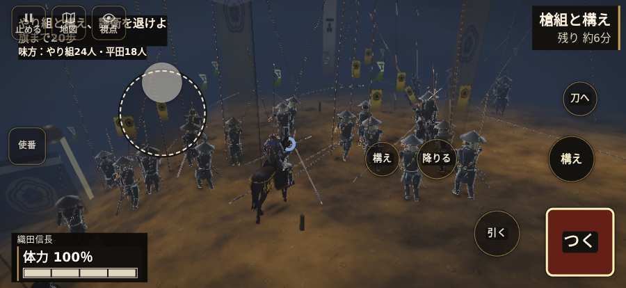

# テストプレイヤーの感想：はじめての中学生

- 人：ハルト（13歳・中学一年）（1205番）
- 変わり目：迷子になりやすい・iPhone 横 874×402・信長で出陣・速い・足軽から・問屋:供・三人称・感度 敏感・途中で止める
- 時：2026/10/23 5:08:35（302秒かかった）
- 画面：iPhone の横向き 874×402・倍率3・指で触る操作（touch.js の釦・棒・なぞり）・画質 高
- 遊んだ戦：三木城・大村の合戦（信長で出陣）（試験の持ち時間で打ち切り）（失敗）
- 機械の混み具合：2（load average）

## ひとこと

> 友だちにすすめられて、やってみた。三木城・大村の合戦（信長で出陣）（試験の持ち時間で打ち切り）をやった。よく分かんないまま終わった。「HUD の札どうしが重なって読めない」のとこ、ふつうに困った。「戦場が札に食われている」のとこ、ムリ。「前へ進もうとしても進めない所があった」のとこ、ムリ。ぶっちゃけ、ここで一回やめかけた。

## 見つけた問題（6件・困った順）

### 1. HUD の札どうしが重なって読めない
- どこで：三木城・大村の合戦（信長で出陣）・開戦
- 何が：.bl.full と #squad-marks（874×402）／#h-prog と #squad-marks（874×402）
- どれくらい困ったか：★★★ やめたくなった（142回）
- 直し方の目安：置き場所をずらすか、片方を出している間はもう片方を隠す
- 画面：（その戦の山場の一枚）

### 2. 戦場が札に食われている（画面の3分の1超）
- どこで：三木城・大村の合戦（信長で出陣）・開戦
- 何が：874×402 で 100%
- どれくらい困ったか：★★★ やめたくなった（65回）
- 直し方の目安：札を小さくするか、平時は薄く・畳む
- 画面：（その戦の山場の一枚）

### 3. console.error：THREE.Object3D.add: object not an instance of THREE.Object3D.
- どこで：三木城・大村の合戦（信長で出陣）・戦の前の札
- 何が：—
- どれくらい困ったか：★★ かなり困った（8回）
- 直し方の目安：出どころを突き止める
- 画面：（その戦の山場の一枚）

### 4. 前へ進もうとしても進めない所があった
- どこで：三木城・大村の合戦（信長で出陣）・95秒・convoy
- 何が：(-72, -52)・段 convoy
- どれくらい困ったか：★★ かなり困った（1回）
- 直し方の目安：当たり（柵・建物・地形）と道のつながりを見直す
- 画面：

### 5. 号令「attack」が、指の号令の輪から出せない
- どこで：三木城・大村の合戦（信長で出陣）・28秒・convoy
- 何が：号令の輪（RADIAL）に無い、または身分が足りず選べない（三木城・大村の合戦（信長で出陣）・28秒・convoy）
- どれくらい困ったか：★ 少し気になった（1回）
- 直し方の目安：号令の輪に足すか、短く押した時の指揮の札（数字の号令）を指で押せるようにする
- 画面：（その戦の山場の一枚）

### 6. 押せる所が小さい（28px 未満）
- どこで：三木城・大村の合戦（信長で出陣）・115秒・convoy
- 何が：#battle-notices > #objectives.keep-combat-task.keep-guard-task > #obj-list：192×22「「今」の任務を進めよう。」
- どれくらい困ったか：★ 少し気になった（1回）
- 直し方の目安：押せる大きさを 28px 以上に
- 画面：（その戦の山場の一枚）

## 遊んだ記録

- 三木城・大村の合戦（信長で出陣）（試験の持ち時間で打ち切り）（戦の任務とは別に、試験全体の持ち時間が尽きた）：311秒・任務失敗・戦功20・組99/100・討ち取り5・突き320/当たり9・号令1回・指で押した数1621・読み込み36.1秒・戦の前の札110字・1コマ34.7ms（実時間231秒・内訳 brain 0.5・pad 1.9・tf 0.9・upd 31.2・eye 0.2）
  - 任務の流れ：0s 西の槍組で護衛を退けよ → 12s 味方の槍組で荷の護衛を退けよ → 12s 南の曲がり道から西の槍組に加われ → 13s 槍組と構え、護衛を退けよ → 42s 味方と木戸を守れ → 43s 構えて平田の口へ進め → 45s 道に沿って平田の木戸へ進め → 47s 木戸で味方と城兵を受けよ → 52s 道に沿って平田の木戸へ進め → 80s 木戸で味方と城兵を受けよ → 86s 道に沿って平田の木戸へ進め → 97s 木戸で味方と城兵を受けよ → 108s 道に沿って平田の木戸へ進め → 113s 木戸で味方と城兵を受けよ
  - 味方の隊：隊15・動いた計1601m・味方の討ち取り47・敵を前に20秒止まった21回・本物の味方5人未満0秒
  - 受けた傷：足軽 0
  - 開戦：
  - 山場：
