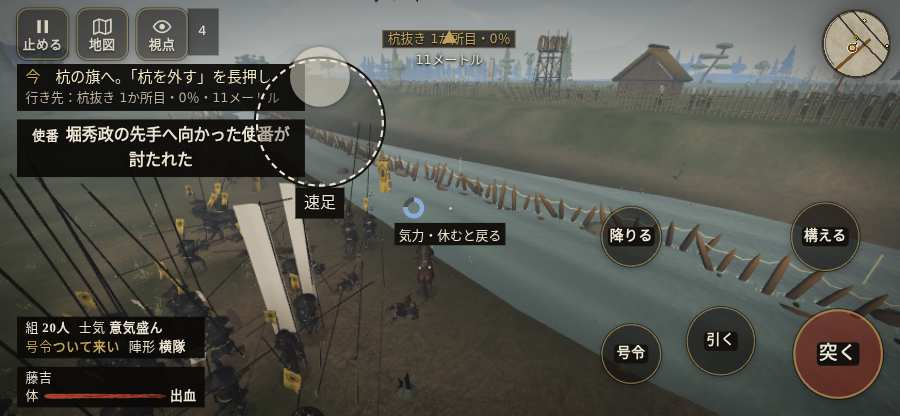

# テストプレイヤーの感想：はじめての中学生

- 人：ハルト（13歳・中学一年）（1220番）
- 変わり目：迷子になりやすい・iPhone 横 844×390・新しく始める通し・ゆっくり・身分 中ほど・問屋:鉄砲・一人称・感度 ふつう・途中で止める
- 時：2026/10/14 1:14:53（127秒かかった）
- 画面：iPhone の横向き 844×390・倍率3・指で触る操作（touch.js の釦・棒・なぞり）・画質 低
- 遊んだ戦：雑賀攻め・小雑賀川（失敗・倒れた）
- 機械の混み具合：2（load average）

## ひとこと

> とりあえずやってみた。雑賀攻め・小雑賀川をやった。よく分かんないまま終わった。1回すぐ死んだ…。「HUD の札どうしが重なって読めない」のとこ、だるい。「「親指の棒（歩く）」を押そうとしたら、別の物に当たった」のとこ、ふつうに困った。「「右側のなぞり（見回す）」を押そうとしたら、別の物に当たった」のとこ、ムリ。ぶっちゃけ、ここで一回やめかけた。

## 見つけた問題（6件・困った順）

### 1. HUD の札どうしが重なって読めない
- どこで：雑賀攻め・小雑賀川・130秒・stakes
- 何が：#brinkfx と .mk.edge（844×390）／#brinkfx と .bl（844×390）
- どれくらい困ったか：★★★ やめたくなった（16回）
- 直し方の目安：置き場所をずらすか、片方を出している間はもう片方を隠す
- 画面：（その戦の山場の一枚）

### 2. 字と背景の明暗の比が低い（3 未満）
- どこで：雑賀攻め・小雑賀川・戦のあと
- 何が：.zk-toast > div > small：2.3「実績を得た」／.zk-toast > div > b：1.1「初陣 ほか1件」
- どれくらい困ったか：★★★ やめたくなった（3回）
- 直し方の目安：字を明るく、または背景を暗く
- 画面：（その戦の山場の一枚）

### 3. 戦場が札に食われている（画面の3分の1超）
- どこで：雑賀攻め・小雑賀川・130秒・stakes
- 何が：844×390 で 100%
- どれくらい困ったか：★★ かなり困った（2回）
- 直し方の目安：札を小さくするか、平時は薄く・畳む
- 画面：（その戦の山場の一枚）

### 4. 「親指の棒（歩く）」を押そうとしたら、別の物に当たった
- どこで：雑賀攻め・小雑賀川・0秒・brief
- 何が：指の下にあったのは #battle-notices > #battle-message > #subtitle「堀秀政向こう岸から撃ってくる」
- どれくらい困ったか：★★ かなり困った（1回）
- 直し方の目安：重ねている札の置き場所をずらすか、pointer-events:none にする
- 画面：

### 5. 「右側のなぞり（見回す）」を押そうとしたら、別の物に当たった
- どこで：雑賀攻め・小雑賀川・222秒・regroup
- 何が：指の下にあったのは .battle-retry「深手を負った理由：正面から槍」
- どれくらい困ったか：★★ かなり困った（1回）
- 直し方の目安：重ねている札の置き場所をずらすか、pointer-events:none にする
- 画面：（その戦の山場の一枚）

### 6. すぐに倒れてしまった
- どこで：雑賀攻め・小雑賀川・231秒・regroup
- 何が：215秒で倒れた（受けた傷：足軽 118）
- どれくらい困ったか：★ 少し気になった（1回）
- 直し方の目安：初めの戦は受ける傷を減らす・危ない時に字幕で構えを教える
- 画面：（その戦の山場の一枚）

## 遊んだ記録

- 雑賀攻め・小雑賀川：215秒・任務失敗（倒れた）・戦功70・組16/20・討ち取り4・突き176/当たり8・号令0回・指で押した数328・読み込み3.2秒・戦の前の札146字・1コマ18.5ms（実時間102秒・内訳 brain 0.0・pad 0.3・tf 0.2・upd 17.9・eye 0.1）
  - 任務の流れ：1s 川の杭の印へ。そばで「杭を外す」を長押し → 5s 杭の旗へ。「杭を外す」を長押し → 137s 中央の渡り口から西岸へ進め → 197s 中央の渡り口を戻り、東岸の旗へ引け → 207s 竹束へ寄り、守りを確かめよ
  - 味方の隊：隊19・動いた計2517m・味方の討ち取り28・敵を前に20秒止まった13回・本物の味方5人未満0秒
  - 受けた傷：足軽 118
  - 開戦：
  - 山場：
