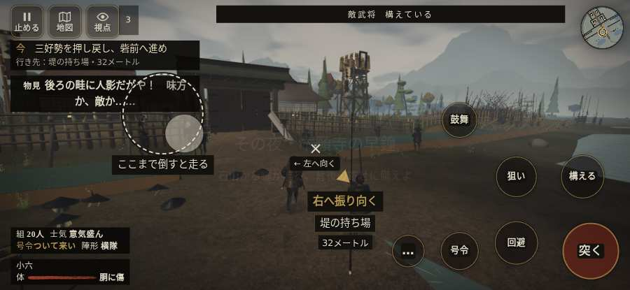

# テストプレイヤーの感想：歴史好きの大人

- 人：ミチオ（62歳・郷土史の会）（1426番）
- 変わり目：連打・iPhone 横 932×430・織田家編の戦を一つ・速い・身分 少し上・問屋:買わない・一人称・感度 鈍い・止めない
- 時：2026/10/14 6:33:33（180秒かかった）
- 画面：iPhone の横向き 932×430・倍率3・指で触る操作（touch.js の釦・棒・なぞり）・画質 低
- 遊んだ戦：野田・福島の戦い（達成）
- 機械の混み具合：3（load average）

## ひとこと

> 野田・福島を、一人称で歩いて見て回りました。務めは果たせましたが、気になる所がいくつか。「親指の棒（歩く）」を押そうとしたら、別の物に当たった。史実を知る者としては、ここは看過できません。「右側のなぞり（見回す）」を押そうとしたら、別の物に当たった。当時の人が見たら首を傾げるでしょう。行き先があるのに20秒動かない兵。これでは興が醒めます。

## 見つけた問題（3件・困った順）

### 1. 「親指の棒（歩く）」を押そうとしたら、別の物に当たった
- どこで：野田・福島の戦い・11秒・assault
- 何が：指の下にあったのは #battle-notices > #battle-message > #subtitle「鉄砲衆盾が据わった！　これで」
- どれくらい困ったか：★★ かなり困った（1回）
- 直し方の目安：重ねている札の置き場所をずらすか、pointer-events:none にする
- 画面：

### 2. 「右側のなぞり（見回す）」を押そうとしたら、別の物に当たった
- どこで：野田・福島の戦い・37秒・night
- 何が：指の下にあったのは div「九月12日の夜その夜・本願寺」
- どれくらい困ったか：★★ かなり困った（1回）
- 直し方の目安：重ねている札の置き場所をずらすか、pointer-events:none にする
- 画面：

### 3. 行き先があるのに20秒動かない兵
- どこで：野田・福島の戦い・50秒・night
- 何が：味方の前田利家：味方の前田利家（号令：move・前田利家の手・頭：無/―・近い敵32m）at (-3,-2)
- どれくらい困ったか：★ 少し気になった（1回）
- 直し方の目安：道が塞がれていないか、行き先に着いたと見なせているかを見る
- 画面：（その戦の山場の一枚）

## 遊んだ記録

- 野田・福島の戦い：252秒・任務達成・戦功183・組17/20・討ち取り5・突き11/当たり10・号令0回・指で押した数29・読み込み2.7秒・戦の前の札139字・1コマ21.6ms（実時間146秒・内訳 brain 0.1・pad 0.2・tf 0.5・upd 20.8・eye 0.1）
  - 任務の流れ：0s 竹束を押し、印へ据えよ → 7s 浅瀬へ進み、味方と三好勢を押し戻せ → 14s 三好勢を押し戻し、砦前へ進め → 31s 砦前で槍を揃え、竹束に隠れよ → 37s 堤の味方へ戻り、一緒に敵を防げ → 197s 堤を守り、退きの下知を待て → 222s 堤から詰め陣の印へ退け → 252s 堤から詰め陣の印へ退け〔済〕
  - 味方の隊：隊17・動いた計1902m・味方の討ち取り23・敵を前に20秒止まった35回・本物の味方5人未満0秒
  - 受けた傷：足軽 25・侍 1
  - 開戦：
