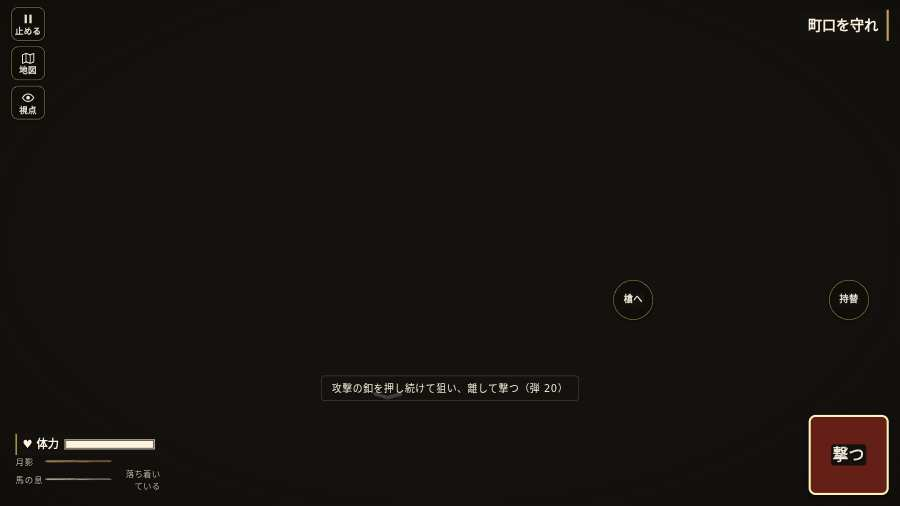

# テストプレイヤーの感想：指揮好きの戦略家

- 人：ケイコ（45歳・将棋と戦略ゲーム好き）（1508番）
- 変わり目：迷子になりやすい・パソコン 1280×720・信長で出陣・速い・足軽から・問屋:供・三人称・感度 ふつう・止めない
- 時：2026/10/23 10:27:35（300秒かかった）
- 画面：パソコン 1280×720・鍵盤とマウス・画質 高
- 遊んだ戦：志賀の陣・宇佐山城（信長で出陣）（試験の持ち時間で打ち切り）（失敗）
- 機械の混み具合：2（load average）

## ひとこと

> 志賀の陣・宇佐山城（信長で出陣）（試験の持ち時間で打ち切り）で、号令を8回かけました。信長でも出陣して、軍配も触りました。号令「focus」が、指の号令の輪から出せない。ここが直れば、ぐっと指揮が楽しくなる。HUD の札どうしが重なって読めない。采配の上で、これは痛い。号令「follow」が、指の号令の輪から出せない。采配の上で、これは痛い。采配で負けたのか、操作で負けたのか分からないのが一番困ります。

## 見つけた問題（8件・困った順）

### 1. HUD の札どうしが重なって読めない
- どこで：志賀の陣・宇佐山城（信長で出陣）・開戦
- 何が：.bl.full と .field-names（1280×720）／.field-names と #h-prog（1280×720）
- どれくらい困ったか：★★★ やめたくなった（172回）
- 直し方の目安：置き場所をずらすか、片方を出している間はもう片方を隠す
- 画面：（その戦の山場の一枚）

### 2. 戦場が札に食われている（画面の3分の1超）
- どこで：志賀の陣・宇佐山城（信長で出陣）・開戦
- 何が：1280×720 で 100%
- どれくらい困ったか：★★★ やめたくなった（78回）
- 直し方の目安：札を小さくするか、平時は薄く・畳む
- 画面：（その戦の山場の一枚）

### 3. 号令「focus」が、指の号令の輪から出せない
- どこで：志賀の陣・宇佐山城（信長で出陣）・39秒・first
- 何が：号令の輪（RADIAL）に無い、または身分が足りず選べない（志賀の陣・宇佐山城（信長で出陣）・39秒・first）
- どれくらい困ったか：★★★ やめたくなった（30回）
- 直し方の目安：号令の輪に足すか、短く押した時の指揮の札（数字の号令）を指で押せるようにする
- 画面：（その戦の山場の一枚）

### 4. 号令「follow」が、指の号令の輪から出せない
- どこで：志賀の陣・宇佐山城（信長で出陣）・11秒・first
- 何が：号令の輪（RADIAL）に無い、または身分が足りず選べない（志賀の陣・宇佐山城（信長で出陣）・11秒・first）
- どれくらい困ったか：★★★ やめたくなった（6回）
- 直し方の目安：号令の輪に足すか、短く押した時の指揮の札（数字の号令）を指で押せるようにする
- 画面：（その戦の山場の一枚）

### 5. 号令「attack」が、指の号令の輪から出せない
- どこで：志賀の陣・宇佐山城（信長で出陣）・30秒・first
- 何が：号令の輪（RADIAL）に無い、または身分が足りず選べない（志賀の陣・宇佐山城（信長で出陣）・30秒・first）
- どれくらい困ったか：★★★ やめたくなった（2回）
- 直し方の目安：号令の輪に足すか、短く押した時の指揮の札（数字の号令）を指で押せるようにする
- 画面：（その戦の山場の一枚）

### 6. 号令「陣形」が、指の号令の輪から出せない
- どこで：志賀の陣・宇佐山城（信長で出陣）・1秒・brief
- 何が：号令の輪（RADIAL）に無い、または身分が足りず選べない（志賀の陣・宇佐山城（信長で出陣）・1秒・brief）
- どれくらい困ったか：★★★ やめたくなった（1回）
- 直し方の目安：号令の輪に足すか、短く押した時の指揮の札（数字の号令）を指で押せるようにする
- 画面：（その戦の山場の一枚）

### 7. 号令「射撃／停止」が、指の号令の輪から出せない
- どこで：志賀の陣・宇佐山城（信長で出陣）・21秒・first
- 何が：号令の輪（RADIAL）に無い、または身分が足りず選べない（志賀の陣・宇佐山城（信長で出陣）・21秒・first）
- どれくらい困ったか：★★★ やめたくなった（1回）
- 直し方の目安：号令の輪に足すか、短く押した時の指揮の札（数字の号令）を指で押せるようにする
- 画面：（その戦の山場の一枚）

### 8. console.error：THREE.Object3D.add: object not an instance of THREE.Object3D.
- どこで：志賀の陣・宇佐山城（信長で出陣）・戦の前の札
- 何が：—
- どれくらい困ったか：★★ かなり困った（12回）
- 直し方の目安：出どころを突き止める
- 画面：（その戦の山場の一枚）

## 遊んだ記録

- 志賀の陣・宇佐山城（信長で出陣）（試験の持ち時間で打ち切り）（戦の任務とは別に、試験全体の持ち時間が尽きた）：383秒・任務失敗・戦功90・組98/100・討ち取り0・突き0/当たり0・号令8回・指で押した数2・読み込み16.1秒・戦の前の札132字・1コマ30.2ms（実時間260秒・内訳 brain 0.3・pad 0.1・tf 0.7・upd 28.9・eye 0.2）
  - 任務の流れ：0s 森隊の槍の列に入り、町口を守れ → 8s 開戦の法螺と太鼓。町口で先手を迎え撃て → 73s 敵の突撃太鼓。両手の敵を町口で受けよ → 100s 坂道の印をたどり、城の木戸へ退け → 284s 木戸の内を守れ。破られたら奥へ
  - 味方の隊：隊29・動いた計2854m・味方の討ち取り56・敵を前に20秒止まった45回・本物の味方5人未満0秒
  - 受けた傷：足軽 72・侍 8
  - 開戦：
  - 山場：
  - 終わり近く：
