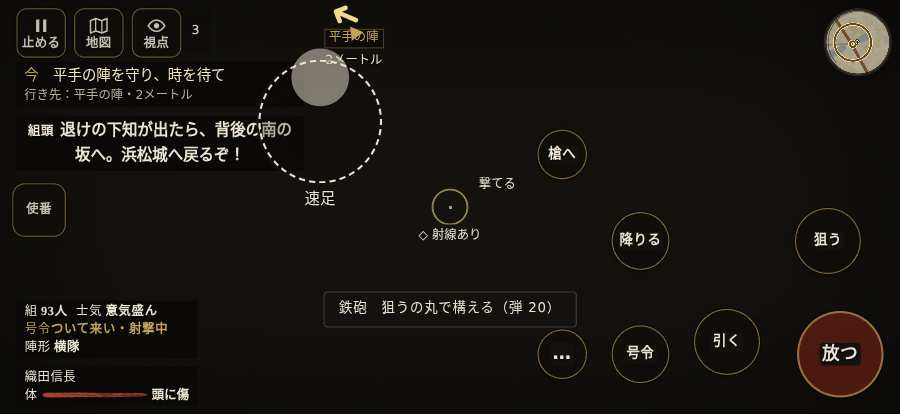

# テストプレイヤーの感想：歴史好きの大人

- 人：ミチオ（62歳・郷土史の会）（1676番）
- 変わり目：迷子になりやすい・iPhone 横 874×402・信長で出陣・速い・足軽から・問屋:買わない・三人称・感度 敏感・止めない
- 時：2026/10/14 12:25:46（265秒かかった）
- 画面：iPhone の横向き 874×402・倍率3・指で触る操作（touch.js の釦・棒・なぞり）・画質 低
- 遊んだ戦：三方ヶ原の戦い（信長で出陣）（達成）
- 機械の混み具合：3（load average）

## ひとこと

> 三方ヶ原（信長で出陣）を、一人称で歩いて見て回りました。務めは果たせましたが、気になる所がいくつか。遊んでいる途中でゲームが落ちた。これでは興が醒めます。名のある武将なのに、顔も装束も並の侍と同じ。史実を知る者としては、ここは看過できません。行き先があるのに20秒動かない兵。細かい事ですが、こういう所で嘘っぽくなる。

## 見つけた問題（7件・困った順）

### 1. 行き先があるのに20秒動かない兵
- どこで：三方ヶ原の戦い（信長で出陣）・178秒・crash
- 何が：味方の足軽：味方の足軽（号令：attack・徳川の手・頭：無/―・近い敵19m）at (7,-24)／味方の足軽：味方の足軽（号令：attack・徳川の手・頭：無/―・近い敵20m）at (5,-23)
- どれくらい困ったか：★★★ やめたくなった（12回）
- 直し方の目安：道が塞がれていないか、行き先に着いたと見なせているかを見る
- 画面：（その戦の山場の一枚）

### 2. 遊んでいる途中でゲームが落ちた（例外）
- どこで：三方ヶ原の戦い（信長で出陣）・231秒・end
- 何が：TypeError: Cannot read properties of undefined (reading 't')     at Battle.update (http://localhost:8765/v202610130955/src/battle.js:2155:7)     at playPersona (http://localhost:8765/v202610130955/src/playbot.js:2137:9)
- どれくらい困ったか：★★★ やめたくなった（1回）
- 直し方の目安：この行の前提（値が無い・死んだ兵など）を確かめる
- 画面：（その戦の山場の一枚）

### 3. 「親指の棒（歩く）」を押そうとしたら、別の物に当たった
- どこで：三方ヶ原の戦い（信長で出陣）・0秒・brief
- 何が：指の下にあったのは #battle-notices > #battle-message > #subtitle「平手汎秀平手汎秀じゃ。わしの」
- どれくらい困ったか：★★ かなり困った（1回）
- 直し方の目安：重ねている札の置き場所をずらすか、pointer-events:none にする
- 画面：

### 4. 名のある武将なのに、顔も装束も並の侍と同じ
- どこで：三方ヶ原の戦い（信長で出陣）・5秒・first
- 何が：水野信元（味方）
- どれくらい困ったか：★ 少し気になった（28回）
- 直し方の目安：units.js の GENERALS に顔・甲冑・兜を足す
- 画面：（その戦の山場の一枚）

### 5. 名のある武将なのに、顔も装束も並の侍と同じ
- どこで：三方ヶ原の戦い（信長で出陣）・5秒・first
- 何が：佐脇藤八（味方）
- どれくらい困ったか：★ 少し気になった（27回）
- 直し方の目安：units.js の GENERALS に顔・甲冑・兜を足す
- 画面：（その戦の山場の一枚）

### 6. 名のある武将なのに、顔も装束も並の侍と同じ
- どこで：三方ヶ原の戦い（信長で出陣）・5秒・first
- 何が：長谷川橋介（味方）
- どれくらい困ったか：★ 少し気になった（27回）
- 直し方の目安：units.js の GENERALS に顔・甲冑・兜を足す
- 画面：（その戦の山場の一枚）

### 7. 戦う兵が遠景の大軍（影の兵）の中に埋もれている
- どこで：三方ヶ原の戦い（信長で出陣）・111秒・crash
- 何が：味方の兵 4人が、遠景の大軍 #21（中心 3,0・131人）の中（7, 4）
- どれくらい困ったか：★ 少し気になった（1回）
- 直し方の目安：遠景の大軍を戦う場所から離す（addDistantArmy の x,z,w,d を見直す）か、兵の行き先を大軍の外にする
- 画面：（その戦の山場の一枚）

## 遊んだ記録

- 三方ヶ原の戦い（信長で出陣）：213秒・任務達成・戦功122・組79/100・討ち取り1・突き0/当たり1・号令0回・指で押した数37・読み込み2.7秒・戦の前の札103字・1コマ41.8ms（実時間224秒・内訳 brain 0.3・pad 0.1・tf 0.7・upd 40.5・eye 0.2）
  - 任務の流れ：0s 平手の旗で槍列に続け → 4s 平手の陣で先手を受け止めよ → 29s 味方の槍の列をそろえ直せ → 35s 平手の陣を守り、時を待て → 97s 右の森へ槍を向け直せ → 103s 右から来る赤備えを支えよ → 131s 味方と南の坂へ退け → 137s 佐久間の手と南の坂へ退け → 147s 坂の上で味方と列をそろえよ → 153s 坂の上で下りる味方を守れ → 191s 追手を避け、浜松へ退け → 213s 追手を避け、浜松へ退け〔済〕
  - 味方の隊：隊11・動いた計1441m・味方の討ち取り38・敵を前に20秒止まった7回・本物の味方5人未満0秒
  - 受けた傷：侍 5
  - 不具合：TypeError: Cannot read properties of undefined (reading 't')     at Battle.update (http://localhost:8765/v202610130955/src/battle.js:2155:7)     at playPersona (http://localhost:8765/v202610130955/src/playbot.js:2137:9)
  - 開戦：
  - 山場：
