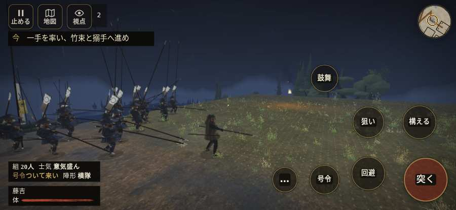

# テストプレイヤーの感想：アクション好き

- 人：ソウタ（24歳・アクションゲーム好き）（1732番）
- 変わり目：迷子になりやすい・iPhone 横 874×402・織田家編の戦を一つ・ゆっくり・足軽から・問屋:刀・槍・具足・一人称・感度 敏感・途中で止める
- 時：2026/10/14 12:05:28（241秒かかった）
- 画面：iPhone の横向き 874×402・倍率3・指で触る操作（touch.js の釦・棒・なぞり）・画質 低
- 遊んだ戦：大河内城の戦い（試験の持ち時間で打ち切り）（失敗）
- 機械の混み具合：3（load average）

## ひとこと

> とにかく突っ込んだ。4分で10人斬った。25回突いて25回当たり。当たりはいい感じ。前へ進もうとしても進めない所があった、ここは爽快感が死んでる。押せる所が小さい、もったいない。行き先があるのに20秒動かない兵、手応えがスカスカ。もっと派手に、じゃなくて重く斬り合いたい。

## 見つけた問題（3件・困った順）

### 1. 前へ進もうとしても進めない所があった
- どこで：大河内城の戦い・33秒・gate
- 何が：(-4, -40)・段 gate
- どれくらい困ったか：★★ かなり困った（1回）
- 直し方の目安：当たり（柵・建物・地形）と道のつながりを見直す
- 画面：

### 2. 押せる所が小さい（28px 未満）
- どこで：大河内城の戦い・開戦
- 何が：#battle-notices > #objectives.goal-changed > #obj-list：264×20「「今」の任務を進めよう。」／#battle-notices > #objectives > #obj-list：264×20「「今」の任務を進めよう。」
- どれくらい困ったか：★ 少し気になった（18回）
- 直し方の目安：押せる大きさを 28px 以上に
- 画面：（その戦の山場の一枚）

### 3. 行き先があるのに20秒動かない兵
- どこで：大河内城の戦い・232秒・siege
- 何が：味方の足軽：味方の足軽（号令：move・使番・頭：無/―・近い敵12m）at (-38,-2)
- どれくらい困ったか：★ 少し気になった（1回）
- 直し方の目安：道が塞がれていないか、行き先に着いたと見なせているかを見る
- 画面：（その戦の山場の一枚）

## 遊んだ記録

- 大河内城の戦い（試験の持ち時間で打ち切り）（戦の任務とは別に、試験全体の持ち時間が尽きた）：247秒・任務失敗・戦功65・組19/20・討ち取り10・突き25/当たり25・号令0回・指で押した数29・読み込み4.0秒・戦の前の札140字・1コマ34.7ms（実時間195秒・内訳 brain 0.1・pad 0.1・tf 0.5・upd 33.9・eye 0.2）
  - 任務の流れ：0s 丹羽の旗で下知を待て → 14s 一手を率い、竹束と搦手へ進め → 42s 坂の旗で槍をそろえ、城兵を止めよ → 89s 坂の旗で、先に退く組を守れ → 99s 殿を務め、追っ手を防いで南の陣へ退け → 225s 南の旗で、城兵と兵糧を止めよ
  - 味方の隊：隊22・動いた計2404m・味方の討ち取り10・敵を前に20秒止まった34回・本物の味方5人未満0秒
  - 開戦：
  - 山場：
