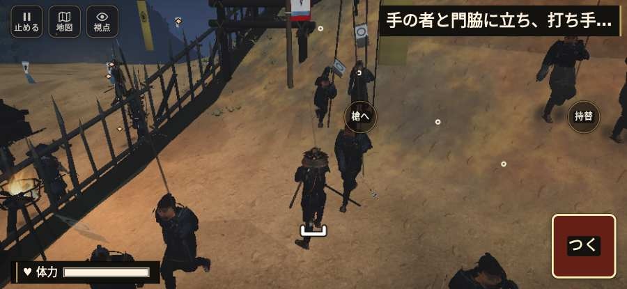

# テストプレイヤーの感想：歴史好きの大人

- 人：ミチオ（62歳・郷土史の会）（1781番）
- 変わり目：台詞を全部読む・iPhone 横 932×430・新しく始める通し・速い・身分 中ほど・問屋:鉄砲・三人称・感度 ふつう・止めない
- 時：2026/10/23 19:21:15（227秒かかった）
- 画面：iPhone の横向き 932×430・倍率3・指で触る操作（touch.js の釦・棒・なぞり）・画質 高
- 遊んだ戦：信貴山城の戦い（試験の持ち時間で打ち切り）（失敗）
- 機械の混み具合：2（load average）

## ひとこと

> 信貴山城（試験の持ち時間で打ち切り）を、一人称で歩いて見て回りました。務めは果たせませんでしたが、それより気になる所があります。行き先があるのに20秒動かない兵。これでは興が醒めます。敵が近いのに、まわりの兵の多くが棒立ち。史実を知る者としては、ここは看過できません。字が枠から切れている。史実を知る者としては、ここは看過できません。

## 見つけた問題（6件・困った順）

### 1. 行き先があるのに20秒動かない兵
- どこで：信貴山城の戦い・103秒・gate
- 何が：味方の足軽：味方の足軽（号令：path・門を破る組・頭：無/―・近い敵16m逃）at (14,-47)／味方の足軽：味方の足軽（号令：path・門を破る組・頭：無/―・近い敵15m逃）at (14,-47)
- どれくらい困ったか：★★★ やめたくなった（39回）
- 直し方の目安：道が塞がれていないか、行き先に着いたと見なせているかを見る
- 画面：（その戦の山場の一枚）

### 2. 敵が近いのに、まわりの兵の多くが棒立ち
- どこで：信貴山城の戦い・305秒・honmaru
- 何が：305秒：まわり35mの15人のうち6人が止まったまま（段 honmaru）
- どれくらい困ったか：★★ かなり困った（1回）
- 直し方の目安：敵が30m内に入ったら、構える・にじり寄る・槍を揃えるなど体を動かす
- 画面：（その戦の山場の一枚）

### 3. 字が枠から切れている
- どこで：信貴山城の戦い・5秒・brief
- 何が：#h-prog > .pg-st > span「一手を率い、先手と尾根道へ進め」／#h-prog > .pg-st > span「尾根の松永勢を崩し、門の前へ進め」
- どれくらい困ったか：★ 少し気になった（32回）
- 直し方の目安：枠を広げるか、字を折り返す
- 画面：（その戦の山場の一枚）

### 4. console.error：THREE.Object3D.add: object not an instance of THREE.Object3D.
- どこで：信貴山城の戦い・戦の前の札
- 何が：—
- どれくらい困ったか：★ 少し気になった（7回）
- 直し方の目安：出どころを突き止める
- 画面：（その戦の山場の一枚）

### 5. 崩れた部隊が、また戦っている
- どこで：信貴山城の戦い・13秒・climb
- 何が：尾根の松永勢（号令：flee）
- どれくらい困ったか：★ 少し気になった（1回）
- 直し方の目安：崩れた部隊の号令を上書きしない
- 画面：（その戦の山場の一枚）

### 6. 門・柵を破れと言うのに、90秒だれも傷つけていない
- どこで：信貴山城の戦い・113秒・gate
- 何が：「手の者で打ち手を守れ。門の印で掛矢で門を打て」（gate）
- どれくらい困ったか：★ 少し気になった（1回）
- 直し方の目安：門を打つ組（g.assault）が門まで行けているか、遊び手が E で打てる所に印があるかを見る
- 画面：（その戦の山場の一枚）

## 遊んだ記録

- 信貴山城の戦い（試験の持ち時間で打ち切り）（戦の任務とは別に、試験全体の持ち時間が尽きた）：337秒・任務失敗・戦功90・組8/20・討ち取り3・突き3/当たり4・号令0回・指で押した数4・読み込み25.6秒・戦の前の札136字・1コマ24.2ms（実時間181秒・内訳 brain 0.3・pad 0.3・tf 1.3・upd 22.1・eye 0.2）
  - 任務の流れ：0s 一手を率い、先手と尾根道へ進め → 5s 尾根の松永勢を崩し、門の前へ進め → 33s 手の者と門脇に立ち、打ち手を守れ → 80s 手の者で打ち手を守れ。門の印で掛矢で門を打て → 140s 道の印に続け。下の曲輪の敵を退けよ → 260s 道の印で西の尾根道から本丸の南口へ。敵を退け、先手と守れ
  - 味方の隊：隊20・動いた計1233m・味方の討ち取り23・敵を前に20秒止まった42回・本物の味方5人未満0秒
  - 開戦：
  - 山場：
  - 一人称で見回す（165秒）：
