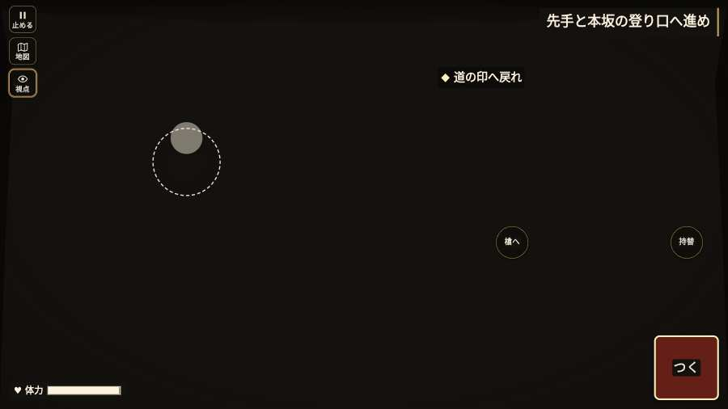

# テストプレイヤーの感想：せっかちな社会人

- 人：ユウキ（35歳・昼休みに遊ぶ会社員）（1809番）
- 変わり目：迷子になりやすい・パソコン 1280×720・信長で出陣・ゆっくり・身分 上・問屋:供・一人称・感度 ふつう・途中で止める
- 時：2026/10/23 19:47:09（287秒かかった）
- 画面：パソコン 1280×720・鍵盤とマウス・画質 高
- 遊んだ戦：比叡山攻め（信長で出陣）（試験の持ち時間で打ち切り）（失敗）
- 機械の混み具合：2（load average）

## ひとこと

> 昼休みに5分ほど。比叡山攻め（信長で出陣）（試験の持ち時間で打ち切り）。HUD の札どうしが重なって読めない。時間がもったいない。戦場が札に食われている。時間がもったいない。戦が始まるまでの読み込みが長い。待ってられない。読み込みも16秒待たされた。結局、何分遊べば一区切りなのかが分からない。

## 見つけた問題（6件・困った順）

### 1. HUD の札どうしが重なって読めない
- どこで：比叡山攻め（信長で出陣）・開戦
- 何が：.bl.full と .field-names（1280×720）／#objectives と .field-names（1280×720）
- どれくらい困ったか：★★★ やめたくなった（219回）
- 直し方の目安：置き場所をずらすか、片方を出している間はもう片方を隠す
- 画面：（その戦の山場の一枚）

### 2. 戦場が札に食われている（画面の3分の1超）
- どこで：比叡山攻め（信長で出陣）・開戦
- 何が：1280×720 で 100%
- どれくらい困ったか：★★ かなり困った（58回）
- 直し方の目安：札を小さくするか、平時は薄く・畳む
- 画面：（その戦の山場の一枚）

### 3. 戦が始まるまでの読み込みが長い
- どこで：比叡山攻め（信長で出陣）
- 何が：比叡山攻め（信長で出陣）：押してから 16.1秒（機械が混んでいる時の値）
- どれくらい困ったか：★★ かなり困った（1回）
- 直し方の目安：読み込みの間に、戦の心得を読ませる／重い物を後から足す
- 画面：（その戦の山場の一枚）

### 4. 何もする事が無いまま待たされた
- どこで：比叡山攻め（信長で出陣）・103秒・climb
- 何が：61秒、任務札が変わらず敵もいない（段 climb）
- どれくらい困ったか：★★ かなり困った（1回）
- 直し方の目安：飛ばせる（canSkip）ようにするか、待つ間にする事を置く
- 画面：

### 5. 字が枠から切れている
- どこで：比叡山攻め（信長で出陣）・15秒・climb
- 何が：.main.cur > .obj-text > .obj-now「道の印をたどり、赤い鳥居へ」／.main.cur > .obj-text > .obj-now「登り口で前列を残る者待て」
- どれくらい困ったか：★ 少し気になった（5回）
- 直し方の目安：枠を広げるか、字を折り返す
- 画面：（その戦の山場の一枚）

### 6. 任務札が長く変わらないのに、何も起きない
- どこで：比叡山攻め（信長で出陣）・143秒・climb
- 何が：101秒「先手と本坂の登り口へ進め」のまま、46秒なにも起きない（段：climb）／90秒「先手と本坂の登り口へ進め」のまま、136秒なにも起きない（段：climb）
- どれくらい困ったか：★ 少し気になった（2回）
- 直し方の目安：この段で待たせるなら、飛ばせる（canSkip）か、進み具合（objProgress）や台詞で先を見せる
- 画面：（その戦の山場の一枚）

## 遊んだ記録

- 比叡山攻め（信長で出陣）（試験の持ち時間で打ち切り）（戦の任務とは別に、試験全体の持ち時間が尽きた）：276秒・任務失敗・戦功0・組100/100・討ち取り0・突き0/当たり0・号令0回・指で押した数5・読み込み16.1秒・戦の前の札115字・1コマ38.5ms（実時間244秒・内訳 brain 0.7・pad 0.0・tf 0.3・upd 37.2・eye 0.1）
  - 任務の流れ：0s 道の先の鳥居へ進め → 6s 先手と鳥居へ進み、守りを退けよ → 17s 先手と本坂の登り口へ進め
  - 味方の隊：隊5・動いた計193m・味方の討ち取り5・敵を前に20秒止まった22回・本物の味方5人未満0秒
  - 受けた傷：弓 1
  - 開戦：
  - 山場：
