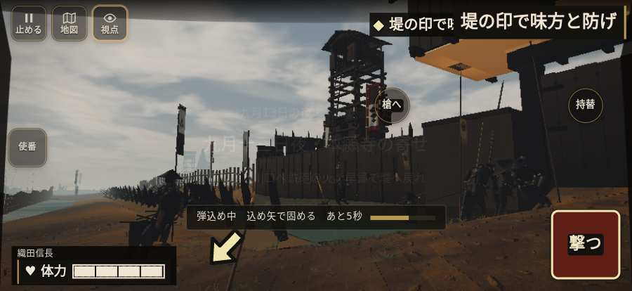

# テストプレイヤーの感想：はじめての中学生

- 人：ハルト（13歳・中学一年）（1945番）
- 変わり目：連打・iPhone 横 874×402・信長で出陣・ふつう・足軽から・問屋:刀・槍・具足・一人称・感度 鈍い・止めない
- 時：2026/10/23 22:51:08（183秒かかった）
- 画面：iPhone の横向き 874×402・倍率3・指で触る操作（touch.js の釦・棒・なぞり）・画質 高
- 遊んだ戦：野田・福島の戦い（信長で出陣）（失敗）、野田・福島の戦い（信長で出陣）（途中で打ち切り）（失敗）
- 機械の混み具合：2（load average）

## ひとこと

> えっと、遊んでみた。野田・福島（信長で出陣）と野田・福島（信長で出陣）（途中で打ち切り）をやった。よく分かんないまま終わった。「親指で歩こうとしても、置く所がふさがっている」のとこ、マジで意味わかんない。「HUD の札どうしが重なって読めない」のとこ、ムリ。「戦場が札に食われている」のとこ、ふつうに困った。ぶっちゃけ、ここで一回やめかけた。

## 見つけた問題（9件・困った順）

### 1. HUD の札どうしが重なって読めない
- どこで：野田・福島の戦い（信長で出陣）・5秒・carry
- 何が：.bl.full と .field-names（874×402）／#objectives と #h-prog（874×402）
- どれくらい困ったか：★★★ やめたくなった（369回）
- 直し方の目安：置き場所をずらすか、片方を出している間はもう片方を隠す

### 2. 親指で歩こうとしても、置く所がふさがっている
- どこで：野田・福島の戦い（信長で出陣）・109秒・night
- 何が：歩く範囲の四か所とも、戦場の上に札がある
- どれくらい困ったか：★★★ やめたくなった（101回）
- 直し方の目安：歩く範囲から札を離す／読むだけの札に指を通す

### 3. 戦場が札に食われている（画面の3分の1超）
- どこで：野田・福島の戦い（信長で出陣）・5秒・carry
- 何が：874×402 で 100%
- どれくらい困ったか：★★★ やめたくなった（83回）
- 直し方の目安：札を小さくするか、平時は薄く・畳む

### 4. console.error：THREE.Object3D.add: object not an instance of THREE.Object3D.
- どこで：野田・福島の戦い（信長で出陣）・戦の前の札
- 何が：—
- どれくらい困ったか：★★ かなり困った（12回）
- 直し方の目安：出どころを突き止める

### 5. 「親指の棒（歩く）」を押そうとしたら、別の物に当たった
- どこで：野田・福島の戦い（信長で出陣）・109秒・night
- 何が：指の下にあったのは div「九月13日の夜・一日が過ぎた」
- どれくらい困ったか：★★ かなり困った（1回）
- 直し方の目安：重ねている札の置き場所をずらすか、pointer-events:none にする
- 画面：

### 6. 「右側のなぞり（見回す）」を押そうとしたら、別の物に当たった
- どこで：野田・福島の戦い（信長で出陣）・109秒・night
- 何が：指の下にあったのは div「九月13日の夜・一日が過ぎた」
- どれくらい困ったか：★★ かなり困った（1回）
- 直し方の目安：重ねている札の置き場所をずらすか、pointer-events:none にする

### 7. 「突く」を押そうとしたら、別の物に当たった
- どこで：野田・福島の戦い（信長で出陣）・269秒・night
- 何が：指の下にあったのは div「九月22日・8日が過ぎた対陣」
- どれくらい困ったか：★★ かなり困った（1回）
- 直し方の目安：重ねている札の置き場所をずらすか、pointer-events:none にする

### 8. 「槍へ」を押そうとしたら、別の物に当たった
- どこで：野田・福島の戦い（信長で出陣）・277秒・retreat
- 何が：指の下にあったのは div「九月23日・一日が過ぎた翌日」
- どれくらい困ったか：★★ かなり困った（1回）
- 直し方の目安：重ねている札の置き場所をずらすか、pointer-events:none にする

### 9. 前へ進もうとしても進めない所があった
- どこで：野田・福島の戦い（信長で出陣）・351秒・retreat
- 何が：(47, 49)・段 retreat
- どれくらい困ったか：★★ かなり困った（1回）
- 直し方の目安：当たり（柵・建物・地形）と道のつながりを見直す

## 遊んだ記録

- 野田・福島の戦い（信長で出陣）：0秒・任務失敗・戦功0・組—・討ち取り—・突き—/当たり—・号令0回・指で押した数—・読み込み0.0秒・戦の前の札0字
  - 不具合：TypeError: Cannot read properties of null (reading 'u')     at Auditor.endCheck (http://localhost:8765/v202610231518/src/audit.js:371:24)     at playPersona (http://localhost:8765/v202610231518/src/playbot.js:2347:19)
- 野田・福島の戦い（信長で出陣）（途中で打ち切り）：378秒・任務失敗・戦功175・組—・討ち取り0・突き43/当たり0・号令0回・指で押した数—・読み込み16.6秒・戦の前の札110字・1コマ17.3ms（実時間156秒・内訳 brain 0.3・pad 1.4・tf 0.3・upd 15.2・eye 0.1）
  - 任務の流れ：0s 竹束の置き場を選べ。中央か西か → 2s 堤で運び手を守れ。太鼓で総攻め → 37s 味方と浅瀬の敵を防げ → 72s 浅瀬を渡り、砦前の印へ → 103s 砦前の印で並べ。塀の奥へ入るな → 109s 堤の印で味方と防げ → 117s 敵が来る。堤で味方と待て → 119s 堤で休め。敵が来たら防げ → 159s 敵が来る。堤で味方と待て → 168s 堤の印で味方と防げ → 171s 敵が来る。堤で味方と待て → 173s 堤の印で味方と防げ → 187s 堤で休め。敵が来たら防げ → 189s 敵が来る。堤で味方と待て
  - 味方の隊：隊17・動いた計2434m・味方の討ち取り48・敵を前に20秒止まった43回・本物の味方5人未満0秒
  - 不具合：TypeError: Cannot read properties of null (reading 'units')     at Auditor.tick (http://localhost:8765/v202610231518/src/audit.js:162:26)     at playPersona (http://localhost:8765/v202610231518/src/playbot.js:2303:11)
  - 開戦：
  - 山場：
