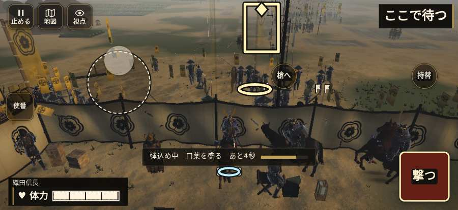

# テストプレイヤーの感想：はじめての中学生

- 人：ハルト（13歳・中学一年）（2090番）
- 変わり目：連打・iPhone 横 874×402・信長で出陣・ふつう・身分 中ほど・問屋:馬・三人称・感度 鈍い・止めない
- 時：2026/10/23 22:20:42（250秒かかった）
- 画面：iPhone の横向き 874×402・倍率3・指で触る操作（touch.js の釦・棒・なぞり）・画質 高
- 遊んだ戦：姉川の戦い（信長で出陣）（失敗）、姉川の戦い（信長で出陣）（途中で打ち切り）（失敗）
- 機械の混み具合：2（load average）

## ひとこと

> えっと、遊んでみた。姉川（信長で出陣）と姉川（信長で出陣）（途中で打ち切り）をやった。よく分かんないまま終わった。「HUD の札どうしが重なって読めない」のとこ、ムリ。「戦場が札に食われている」のとこ、マジで意味わかんない。「前へ進もうとしても進めない所があった」のとこ、ふつうに困った。ぶっちゃけ、ここで一回やめかけた。

## 見つけた問題（5件・困った順）

### 1. HUD の札どうしが重なって読めない
- どこで：姉川の戦い（信長で出陣）・開戦
- 何が：.bl.full と .field-names（874×402）／.bl.full と #mission-target-lines（874×402）
- どれくらい困ったか：★★★ やめたくなった（492回）
- 直し方の目安：置き場所をずらすか、片方を出している間はもう片方を隠す

### 2. 戦場が札に食われている（画面の3分の1超）
- どこで：姉川の戦い（信長で出陣）・開戦
- 何が：874×402 で 100%
- どれくらい困ったか：★★★ やめたくなった（77回）
- 直し方の目安：札を小さくするか、平時は薄く・畳む

### 3. 押せる所が画面の外にある
- どこで：姉川の戦い（信長で出陣）・20秒・charge
- 何が：#hud.battle-active.no-minimap > #mission-goal > .goal-label「あと53歩」 at 296,366／#hud.battle-active.no-minimap > #mission-goal > .goal-label「あと9歩」 at 310,366
- どれくらい困ったか：★★★ やめたくなった（5回）
- 直し方の目安：画面の内に収めるか、スクロールできるようにする

### 4. console.error：THREE.Object3D.add: object not an instance of THREE.Object3D.
- どこで：姉川の戦い（信長で出陣）・戦の前の札
- 何が：—
- どれくらい困ったか：★★ かなり困った（6回）
- 直し方の目安：出どころを突き止める

### 5. 前へ進もうとしても進めない所があった
- どこで：姉川の戦い（信長で出陣）・72秒・charge
- 何が：(-21, 161)・段 charge
- どれくらい困ったか：★★ かなり困った（1回）
- 直し方の目安：当たり（柵・建物・地形）と道のつながりを見直す
- 画面：

## 遊んだ記録

- 姉川の戦い（信長で出陣）：0秒・任務失敗・戦功0・組—・討ち取り—・突き—/当たり—・号令0回・指で押した数—・読み込み0.0秒・戦の前の札0字
  - 不具合：TypeError: Cannot read properties of null (reading 'u')     at Auditor.endCheck (http://localhost:8765/v202610231518/src/audit.js:371:24)     at playPersona (http://localhost:8765/v202610231518/src/playbot.js:2347:19)
- 姉川の戦い（信長で出陣）（途中で打ち切り）：375秒・任務失敗・戦功0・組—・討ち取り0・突き0/当たり0・号令0回・指で押した数—・読み込み8.4秒・戦の前の札115字・1コマ23.5ms（実時間193秒・内訳 brain 0.2・pad 1.4・tf 1.0・upd 20.8・eye 0.1）
  - 任務の流れ：0s 浅井の寄せを受け、押し返せ → 18s 磯野の寄せを受け、押し返せ → 92s 浅井の新手を受け止めよ → 109s 印の槍列で槍を揃え直せ → 348s （任務なし） → 352s 旗まで進もう
  - 味方の隊：隊17・動いた計2307m・味方の討ち取り52・敵を前に20秒止まった40回・本物の味方5人未満0秒
  - 不具合：TypeError: Cannot read properties of null (reading 'units')     at Auditor.tick (http://localhost:8765/v202610231518/src/audit.js:162:26)     at playPersona (http://localhost:8765/v202610231518/src/playbot.js:2303:11)
  - 開戦：
  - 山場：
