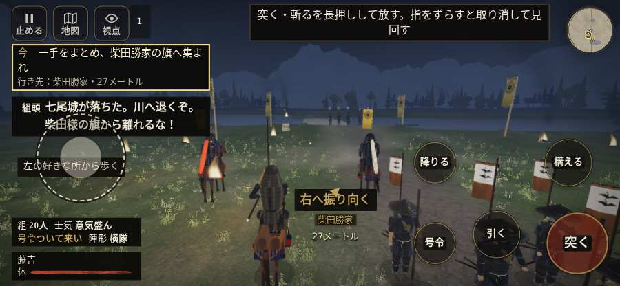

# テストプレイヤーの感想：歴史好きの大人

- 人：ミチオ（62歳・郷土史の会）（2181番）
- 変わり目：走りっぱなし・iPhone 横 844×390・織田家編の戦を一つ・ゆっくり・身分 上・問屋:馬・一人称・感度 ふつう・止めない
- 時：2026/10/15 0:00:44（236秒かかった）
- 画面：iPhone の横向き 844×390・倍率3・指で触る操作（touch.js の釦・棒・なぞり）・画質 低
- 遊んだ戦：手取川の戦い（失敗・倒れた）
- 機械の混み具合：3（load average）

## ひとこと

> 手取川を、一人称で歩いて見て回りました。務めは果たせませんでしたが、それより気になる所があります。「親指の棒（歩く）」を押そうとしたら、別の物に当たった。当時の人が見たら首を傾げるでしょう。行き先があるのに20秒動かない兵。これでは興が醒めます。倒れて戦が終わった。これでは興が醒めます。

## 見つけた問題（3件・困った順）

### 1. 行き先があるのに20秒動かない兵
- どこで：手取川の戦い・71秒・rear
- 何が：味方の丹羽長秀：味方の丹羽長秀（号令：path・丹羽長秀の手・頭：無/―・近い敵37m）at (-31,-60)／味方の前田利家：味方の前田利家（号令：path・前田利家の手・頭：無/―・近い敵25m）at (46,-55)
- どれくらい困ったか：★★★ やめたくなった（4回）
- 直し方の目安：道が塞がれていないか、行き先に着いたと見なせているかを見る
- 画面：（その戦の山場の一枚）

### 2. 「親指の棒（歩く）」を押そうとしたら、別の物に当たった
- どこで：手取川の戦い・0秒・brief
- 何が：指の下にあったのは #battle-notices > #battle-message > #subtitle「組頭七尾城が落ちた。川へ退く」
- どれくらい困ったか：★★ かなり困った（1回）
- 直し方の目安：重ねている札の置き場所をずらすか、pointer-events:none にする
- 画面：

### 3. 倒れて戦が終わった
- どこで：手取川の戦い・266秒・cross
- 何が：250秒で倒れた（受けた傷：足軽 103・侍 32）
- どれくらい困ったか：★ 少し気になった（1回）
- 直し方の目安：初めの戦は受ける傷を減らす・危ない時に字幕で構えを教える
- 画面：（その戦の山場の一枚）

## 遊んだ記録

- 手取川の戦い：250秒・任務失敗（倒れた）・戦功100・組17/20・討ち取り0・突き2/当たり1・号令0回・指で押した数9・読み込み3.3秒・戦の前の札138字・1コマ32.9ms（実時間198秒・内訳 brain 0.1・pad 0.1・tf 0.5・upd 32.0・eye 0.2）
  - 任務の流れ：0s 一手をまとめ、柴田勝家の旗へ集まれ → 22s 組頭に続き、北岸の火へ退け → 36s 一手を率い、北岸で追手を止めよ／旗のそばで、北の追手を止めよ → 60s 一手を率い、北岸で追手を止めよ／北岸の火で、組と次の追手を止めよ → 88s 一手を率い、北岸で追手を止めよ／組と前へ出て、追手を押し返せ → 181s 一手を率い、北岸で追手を止めよ／追手を食い止め、本隊を渡せ → 246s 浅瀬を渡り、南岸の火へ進め／追手を食い止め、本隊を渡せ〔済〕
  - 味方の隊：隊22・動いた計1522m・味方の討ち取り31・敵を前に20秒止まった81回・本物の味方5人未満0秒
  - 受けた傷：足軽 103・侍 32
  - 開戦：
  - 一人称で見回す（45秒）：
