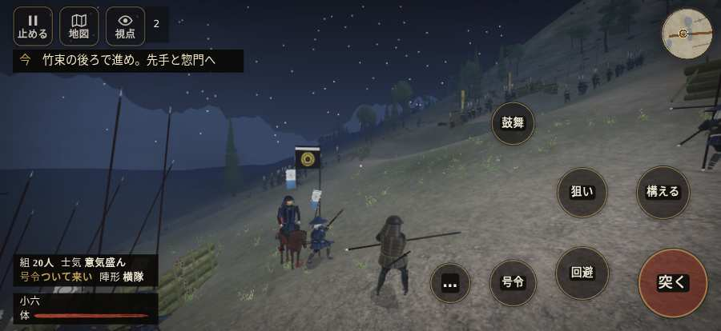

# テストプレイヤーの感想：アクション好き

- 人：ソウタ（24歳・アクションゲーム好き）（2207番）
- 変わり目：迷子になりやすい・iPhone 横 874×402・織田家編の戦を一つ・速い・身分 中ほど・問屋:刀・槍・具足・一人称・感度 ふつう・途中で止める
- 時：2026/10/15 0:29:26（203秒かかった）
- 画面：iPhone の横向き 874×402・倍率3・指で触る操作（touch.js の釦・棒・なぞり）・画質 低
- 遊んだ戦：越前・大滝寺の夜討ち（失敗）
- 機械の混み具合：4（load average）

## ひとこと

> とにかく突っ込んだ。5分で1人斬った。2回突いて2回当たり。当たりはいい感じ。前へ進もうとしても進めない所があった、手応えがスカスカ。押せる所が小さい、ここは爽快感が死んでる。斬り合う相手が少なくて退屈、もったいない。もっと派手に、じゃなくて重く斬り合いたい。

## 見つけた問題（4件・困った順）

### 1. 押せる所が小さい（28px 未満）
- どこで：越前・大滝寺の夜討ち・5秒・climb
- 何が：#battle-notices > #objectives > #obj-list：264×20「「今」の任務を進めよう。」
- どれくらい困ったか：★★ かなり困った（60回）
- 直し方の目安：押せる大きさを 28px 以上に
- 画面：（その戦の山場の一枚）

### 2. 前へ進もうとしても進めない所があった
- どこで：越前・大滝寺の夜討ち・33秒・climb
- 何が：(1, -158)・段 climb
- どれくらい困ったか：★★ かなり困った（6回）
- 直し方の目安：当たり（柵・建物・地形）と道のつながりを見直す
- 画面：

### 3. 行き先があるのに20秒動かない兵
- どこで：越前・大滝寺の夜討ち・105秒・climb
- 何が：味方の足軽：味方の足軽（号令：move・谷筋へ回る手（槍）・頭：無/―・近い敵4m）at (10,-47)／味方の足軽：味方の足軽（号令：attack・谷筋へ回る手（槍）・頭：full/engage・近い敵0m）at (11,-53)
- どれくらい困ったか：★ 少し気になった（2回）
- 直し方の目安：道が塞がれていないか、行き先に着いたと見なせているかを見る
- 画面：（その戦の山場の一枚）

### 4. 斬り合う相手が少なくて退屈
- どこで：越前・大滝寺の夜討ち・344秒・end
- 何が：5分で1人
- どれくらい困ったか：★ 少し気になった（1回）
- 画面：（その戦の山場の一枚）

## 遊んだ記録

- 越前・大滝寺の夜討ち：305秒・任務失敗・戦功0・組10/20・討ち取り1・突き2/当たり2・号令2回・指で押した数10・読み込み3.5秒・戦の前の札141字・1コマ21.5ms（実時間168秒・内訳 brain 0.1・pad 0.1・tf 0.4・upd 20.8・eye 0.1）
  - 任務の流れ：0s 先手を率い、惣門へ進め → 5s 竹束の後ろで進め。先手と惣門へ → 305s 竹束の後ろで進め。先手と惣門へ〔失〕
  - 味方の隊：隊10・動いた計2096m・味方の討ち取り74・敵を前に20秒止まった9回・本物の味方5人未満0秒
  - 受けた傷：足軽 20
  - 開戦：
  - 山場：
