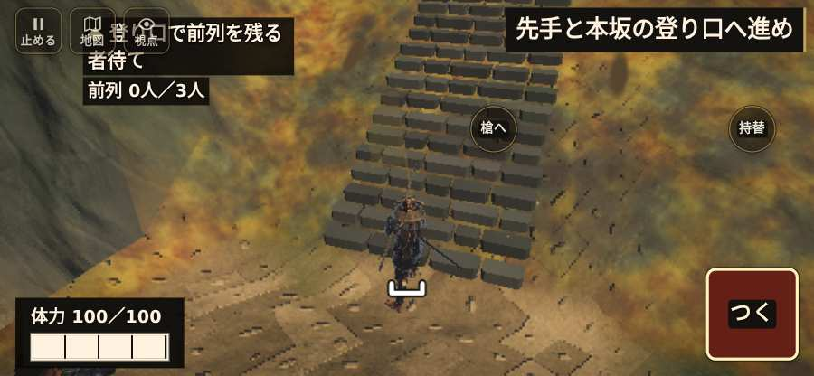

# テストプレイヤーの感想：せっかちな社会人

- 人：ユウキ（35歳・昼休みに遊ぶ会社員）（2224番）
- 変わり目：迷子になりやすい・iPhone 横 844×390・新しく始める通し・ふつう・身分 少し上・問屋:鉄砲・三人称・感度 ふつう・途中で止める
- 時：2026/10/24 1:47:33（293秒かかった）
- 画面：iPhone の横向き 844×390・倍率3・指で触る操作（touch.js の釦・棒・なぞり）・画質 高
- 遊んだ戦：比叡山攻め（試験の持ち時間で打ち切り）（失敗）
- 機械の混み具合：2（load average）

## ひとこと

> 昼休みに6分ほど。比叡山攻め（試験の持ち時間で打ち切り）。HUD の札どうしが重なって読めない。待ってられない。指の端末では「Space」ができない。待ってられない。戦場が札に食われている。ここで閉じる人は多いと思う。読み込みも18秒待たされた。結局、何分遊べば一区切りなのかが分からない。

## 見つけた問題（5件・困った順）

### 1. HUD の札どうしが重なって読めない
- どこで：比叡山攻め・5秒・brief
- 何が：.bl.full と .field-names（844×390）／#objectives と .field-names（844×390）
- どれくらい困ったか：★★★ やめたくなった（260回）
- 直し方の目安：置き場所をずらすか、片方を出している間はもう片方を隠す
- 画面：（その戦の山場の一枚）

### 2. 戦場が札に食われている（画面の3分の1超）
- どこで：比叡山攻め・5秒・brief
- 何が：844×390 で 100%
- どれくらい困ったか：★★ かなり困った（79回）
- 直し方の目安：札を小さくするか、平時は薄く・畳む
- 画面：（その戦の山場の一枚）

### 3. 字が枠から切れている
- どこで：比叡山攻め・10秒・climb
- 何が：#h-prog > .pg-st > span「先手と鳥居へ進み、守りを退けよ」／#h-prog > .pg-st > span「本坂を登り、道をふさぐ者を退けよ」
- どれくらい困ったか：★★ かなり困った（72回）
- 直し方の目安：枠を広げるか、字を折り返す
- 画面：（その戦の山場の一枚）

### 4. 指の端末では「Space」ができない（押す丸が無い）
- どこで：比叡山攻め・73秒・climb
- 何が：bot の頭が Space を押したがった（比叡山攻め・73秒・climb）
- どれくらい困ったか：★★ かなり困った（24回）
- 直し方の目安：touch.js に釦を足すか、戦の方で要らなくする
- 画面：（その戦の山場の一枚）

### 5. 戦が始まるまでの読み込みが長い
- どこで：比叡山攻め
- 何が：比叡山攻め：押してから 17.8秒（機械が混んでいる時の値）
- どれくらい困ったか：★★ かなり困った（1回）
- 直し方の目安：読み込みの間に、戦の心得を読ませる／重い物を後から足す
- 画面：（その戦の山場の一枚）

## 遊んだ記録

- 比叡山攻め（試験の持ち時間で打ち切り）（戦の任務とは別に、試験全体の持ち時間が尽きた）：385秒・任務失敗・戦功0・組17/20・討ち取り6・突き14/当たり15・号令0回・指で押した数19・読み込み17.8秒・戦の前の札135字・1コマ31.7ms（実時間261秒・内訳 brain 0.8・pad 0.4・tf 1.2・upd 29.1・eye 0.1）
  - 任務の流れ：0s 道の先の鳥居へ進め → 6s 先手と鳥居へ進み、守りを退けよ → 11s 先手と本坂の登り口へ進め → 62s 本坂を登り、道をふさぐ者を退けよ → 104s 本坂を登り、道をふさぐ者を退けよ／深手。味方の後ろで身を守れ → 114s 本坂を登り、道をふさぐ者を退けよ → 137s 本坂を登り、道をふさぐ者を退けよ／深手。味方の後ろで身を守れ → 203s 文殊楼の守りを退け、先手と門を抜けよ／深手。味方の後ろで身を守れ → 212s 文殊楼の守りを退け、先手と門を抜けよ
  - 味方の隊：隊6・動いた計1110m・味方の討ち取り42・敵を前に20秒止まった20回・本物の味方5人未満0秒
  - 受けた傷：足軽 145・弓 1
  - 開戦：
  - 山場：
  - 終わり近く：
