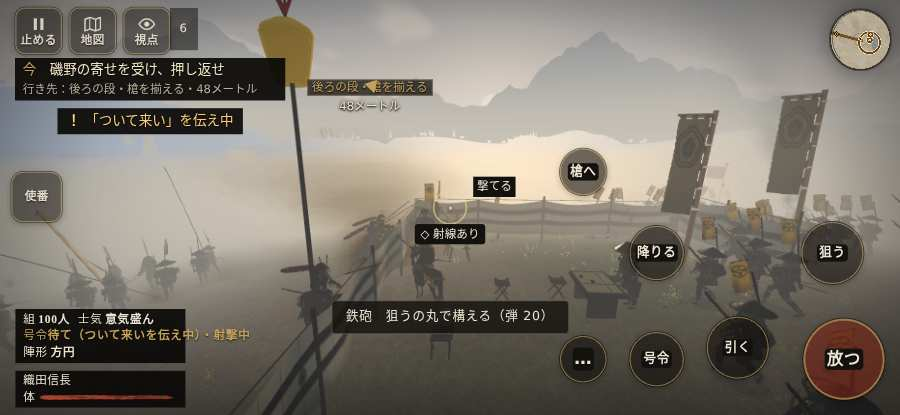

# テストプレイヤーの感想：指揮好きの戦略家

- 人：ケイコ（45歳・将棋と戦略ゲーム好き）（2333番）
- 変わり目：走りっぱなし・iPhone 横 932×430・信長で出陣・ふつう・身分 少し上・問屋:買わない・一人称・感度 ふつう・途中で止める
- 時：2026/10/15 0:08:21（301秒かかった）
- 画面：iPhone の横向き 932×430・倍率3・指で触る操作（touch.js の釦・棒・なぞり）・画質 低
- 遊んだ戦：姉川の戦い（信長で出陣）（試験の持ち時間で打ち切り）（失敗）
- 機械の混み具合：3（load average）

## ひとこと

> 姉川（信長で出陣）（試験の持ち時間で打ち切り）で、号令を27回かけました。信長でも出陣して、軍配も触りました。号令「陣形」が、指の号令の輪から出せない。ここが直れば、ぐっと指揮が楽しくなる。号令「続け」から3秒たっても、組の7割が動かない。指揮官としてはもどかしい。前へ進もうとしても進めない所があった。指揮官としてはもどかしい。采配で負けたのか、操作で負けたのか分からないのが一番困ります。

## 見つけた問題（3件・困った順）

### 1. 号令「陣形」が、指の号令の輪から出せない
- どこで：姉川の戦い（信長で出陣）・2秒・brief
- 何が：号令の輪（RADIAL）に無い、または身分が足りず選べない（姉川の戦い（信長で出陣）・2秒・brief）
- どれくらい困ったか：★★★ やめたくなった（5回）
- 直し方の目安：号令の輪に足すか、短く押した時の指揮の札（数字の号令）を指で押せるようにする
- 画面：（その戦の山場の一枚）

### 2. 号令「続け」から3秒たっても、組の7割が動かない
- どこで：姉川の戦い（信長で出陣）・118秒・charge
- 何が：100人のうち動いたのは0人（姉川の戦い（信長で出陣）・118秒・charge）
- どれくらい困ったか：★★ かなり困った（9回）
- 直し方の目安：号令を受けた兵がすぐ向きを変えて動き出すようにする（行き先・狙いの付け直し）
- 画面：

### 3. 前へ進もうとしても進めない所があった
- どこで：姉川の戦い（信長で出陣）・33秒・charge
- 何が：(-18, 161)・段 charge
- どれくらい困ったか：★★ かなり困った（7回）
- 直し方の目安：当たり（柵・建物・地形）と道のつながりを見直す
- 画面：

## 遊んだ記録

- 姉川の戦い（信長で出陣）（試験の持ち時間で打ち切り）（戦の任務とは別に、試験全体の持ち時間が尽きた）：285秒・任務失敗・戦功25・組77/100・討ち取り0・突き0/当たり0・号令27回・指で押した数33・読み込み3.2秒・戦の前の札115字・1コマ40.7ms（実時間258秒・内訳 brain 0.2・pad 0.1・tf 0.6・upd 39.5・eye 0.2）
  - 任務の流れ：0s 浅井の寄せを受け、押し返せ → 18s 磯野の寄せを受け、押し返せ → 92s 浅井の新手を受け止めよ → 230s 横槍に合わせ、浅井を押せ
  - 味方の隊：隊17・動いた計1253m・味方の討ち取り54・敵を前に20秒止まった32回・本物の味方5人未満0秒
  - 開戦：
