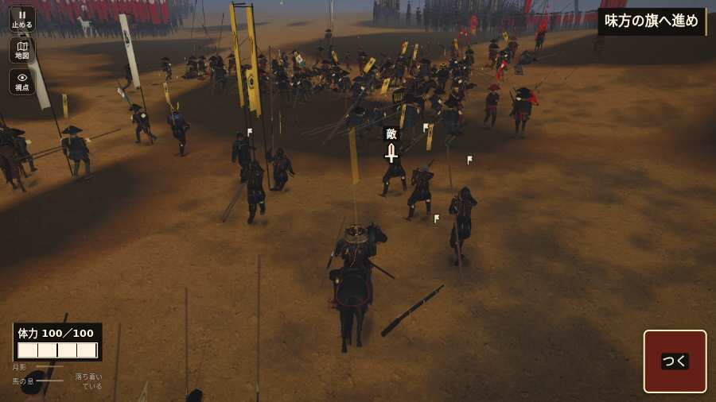

# テストプレイヤーの感想：せっかちな社会人

- 人：ユウキ（35歳・昼休みに遊ぶ会社員）（2404番）
- 変わり目：台詞を全部読む・パソコン 1280×720・織田家編の戦を一つ・速い・身分 少し上・問屋:馬・三人称・感度 ふつう・止めない
- 時：2026/10/24 7:28:21（147秒かかった）
- 画面：パソコン 1280×720・鍵盤とマウス・画質 高
- 遊んだ戦：三方ヶ原の戦い（失敗・倒れた）
- 機械の混み具合：4（load average）

## ひとこと

> 昼休みに3分ほど。三方ヶ原。HUD の札どうしが重なって読めない。正直、飛ばしたい。遊んでいる途中でゲームが落ちた。時間がもったいない。戦場が札に食われている。待ってられない。読み込みも9秒待たされた。結局、何分遊べば一区切りなのかが分からない。

## 見つけた問題（6件・困った順）

### 1. HUD の札どうしが重なって読めない
- どこで：三方ヶ原の戦い・開戦
- 何が：.bl.hz-has-73 と .field-names（1280×720）／#h-prog と .field-names（1280×720）
- どれくらい困ったか：★★★ やめたくなった（195回）
- 直し方の目安：置き場所をずらすか、片方を出している間はもう片方を隠す
- 画面：（その戦の山場の一枚）

### 2. 遊んでいる途中でゲームが落ちた（例外）
- どこで：三方ヶ原の戦い・210秒・crash
- 何が：TypeError: Cannot read properties of null (reading 'u')     at watchStep (http://localhost:8765/v202610240017/src/playbot.js:1692:42)     at playPersona (http://localhost:8765/v202610240017/src/playbot.js:2304:7)
- どれくらい困ったか：★★★ やめたくなった（1回）
- 直し方の目安：この行の前提（値が無い・死んだ兵など）を確かめる
- 画面：（その戦の山場の一枚）

### 3. 戦場が札に食われている（画面の3分の1超）
- どこで：三方ヶ原の戦い・開戦
- 何が：1280×720 で 100%
- どれくらい困ったか：★★ かなり困った（45回）
- 直し方の目安：札を小さくするか、平時は薄く・畳む
- 画面：（その戦の山場の一枚）

### 4. console.error：THREE.Object3D.add: object not an instance of THREE.Object3D.
- どこで：三方ヶ原の戦い・戦の前の札
- 何が：—
- どれくらい困ったか：★★ かなり困った（11回）
- 直し方の目安：出どころを突き止める
- 画面：（その戦の山場の一枚）

### 5. 戦が始まるまでの読み込みが長い
- どこで：三方ヶ原の戦い
- 何が：三方ヶ原の戦い：押してから 8.6秒（機械が混んでいる時の値）
- どれくらい困ったか：★★ かなり困った（1回）
- 直し方の目安：読み込みの間に、戦の心得を読ませる／重い物を後から足す
- 画面：（その戦の山場の一枚）

### 6. 倒れて戦が終わった
- どこで：三方ヶ原の戦い・210秒・crash
- 何が：206秒で倒れた（受けた傷：足軽 107・騎馬 0｜段 crash・最後の傷 83s足軽12→95囲退距3.3見2.9 87s足軽12→78退距2.0見1.9 185s足軽11→73退距3.7見3.1 190s足軽13→58退距3.3見2.6 192s足軽13→42退距3.1見2.5 195s足軽9→25退距3.4見2.9 198s足軽12→16退距3.4見2.6 206s足軽12→13退距3.3見2.6｜跡 170:2:14,56,8:73:thrust 173:2:14,59,8:73:thrust 176:2:14,60,8:73:thrust 179:2:14,60,8:73:thrust 182:2:20,63,7:73:thrust 185:2:17,61,7:73:thrust 188:2:13,62,7:58:slam 191:2:11,64,7:42:slam 194:2:9,67,7:25:thrust 197:2:10,71,6:16:slam 200:2:10,74,6:13:slam 203:2:10,76,5:13:slam 206:2:8,79,5:13:slam 209:2:8,79,5:0:thrust）
- どれくらい困ったか：★ 少し気になった（1回）
- 直し方の目安：初めの戦は受ける傷を減らす・危ない時に字幕で構えを教える
- 画面：（その戦の山場の一枚）

## 遊んだ記録

- 三方ヶ原の戦い：206秒・任務失敗（倒れた）・戦功0・組—・討ち取り6・突き9/当たり11・号令0回・指で押した数13・読み込み8.6秒・戦の前の札182字・1コマ24.3ms（実時間119秒・内訳 brain 0.2・pad 0.1・tf 0.3・upd 23.6・eye 0.1）
  - 任務の流れ：0s 目の前の槍の持ち場へ進め → 21s 平手の列で敵へ構えよ → 59s 味方の槍の列をそろえ直せ → 65s 平手の槍列を守れ → 127s 右の森へ槍を向け直せ → 133s 一手を右へ向け、赤備えを支えよ → 134s 味方と右へ槍を向け、馬を受けよ → 161s 味方と南の坂へ退け → 167s 佐久間の手と南の坂へ退け → 168s 坂に着いた。追手へ構えよ → 172s 坂で追手を支え、味方を先に通せ → 178s 一手で殿を務め、味方を坂へ通せ
  - 味方の隊：隊39・動いた計1976m・味方の討ち取り75・敵を前に20秒止まった21回・本物の味方5人未満0秒
  - 受けた傷：足軽 107・騎馬 0｜段 crash・最後の傷 83s足軽12→95囲退距3.3見2.9 87s足軽12→78退距2.0見1.9 185s足軽11→73退距3.7見3.1 190s足軽13→58退距3.3見2.6 192s足軽13→42退距3.1見2.5 195s足軽9→25退距3.4見2.9 198s足軽12→16退距3.4見2.6 206s足軽12→13退距3.3見2.6｜跡 170:2:14,56,8:73:thrust 173:2:14,59,8:73:thrust 176:2:14,60,8:73:thrust 179:2:14,60,8:73:thrust 182:2:20,63,7:73:thrust 185:2:17,61,7:73:thrust 188:2:13,62,7:58:slam 191:2:11,64,7:42:slam 194:2:9,67,7:25:thrust 197:2:10,71,6:16:slam 200:2:10,74,6:13:slam 203:2:10,76,5:13:slam 206:2:8,79,5:13:slam 209:2:8,79,5:0:thrust
  - 不具合：TypeError: Cannot read properties of null (reading 'u')     at watchStep (http://localhost:8765/v202610240017/src/playbot.js:1692:42)     at playPersona (http://localhost:8765/v202610240017/src/playbot.js:2304:7)
  - 開戦：
  - 山場：
  - 勝ち負けが決まった所：
