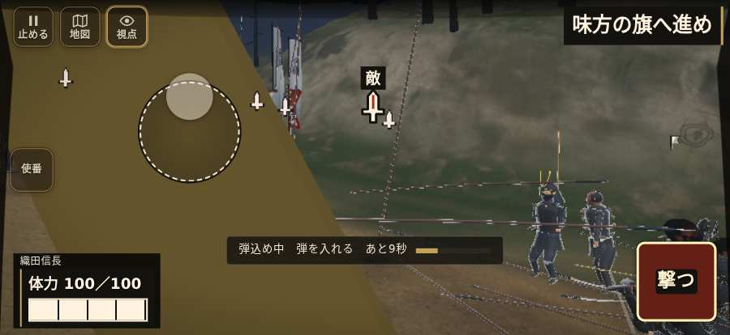

# テストプレイヤーの感想：はじめての中学生

- 人：ハルト（13歳・中学一年）（2405番）
- 変わり目：台詞を全部読む・iPhone 横 874×402・信長で出陣・速い・足軽から・問屋:買わない・一人称・感度 ふつう・途中で止める
- 時：2026/10/24 7:30:52（87秒かかった）
- 画面：iPhone の横向き 874×402・倍率3・指で触る操作（touch.js の釦・棒・なぞり）・画質 高
- 遊んだ戦：刀根坂の戦い（信長で出陣）（達成）
- 機械の混み具合：3（load average）

## ひとこと

> 友だちにすすめられて、やってみた。刀根坂（信長で出陣）をやった。1回はなんかクリアできた。「HUD の札どうしが重なって読めない」のとこ、だるい。「戦場が札に食われている」のとこ、だるい。「遊んでいる途中でゲームが落ちた」のとこ、だるい。ぶっちゃけ、ここで一回やめかけた。

## 見つけた問題（11件・困った順）

### 1. HUD の札どうしが重なって読めない
- どこで：刀根坂の戦い（信長で出陣）・開戦
- 何が：.bl.hz-has-73 と .field-names（874×402）／#h-prog と .field-names（874×402）
- どれくらい困ったか：★★★ やめたくなった（214回）
- 直し方の目安：置き場所をずらすか、片方を出している間はもう片方を隠す
- 画面：（その戦の山場の一枚）

### 2. 戦場が札に食われている（画面の3分の1超）
- どこで：刀根坂の戦い（信長で出陣）・開戦
- 何が：874×402 で 100%
- どれくらい困ったか：★★★ やめたくなった（69回）
- 直し方の目安：札を小さくするか、平時は薄く・畳む
- 画面：（その戦の山場の一枚）

### 3. 押せる所が小さい（28px 未満）
- どこで：刀根坂の戦い（信長で出陣）・5秒・chase
- 何が：#hud.hz-has-23.battle-active > #mission-goal > .goal-label：16×8「」
- どれくらい困ったか：★★★ やめたくなった（27回）
- 直し方の目安：押せる大きさを 28px 以上に
- 画面：（その戦の山場の一枚）

### 4. 字が枠から切れている
- どこで：刀根坂の戦い（信長で出陣）・10秒・chase
- 何が：#h-prog > .pg-st > span「道の曲がりへ進み、味方と敵を崩せ」／#h-prog > .pg-st > span「城下の道へ進み、勝家の手に続け」
- どれくらい困ったか：★★★ やめたくなった（9回）
- 直し方の目安：枠を広げるか、字を折り返す
- 画面：（その戦の山場の一枚）

### 5. 字と背景の明暗の比が低い（3 未満）
- どこで：刀根坂の戦い（信長で出陣）・戦のあと
- 何が：.ek-c > table > caption：1.0「組の人数」／tbody > tr > th：1.0「戦の終わり」
- どれくらい困ったか：★★★ やめたくなった（5回）
- 直し方の目安：字を明るく、または背景を暗く
- 画面：（その戦の山場の一枚）

### 6. 遊んでいる途中でゲームが落ちた（例外）
- どこで：刀根坂の戦い（信長で出陣）・325秒・end
- 何が：TypeError: Cannot read properties of null (reading 'u')     at watchStep (http://localhost:8765/v202610240017/src/playbot.js:1692:42)     at playPersona (http://localhost:8765/v202610240017/src/playbot.js:2304:7)
- どれくらい困ったか：★★★ やめたくなった（1回）
- 直し方の目安：この行の前提（値が無い・死んだ兵など）を確かめる
- 画面：（その戦の山場の一枚）

### 7. 指の端末では「Digit1」ができない（押す丸が無い）
- どこで：刀根坂の戦い（信長で出陣）・41秒・chase
- 何が：bot の頭が Digit1 を押したがった（刀根坂の戦い（信長で出陣）・41秒・chase）
- どれくらい困ったか：★★ かなり困った（1回）
- 直し方の目安：touch.js に釦を足すか、戦の方で要らなくする
- 画面：（その戦の山場の一枚）

### 8. 「突く」を押そうとしたら、別の物に当たった
- どこで：刀根坂の戦い（信長で出陣）・237秒・road
- 何が：指の下にあったのは div「越前への追撃　数日の道のり八」
- どれくらい困ったか：★★ かなり困った（1回）
- 直し方の目安：重ねている札の置き場所をずらすか、pointer-events:none にする
- 画面：

### 9. 「右側のなぞり（見回す）」を押そうとしたら、別の物に当たった
- どこで：刀根坂の戦い（信長で出陣）・245秒・road
- 何が：指の下にあったのは div > canvas「刀根坂から敦賀、木の芽峠、府中を経て一乗谷へ向かう略図」
- どれくらい困ったか：★★ かなり困った（1回）
- 直し方の目安：重ねている札の置き場所をずらすか、pointer-events:none にする
- 画面：（その戦の山場の一枚）

### 10. console.error：THREE.WebGLProgram: Shader Error 1282 - VALIDATE_STATUS false

Program Info Log:
- どこで：刀根坂の戦い（信長で出陣）・40秒・chase
- 何が：—
- どれくらい困ったか：★ 少し気になった（2回）
- 直し方の目安：出どころを突き止める
- 画面：（その戦の山場の一枚）

### 11. 号令「follow」が、指の号令の輪から出せない
- どこで：刀根坂の戦い（信長で出陣）・248秒・town
- 何が：号令の輪（RADIAL）に無い、または身分が足りず選べない（刀根坂の戦い（信長で出陣）・248秒・town）
- どれくらい困ったか：★ 少し気になった（1回）
- 直し方の目安：号令の輪に足すか、短く押した時の指揮の札（数字の号令）を指で押せるようにする
- 画面：（その戦の山場の一枚）

## 遊んだ記録

- 刀根坂の戦い（信長で出陣）：325秒・任務達成・戦功130・組—・討ち取り11・突き190/当たり16・号令1回・指で押した数1952・読み込み10.6秒・戦の前の札106字・1コマ8ms（実時間63秒・内訳 brain 0.1・pad 0.2・tf 0.1・upd 7.5・eye 0.1）
  - 任務の流れ：0s 馬が動いたら、信長公に続け → 5s 味方に続き、道を塞ぐ敵を崩せ → 5s 道の曲がりへ進み、味方と敵を崩せ → 15s 味方と印の敵へ進め → 18s 印の敵へ、味方と近づけ → 23s 道の印へ、味方と進め → 28s 道の曲がりへ、味方と進め → 28s 印の敵へ、味方と近づけ → 29s 道の曲がりへ、味方と進め → 37s 印の敵へ、味方と近づけ → 40s 敵へ構え、味方と押せ → 50s 道の曲がりへ、味方と進め → 52s 道の曲がりへ進み、味方と敵を崩せ → 54s 味方と印の敵へ進め
  - 味方の隊：隊14・動いた計4850m・味方の討ち取り19・敵を前に20秒止まった7回・本物の味方5人未満0秒
  - 受けた傷：足軽 5
  - 不具合：TypeError: Cannot read properties of null (reading 'u')     at watchStep (http://localhost:8765/v202610240017/src/playbot.js:1692:42)     at playPersona (http://localhost:8765/v202610240017/src/playbot.js:2304:7)
  - 開戦：
  - 山場：
