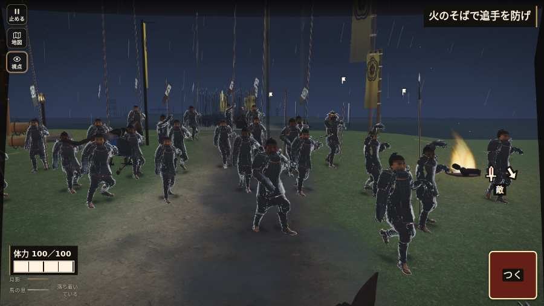

# テストプレイヤーの感想：せっかちな社会人

- 人：ユウキ（35歳・昼休みに遊ぶ会社員）（2439番）
- 変わり目：構え多め・パソコン 1280×720・新しく始める通し・ふつう・身分 中ほど・問屋:買わない・一人称・感度 ふつう・止めない
- 時：2026/10/24 7:54:02（206秒かかった）
- 画面：パソコン 1280×720・鍵盤とマウス・画質 高
- 遊んだ戦：手取川の戦い（失敗）
- 機械の混み具合：3（load average）

## ひとこと

> 昼休みに5分ほど。手取川。HUD の札どうしが重なって読めない。時間がもったいない。遊んでいる途中でゲームが落ちた。正直、飛ばしたい。戦場が札に食われている。待ってられない。読み込みも16秒待たされた。結局、何分遊べば一区切りなのかが分からない。

## 見つけた問題（6件・困った順）

### 1. HUD の札どうしが重なって読めない
- どこで：手取川の戦い・開戦
- 何が：.bl.hz-has-73 と .field-names（1280×720）／#h-prog と .field-names（1280×720）
- どれくらい困ったか：★★★ やめたくなった（232回）
- 直し方の目安：置き場所をずらすか、片方を出している間はもう片方を隠す
- 画面：（その戦の山場の一枚）

### 2. 遊んでいる途中でゲームが落ちた（例外）
- どこで：手取川の戦い・306秒・end
- 何が：TypeError: Cannot read properties of null (reading 'u')     at watchStep (http://localhost:8765/v202610240017/src/playbot.js:1692:42)     at playPersona (http://localhost:8765/v202610240017/src/playbot.js:2304:7)
- どれくらい困ったか：★★★ やめたくなった（1回）
- 直し方の目安：この行の前提（値が無い・死んだ兵など）を確かめる
- 画面：（その戦の山場の一枚）

### 3. 戦場が札に食われている（画面の3分の1超）
- どこで：手取川の戦い・開戦
- 何が：1280×720 で 100%
- どれくらい困ったか：★★ かなり困った（67回）
- 直し方の目安：札を小さくするか、平時は薄く・畳む
- 画面：（その戦の山場の一枚）

### 4. 押せる所が小さい（28px 未満）
- どこで：手取川の戦い・開戦
- 何が：#hud.hz-has-23.battle-active > #mission-goal > .goal-label：16×8「」
- どれくらい困ったか：★★ かなり困った（11回）
- 直し方の目安：押せる大きさを 28px 以上に
- 画面：（その戦の山場の一枚）

### 5. 戦が始まるまでの読み込みが長い
- どこで：手取川の戦い
- 何が：手取川の戦い：押してから 15.8秒（機械が混んでいる時の値）
- どれくらい困ったか：★★ かなり困った（1回）
- 直し方の目安：読み込みの間に、戦の心得を読ませる／重い物を後から足す
- 画面：（その戦の山場の一枚）

### 6. 行き先があるのに20秒動かない兵
- どこで：手取川の戦い・42秒・rear
- 何が：味方の前田利家：味方の前田利家（号令：move・前田利家の手・頭：無/―・近い敵36m逃）at (46,-54)／味方の前田利家：味方の前田利家（号令：path・前田利家の手・頭：無/―・近い敵5m）at (10,-46)
- どれくらい困ったか：★ 少し気になった（7回）
- 直し方の目安：道が塞がれていないか、行き先に着いたと見なせているかを見る
- 画面：（その戦の山場の一枚）

## 遊んだ記録

- 手取川の戦い：306秒・任務失敗・戦功60・組—・討ち取り0・突き0/当たり0・号令0回・指で押した数4・読み込み15.8秒・戦の前の札160字・1コマ21.8ms（実時間172秒・内訳 brain 0.2・pad 0.0・tf 0.2・upd 21.3・eye 0.1）
  - 任務の流れ：0s 組をまとめ、柴田勝家の旗へ → 6s 組頭に続き、北岸の火へ退け → 13s 旗のそばで追手を防げ → 37s 火のそばで追手を防げ → 76s 組と火へ進み、追手へ槍を構えよ → 84s 手負いは浅瀬を渡り、南岸へ退け → 181s 南岸で追手を止め、味方を迎えよ → 306s 殿の持ち場を支えられなかった〔失〕
  - 味方の隊：隊13・動いた計1597m・味方の討ち取り22・敵を前に20秒止まった22回・本物の味方5人未満0秒
  - 受けた傷：足軽 86・侍 25
  - 不具合：TypeError: Cannot read properties of null (reading 'u')     at watchStep (http://localhost:8765/v202610240017/src/playbot.js:1692:42)     at playPersona (http://localhost:8765/v202610240017/src/playbot.js:2304:7)
  - 開戦：
  - 山場：
  - 勝ち負けが決まった所：
