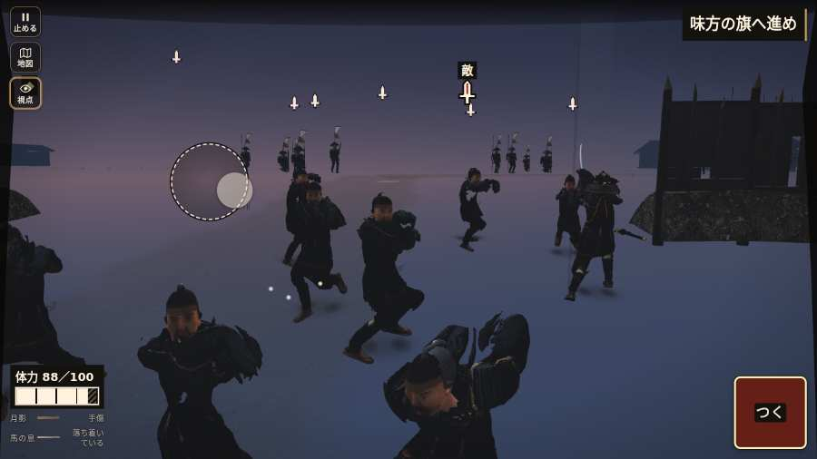

# テストプレイヤーの感想：歴史好きの大人

- 人：ミチオ（62歳・郷土史の会）（2496番）
- 変わり目：迷子になりやすい・パソコン 1280×720・新しく始める通し・ふつう・身分 上・問屋:供・一人称・感度 敏感・止めない
- 時：2026/10/24 7:39:46（186秒かかった）
- 画面：パソコン 1280×720・鍵盤とマウス・画質 高
- 遊んだ戦：有岡城の戦い（失敗・倒れた）、天正伊賀の乱・比自山城（失敗）
- 機械の混み具合：2（load average）

## ひとこと

> 有岡城と天正伊賀の乱・比自山城を、一人称で歩いて見て回りました。務めは果たせませんでしたが、それより気になる所があります。遊んでいる途中でゲームが落ちた。細かい事ですが、こういう所で嘘っぽくなる。問屋で「買う」を押しても、銭が減らない。細かい事ですが、こういう所で嘘っぽくなる。敵と味方が同じ家の装束・旗で出てくる。これでは興が醒めます。

## 見つけた問題（6件・困った順）

### 1. 遊んでいる途中でゲームが落ちた（例外）
- どこで：有岡城の戦い・90秒・open
- 何が：TypeError: Cannot read properties of null (reading 'u')     at watchStep (http://localhost:8765/v202610240017/src/playbot.js:1692:42)     at playPersona (http://localhost:8765/v202610240017/src/playbot.js:2304:7)
- どれくらい困ったか：★★★ やめたくなった（1回）
- 直し方の目安：この行の前提（値が無い・死んだ兵など）を確かめる
- 画面：（その戦の山場の一枚）

### 2. 問屋で「買う」を押しても、銭が減らない（買えていない？）
- どこで：天正伊賀の乱・比自山城の前・城下
- 何が：押した物：若党雇い賃 8貫（銭 15.51貫のまま）
- どれくらい困ったか：★★ かなり困った（2回）
- 直し方の目安：買えない時は釦を押せない見た目にし、理由を書く
- 画面：（その戦の山場の一枚）

### 3. 敵と味方が同じ家の装束・旗で出てくる
- どこで：有岡城の戦い・1秒・brief
- 何が：有岡城の戦い：両方に「oda」の隊がいる
- どれくらい困ったか：★★ かなり困った（1回）
- 直し方の目安：敵の隊の faction を、その戦の相手の家にする
- 画面：（その戦の山場の一枚）

### 4. console.error：THREE.Object3D.add: object not an instance of THREE.Object3D.
- どこで：天正伊賀の乱・比自山城・戦の前の札
- 何が：—
- どれくらい困ったか：★ 少し気になった（4回）
- 直し方の目安：出どころを突き止める
- 画面：（その戦の山場の一枚）

### 5. 号令「attack」が、指の号令の輪から出せない
- どこで：有岡城の戦い・34秒・open
- 何が：号令の輪（RADIAL）に無い、または身分が足りず選べない（有岡城の戦い・34秒・open）
- どれくらい困ったか：★ 少し気になった（3回）
- 直し方の目安：号令の輪に足すか、短く押した時の指揮の札（数字の号令）を指で押せるようにする
- 画面：（その戦の山場の一枚）

### 6. 倒れて戦が終わった
- どこで：有岡城の戦い・90秒・open
- 何が：86秒で倒れた（受けた傷：足軽 72・侍 20｜段 open・最後の傷 38s足軽10→110退距3.2見1.8 44s足軽11→97距1.8見1.8 61s足軽14→90横囲退距2.4見2.4 61s足軽13→76囲退距3.2見2.2 63s足軽7→69囲退距2.0見2.0 72s足軽16→60退距1.8見1.8 82s侍20→38横退距1.3見1.3｜跡 49:1:-375,-108,1:82:thrust 52:1:-368,-108,2:86:thrust 55:1:-360,-101,2:90:thrust 58:1:-350,-97,2:90:thrust 61:1:-343,-95,2:76:slam 64:1:-339,-92,2:60:butt 67:1:-338,-90,2:60:butt 70:1:-339,-90,2:60:butt 73:1:-340,-90,2:39:thrust 76:1:-340,-90,2:38:thrust 79:1:-337,-88,2:38:thrust 82:1:-338,-84,2:38:thrust 85:1:-339,-83,2:11:gyaku 88:1:-338,-84,2:0:gyaku）
- どれくらい困ったか：★ 少し気になった（1回）
- 直し方の目安：初めの戦は受ける傷を減らす・危ない時に字幕で構えを教える
- 画面：（その戦の山場の一枚）

## 遊んだ記録

- 有岡城の戦い：86秒・任務失敗（倒れた）・戦功96・組—・討ち取り6・突き10/当たり9・号令3回・指で押した数13・読み込み16.5秒・戦の前の札154字・1コマ29.3ms（実時間71秒・内訳 brain 0.4・pad 0.1・tf 0.2・upd 28.6・eye 0.2）
  - 任務の流れ：0s 組をそろえ、開門を待て → 25s 先手と木戸へ攻め入れ → 25s 木戸へ進め／180秒 → 26s 木戸へ進め／179秒 → 27s 木戸へ進め／178秒 → 28s 木戸へ進め／177秒 → 29s 木戸へ進め／176秒 → 30s 木戸へ進め／175秒 → 31s 木戸へ進め／174秒 → 32s 木戸へ進め／173秒 → 33s 木戸へ進め／172秒 → 34s 木戸へ進め／171秒 → 35s 木戸の敵を押し返せ／171秒 → 35s 木戸の敵を押し返せ／170秒
  - 味方の隊：隊14・動いた計1146m・味方の討ち取り8・敵を前に20秒止まった14回・本物の味方5人未満0秒
  - 受けた傷：足軽 72・侍 20｜段 open・最後の傷 38s足軽10→110退距3.2見1.8 44s足軽11→97距1.8見1.8 61s足軽14→90横囲退距2.4見2.4 61s足軽13→76囲退距3.2見2.2 63s足軽7→69囲退距2.0見2.0 72s足軽16→60退距1.8見1.8 82s侍20→38横退距1.3見1.3｜跡 49:1:-375,-108,1:82:thrust 52:1:-368,-108,2:86:thrust 55:1:-360,-101,2:90:thrust 58:1:-350,-97,2:90:thrust 61:1:-343,-95,2:76:slam 64:1:-339,-92,2:60:butt 67:1:-338,-90,2:60:butt 70:1:-339,-90,2:60:butt 73:1:-340,-90,2:39:thrust 76:1:-340,-90,2:38:thrust 79:1:-337,-88,2:38:thrust 82:1:-338,-84,2:38:thrust 85:1:-339,-83,2:11:gyaku 88:1:-338,-84,2:0:gyaku
  - 不具合：TypeError: Cannot read properties of null (reading 'u')     at watchStep (http://localhost:8765/v202610240017/src/playbot.js:1692:42)     at playPersona (http://localhost:8765/v202610240017/src/playbot.js:2304:7)
  - 開戦：
  - 山場：
  - 勝ち負けが決まった所：
- 天正伊賀の乱・比自山城：0秒・任務失敗・戦功0・組—・討ち取り0・突き0/当たり0・号令0回・指で押した数—・読み込み65.8秒・戦の前の札0字
  - 不具合：新しい戦の読み込みが終わらなかった
