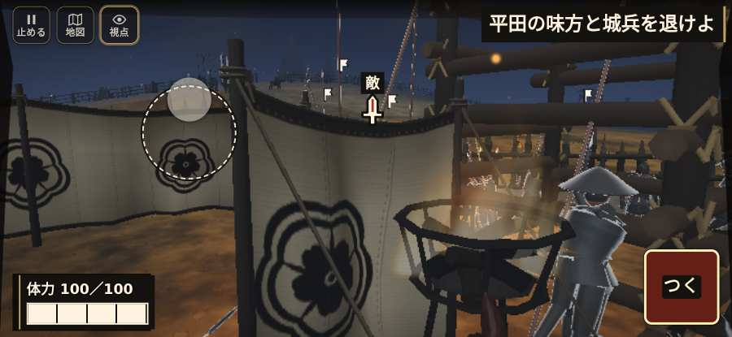

# テストプレイヤーの感想：アクション好き

- 人：ソウタ（24歳・アクションゲーム好き）（2517番）
- 変わり目：走りっぱなし・iPhone 横 932×430・新しく始める通し・速い・身分 上・問屋:鉄砲・一人称・感度 鈍い・途中で止める
- 時：2026/10/24 7:42:23（226秒かかった）
- 画面：iPhone の横向き 932×430・倍率3・指で触る操作（touch.js の釦・棒・なぞり）・画質 高
- 遊んだ戦：三木城・大村の合戦（失敗）、三木城・大村の合戦（途中で打ち切り）（達成）
- 機械の混み具合：2（load average）

## ひとこと

> とにかく突っ込んだ。6分で2人斬った。4回突いて4回当たり。当たりはいい感じ。HUD の札どうしが重なって読めない、もったいない。遊んでいる途中でゲームが落ちた、ストレスたまる。戦場が札に食われている、手応えがスカスカ。もっと派手に、じゃなくて重く斬り合いたい。

## 見つけた問題（7件・困った順）

### 1. 遊んでいる途中でゲームが落ちた（例外）
- どこで：三木城・大村の合戦・382秒・end
- 何が：TypeError: Cannot read properties of null (reading 'u')     at watchStep (http://localhost:8765/v202610240017/src/playbot.js:1692:42)     at playPersona (http://localhost:8765/v202610240017/src/playbot.js:2304:7)
- どれくらい困ったか：★★★ やめたくなった（1回）
- 直し方の目安：この行の前提（値が無い・死んだ兵など）を確かめる

### 2. HUD の札どうしが重なって読めない
- どこで：三木城・大村の合戦・5秒・brief
- 何が：.bl.hz-has-73 と .field-names（932×430）／#objectives と .field-names（932×430）
- どれくらい困ったか：★★ かなり困った（219回）
- 直し方の目安：置き場所をずらすか、片方を出している間はもう片方を隠す

### 3. 戦場が札に食われている（画面の3分の1超）
- どこで：三木城・大村の合戦・5秒・brief
- 何が：932×430 で 100%
- どれくらい困ったか：★★ かなり困った（79回）
- 直し方の目安：札を小さくするか、平時は薄く・畳む

### 4. console.error：THREE.Object3D.add: object not an instance of THREE.Object3D.
- どこで：三木城・大村の合戦・戦の前の札
- 何が：—
- どれくらい困ったか：★★ かなり困った（8回）
- 直し方の目安：出どころを突き止める

### 5. 前へ進もうとしても進めない所があった
- どこで：三木城・大村の合戦・109秒・convoy
- 何が：(-77, -64)・段 convoy
- どれくらい困ったか：★★ かなり困った（3回）
- 直し方の目安：当たり（柵・建物・地形）と道のつながりを見直す
- 画面：

### 6. 押せる所が小さい（28px 未満）
- どこで：三木城・大村の合戦・45秒・convoy
- 何が：#hud.hz-has-23.battle-active > #mission-goal > .goal-label：16×8「」
- どれくらい困ったか：★ 少し気になった（10回）
- 直し方の目安：押せる大きさを 28px 以上に

### 7. 号令「attack」が、指の号令の輪から出せない
- どこで：三木城・大村の合戦・27秒・convoy
- 何が：号令の輪（RADIAL）に無い、または身分が足りず選べない（三木城・大村の合戦・27秒・convoy）
- どれくらい困ったか：★ 少し気になった（1回）
- 直し方の目安：号令の輪に足すか、短く押した時の指揮の札（数字の号令）を指で押せるようにする

## 遊んだ記録

- 三木城・大村の合戦：0秒・任務失敗・戦功0・組—・討ち取り—・突き—/当たり—・号令0回・指で押した数—・読み込み0.0秒・戦の前の札0字
  - 不具合：TypeError: Cannot read properties of null (reading 'canRide')     at playPersona (http://localhost:8765/v202610240017/src/playbot.js:2376:18)     at async runPersona (http://localhost:8765/v202610240017/src/playbot.js:2475:15)
- 三木城・大村の合戦（途中で打ち切り）：382秒・任務達成・戦功110・組—・討ち取り2・突き4/当たり4・号令1回・指で押した数8・読み込み23.9秒・戦の前の札163字・1コマ20.9ms（実時間187秒・内訳 brain 0.4・pad 0.1・tf 0.4・upd 20.0・eye 0.1）
  - 任務の流れ：0s 西の槍組で護衛を退けよ → 12s 味方の槍組で荷の護衛を退けよ → 12s 南の曲がり道から西の槍組に加われ → 13s 槍組と構え、護衛を退けよ → 42s 川へ出ず、平田の味方へ下がれ → 44s 平田の味方の印へ戻れ。共に城兵を受けよ → 46s 平田の味方と城兵を退けよ → 47s 平田の味方の印へ戻れ。共に城兵を受けよ → 51s 平田の味方と城兵を退けよ → 127s 平田の味方の印へ戻れ。共に城兵を受けよ → 128s 平田の味方と城兵を退けよ → 129s 平田の味方の印へ戻れ。共に城兵を受けよ → 133s 平田の味方と城兵を退けよ → 199s 平田の味方の印へ戻れ。共に城兵を受けよ
  - 味方の隊：隊13・動いた計1659m・味方の討ち取り76・敵を前に20秒止まった50回・本物の味方5人未満0秒
  - 受けた傷：足軽 0・侍 0
  - 不具合：TypeError: Cannot read properties of null (reading 'u')     at watchStep (http://localhost:8765/v202610240017/src/playbot.js:1692:42)     at playPersona (http://localhost:8765/v202610240017/src/playbot.js:2304:7)
  - 開戦：
  - 山場：
