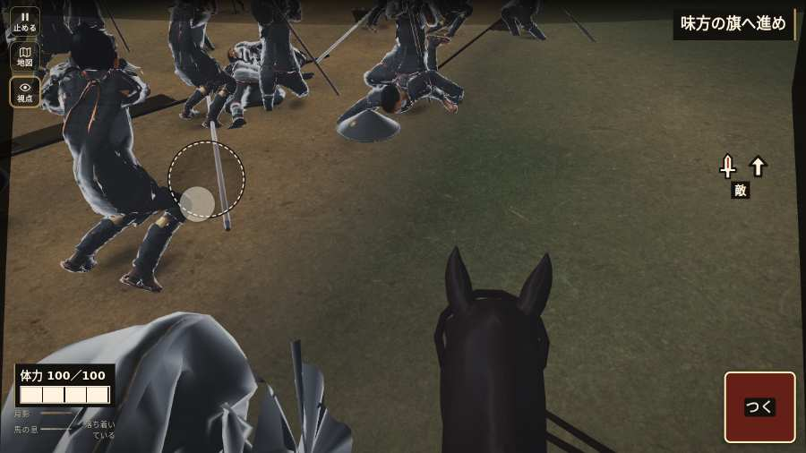

# テストプレイヤーの感想：はじめての中学生

- 人：ハルト（13歳・中学一年）（2530番）
- 変わり目：構え多め・パソコン 1280×720・織田家編の戦を一つ・速い・身分 少し上・問屋:供・一人称・感度 敏感・止めない
- 時：2026/10/24 7:20:03（133秒かかった）
- 画面：パソコン 1280×720・鍵盤とマウス・画質 高
- 遊んだ戦：刀根坂の戦い（失敗・倒れた）
- 機械の混み具合：3（load average）

## ひとこと

> えっと、遊んでみた。刀根坂をやった。よく分かんないまま終わった。1回すぐ死んだ…。「HUD の札どうしが重なって読めない」のとこ、ムリ。「戦場が札に食われている」のとこ、マジで意味わかんない。「遊んでいる途中でゲームが落ちた」のとこ、ふつうに困った。ぶっちゃけ、ここで一回やめかけた。

## 見つけた問題（8件・困った順）

### 1. HUD の札どうしが重なって読めない
- どこで：刀根坂の戦い・開戦
- 何が：.bl.hz-has-73 と .field-names（1280×720）／#h-prog と .field-names（1280×720）
- どれくらい困ったか：★★★ やめたくなった（179回）
- 直し方の目安：置き場所をずらすか、片方を出している間はもう片方を隠す
- 画面：（その戦の山場の一枚）

### 2. 戦場が札に食われている（画面の3分の1超）
- どこで：刀根坂の戦い・開戦
- 何が：1280×720 で 100%
- どれくらい困ったか：★★★ やめたくなった（59回）
- 直し方の目安：札を小さくするか、平時は薄く・畳む
- 画面：（その戦の山場の一枚）

### 3. 押せる所が小さい（28px 未満）
- どこで：刀根坂の戦い・開戦
- 何が：#hud.hz-has-23.battle-active > #mission-goal > .goal-label：16×8「」
- どれくらい困ったか：★★★ やめたくなった（21回）
- 直し方の目安：押せる大きさを 28px 以上に
- 画面：（その戦の山場の一枚）

### 4. 遊んでいる途中でゲームが落ちた（例外）
- どこで：刀根坂の戦い・280秒・town
- 何が：TypeError: Cannot read properties of null (reading 'u')     at watchStep (http://localhost:8765/v202610240017/src/playbot.js:1692:42)     at playPersona (http://localhost:8765/v202610240017/src/playbot.js:2304:7)
- どれくらい困ったか：★★★ やめたくなった（1回）
- 直し方の目安：この行の前提（値が無い・死んだ兵など）を確かめる
- 画面：（その戦の山場の一枚）

### 5. 「突く」を押そうとしたら、別の物に当たった
- どこで：刀根坂の戦い・237秒・road
- 何が：指の下にあったのは div「越前への追撃　数日の道のり八」
- どれくらい困ったか：★★ かなり困った（1回）
- 直し方の目安：重ねている札の置き場所をずらすか、pointer-events:none にする
- 画面：

### 6. 「右側のなぞり（見回す）」を押そうとしたら、別の物に当たった
- どこで：刀根坂の戦い・237秒・road
- 何が：指の下にあったのは div > canvas「刀根坂から敦賀、木の芽峠、府中を経て一乗谷へ向かう略図」
- どれくらい困ったか：★★ かなり困った（1回）
- 直し方の目安：重ねている札の置き場所をずらすか、pointer-events:none にする
- 画面：（その戦の山場の一枚）

### 7. 号令「follow」が、指の号令の輪から出せない
- どこで：刀根坂の戦い・248秒・town
- 何が：号令の輪（RADIAL）に無い、または身分が足りず選べない（刀根坂の戦い・248秒・town）
- どれくらい困ったか：★ 少し気になった（8回）
- 直し方の目安：号令の輪に足すか、短く押した時の指揮の札（数字の号令）を指で押せるようにする
- 画面：（その戦の山場の一枚）

### 8. すぐに倒れてしまった
- どこで：刀根坂の戦い・280秒・town
- 何が：276秒で倒れた（受けた傷：足軽 111｜段 town・最後の傷 91s足軽13→109背退距1.8見1.8 91s足軽10→92横退距2.0見1.8 265s足軽10→75横囲退距2.4見2.4 268s足軽17→62背囲退距2.1見1.5 269s足軽14→39囲退距1.6見1.6 271s足軽12→28囲退距1.4見1.4 272s足軽15→12囲退距2.9見2.2 273s足軽13→12囲退距2.0見2.0｜跡 239:4:-3,-13,16:75:thrust 242:4:-3,-13,16:75:thrust 245:4:-3,-13,16:75:thrust 248:4:-3,-13,16:75:thrust 251:5:73,-144,31:75:thrust 254:5:73,-143,31:75:thrust 257:5:72,-141,31:75:thrust 260:5:79,-136,31:75:thrust 263:5:86,-133,31:75:thrust 266:5:87,-130,31:62:thrust 269:5:88,-129,31:29:thrust 272:5:88,-128,31:12:thrust 275:5:87,-128,31:12:thrust 278:5:86,-128,31:0:thrust）
- どれくらい困ったか：★ 少し気になった（1回）
- 直し方の目安：初めの戦は受ける傷を減らす・危ない時に字幕で構えを教える
- 画面：（その戦の山場の一枚）

## 遊んだ記録

- 刀根坂の戦い：276秒・任務失敗（倒れた）・戦功0・組—・討ち取り6・突き298/当たり14・号令4回・指で押した数1335・読み込み12.6秒・戦の前の札169字・1コマ14.3ms（実時間99秒・内訳 brain 0.2・pad 0.2・tf 0.1・upd 13.7・eye 0.1）
  - 任務の流れ：0s 馬が動いたら、信長公に続け → 5s 味方に続き、道を塞ぐ敵を崩せ → 5s 道の曲がりへ進み、味方と敵を崩せ → 15s 味方と印の敵へ進め → 16s 道の曲がりへ進み、味方と敵を崩せ → 18s 味方と印の敵へ進め → 20s 印の敵へ、味方と近づけ → 24s 敵へ構え、味方と押せ → 30s 印の敵へ、味方と近づけ → 31s 敵へ構え、味方と押せ → 34s 印の敵へ、味方と近づけ → 35s 敵へ構え、味方と押せ → 39s 印の敵へ、味方と近づけ → 39s 敵へ構え、味方と押せ
  - 味方の隊：隊11・動いた計2539m・味方の討ち取り17・敵を前に20秒止まった6回・本物の味方5人未満0秒
  - 受けた傷：足軽 111｜段 town・最後の傷 91s足軽13→109背退距1.8見1.8 91s足軽10→92横退距2.0見1.8 265s足軽10→75横囲退距2.4見2.4 268s足軽17→62背囲退距2.1見1.5 269s足軽14→39囲退距1.6見1.6 271s足軽12→28囲退距1.4見1.4 272s足軽15→12囲退距2.9見2.2 273s足軽13→12囲退距2.0見2.0｜跡 239:4:-3,-13,16:75:thrust 242:4:-3,-13,16:75:thrust 245:4:-3,-13,16:75:thrust 248:4:-3,-13,16:75:thrust 251:5:73,-144,31:75:thrust 254:5:73,-143,31:75:thrust 257:5:72,-141,31:75:thrust 260:5:79,-136,31:75:thrust 263:5:86,-133,31:75:thrust 266:5:87,-130,31:62:thrust 269:5:88,-129,31:29:thrust 272:5:88,-128,31:12:thrust 275:5:87,-128,31:12:thrust 278:5:86,-128,31:0:thrust
  - 不具合：TypeError: Cannot read properties of null (reading 'u')     at watchStep (http://localhost:8765/v202610240017/src/playbot.js:1692:42)     at playPersona (http://localhost:8765/v202610240017/src/playbot.js:2304:7)
  - 開戦：
  - 山場：
