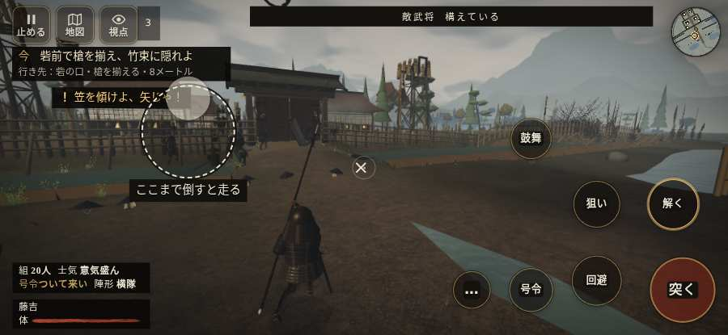

# テストプレイヤーの感想：アクション好き

- 人：ソウタ（24歳・アクションゲーム好き）（2562番）
- 変わり目：迷子になりやすい・iPhone 横 932×430・新しく始める通し・ふつう・身分 少し上・問屋:鉄砲・三人称・感度 ふつう・途中で止める
- 時：2026/10/15 10:05:58（141秒かかった）
- 画面：iPhone の横向き 932×430・倍率3・指で触る操作（touch.js の釦・棒・なぞり）・画質 低
- 遊んだ戦：野田・福島の戦い（達成）
- 機械の混み具合：2（load average）

## ひとこと

> とにかく突っ込んだ。5分で4人斬った。9回突いて9回当たり。当たりはいい感じ。親指で歩こうとしても、置く所がふさがっている、ここは爽快感が死んでる。「親指の棒（歩く）」を押そうとしたら、別の物に当たった、ここは爽快感が死んでる。「右側のなぞり（見回す）」を押そうとしたら、別の物に当たった、もったいない。もっと派手に、じゃなくて重く斬り合いたい。

## 見つけた問題（6件・困った順）

### 1. 親指で歩こうとしても、置く所がふさがっている
- どこで：野田・福島の戦い・210秒・retreat
- 何が：歩く範囲の四か所とも、戦場の上に札がある
- どれくらい困ったか：★★★ やめたくなった（101回）
- 直し方の目安：歩く範囲から札を離す／読むだけの札に指を通す
- 画面：（その戦の山場の一枚）

### 2. 行き先があるのに20秒動かない兵
- どこで：野田・福島の戦い・54秒・night
- 何が：味方の前田利家：味方の前田利家（号令：move・前田利家の手・頭：無/―・近い敵28m）at (-2,-2)／敵の侍：敵の侍（号令：path・殿を狙う敵・頭：無/―・近い敵53m）at (79,-28)
- どれくらい困ったか：★★ かなり困った（8回）
- 直し方の目安：道が塞がれていないか、行き先に着いたと見なせているかを見る
- 画面：（その戦の山場の一枚）

### 3. 死んだ相手を3秒以上狙い続けている
- どこで：野田・福島の戦い・87秒・night
- 何が：味方の足軽：味方の足軽
- どれくらい困ったか：★★ かなり困った（4回）
- 直し方の目安：相手が倒れたら狙いを外す
- 画面：（その戦の山場の一枚）

### 4. 「親指の棒（歩く）」を押そうとしたら、別の物に当たった
- どこで：野田・福島の戦い・11秒・assault
- 何が：指の下にあったのは #battle-notices > #battle-message > #subtitle「鉄砲衆盾が据わった！　これで」
- どれくらい困ったか：★★ かなり困った（1回）
- 直し方の目安：重ねている札の置き場所をずらすか、pointer-events:none にする
- 画面：

### 5. 「右側のなぞり（見回す）」を押そうとしたら、別の物に当たった
- どこで：野田・福島の戦い・42秒・night
- 何が：指の下にあったのは div「九月12日の夜その夜・本願寺」
- どれくらい困ったか：★★ かなり困った（1回）
- 直し方の目安：重ねている札の置き場所をずらすか、pointer-events:none にする
- 画面：（その戦の山場の一枚）

### 6. 斬り合う相手が少なくて退屈
- どこで：野田・福島の戦い・280秒・end
- 何が：5分で4人
- どれくらい困ったか：★ 少し気になった（1回）
- 画面：（その戦の山場の一枚）

## 遊んだ記録

- 野田・福島の戦い：280秒・任務達成・戦功203・組18/20・討ち取り4・突き9/当たり9・号令0回・指で押した数23・読み込み3.8秒・戦の前の札139字・1コマ16ms（実時間118秒・内訳 brain 0.1・pad 0.1・tf 0.3・upd 15.4・eye 0.1）
  - 任務の流れ：1s 竹束を押し、印へ据えよ → 7s 浅瀬へ進み、味方と三好勢を押し戻せ → 14s 三好勢を押し戻し、砦前へ進め → 36s 砦前で槍を揃え、竹束に隠れよ → 42s 堤の味方へ戻り、一緒に敵を防げ → 202s 堤を守り、退きの下知を待て → 210s 堤から詰め陣の印へ退け → 280s 堤から詰め陣の印へ退け〔済〕
  - 味方の隊：隊17・動いた計1952m・味方の討ち取り23・敵を前に20秒止まった41回・本物の味方5人未満0秒
  - 受けた傷：侍 30・足軽 1
  - 開戦：
  - 山場：
