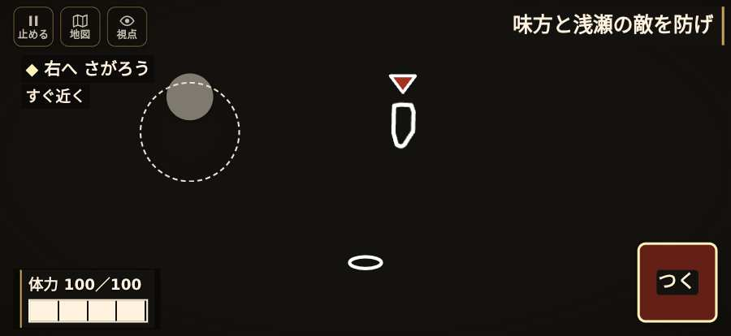
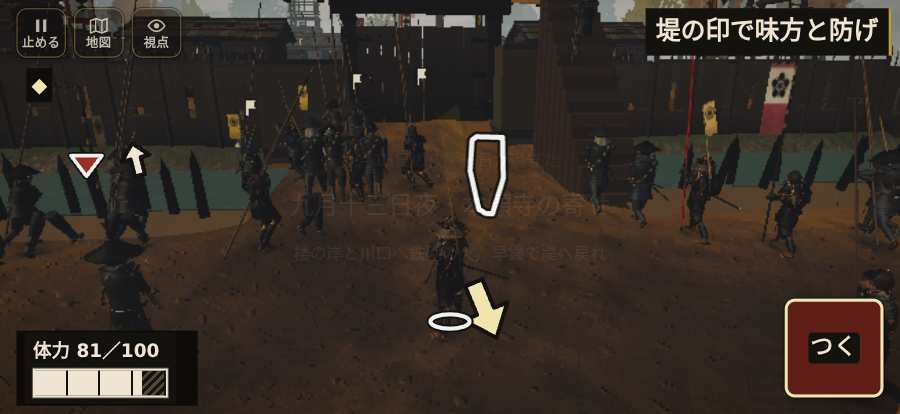

# テストプレイヤーの感想：歴史好きの大人

- 人：ミチオ（62歳・郷土史の会）（2631番）
- 変わり目：連打・iPhone 横 874×402・織田家編の戦を一つ・速い・身分 少し上・問屋:鉄砲・三人称・感度 敏感・途中で止める
- 時：2026/10/24 12:44:33（132秒かかった）
- 画面：iPhone の横向き 874×402・倍率3・指で触る操作（touch.js の釦・棒・なぞり）・画質 高
- 遊んだ戦：野田・福島の戦い（達成）
- 機械の混み具合：2（load average）

## ひとこと

> 野田・福島を、一人称で歩いて見て回りました。務めは果たせましたが、気になる所がいくつか。親指で歩こうとしても、置く所がふさがっている。史実を知る者としては、ここは看過できません。遊んでいる途中でゲームが落ちた。当時の人が見たら首を傾げるでしょう。「右側のなぞり（見回す）」を押そうとしたら、別の物に当たった。史実を知る者としては、ここは看過できません。

## 見つけた問題（6件・困った順）

### 1. 親指で歩こうとしても、置く所がふさがっている
- どこで：野田・福島の戦い・67秒・night
- 何が：歩く範囲の四か所とも、戦場の上に札がある
- どれくらい困ったか：★★★ やめたくなった（202回）
- 直し方の目安：歩く範囲から札を離す／読むだけの札に指を通す
- 画面：（その戦の山場の一枚）

### 2. 遊んでいる途中でゲームが落ちた（例外）
- どこで：野田・福島の戦い・263秒・end
- 何が：TypeError: Cannot read properties of null (reading 'u')     at watchStep (http://localhost:8765/v202610240235/src/playbot.js:1690:42)     at playPersona (http://localhost:8765/v202610240235/src/playbot.js:2302:7)
- どれくらい困ったか：★★★ やめたくなった（1回）
- 直し方の目安：この行の前提（値が無い・死んだ兵など）を確かめる
- 画面：（その戦の山場の一枚）

### 3. 「右側のなぞり（見回す）」を押そうとしたら、別の物に当たった
- どこで：野田・福島の戦い・67秒・night
- 何が：指の下にあったのは div「九月13日の夜・一日が過ぎた」
- どれくらい困ったか：★★ かなり困った（1回）
- 直し方の目安：重ねている札の置き場所をずらすか、pointer-events:none にする
- 画面：

### 4. 「親指の棒（歩く）」を押そうとしたら、別の物に当たった
- どこで：野田・福島の戦い・67秒・night
- 何が：指の下にあったのは div「九月13日の夜・一日が過ぎた」
- どれくらい困ったか：★★ かなり困った（1回）
- 直し方の目安：重ねている札の置き場所をずらすか、pointer-events:none にする
- 画面：（その戦の山場の一枚）

### 5. console.error：THREE.Object3D.add: object not an instance of THREE.Object3D.
- どこで：野田・福島の戦い・戦の前の札
- 何が：—
- どれくらい困ったか：★ 少し気になった（12回）
- 直し方の目安：出どころを突き止める
- 画面：（その戦の山場の一枚）

### 6. 行き先があるのに20秒動かない兵
- どこで：野田・福島の戦い・259秒・retreat
- 何が：味方の鉄砲：味方の鉄砲（号令：retreat・織田の鉄砲衆・頭：無/―・近い敵35m逃）at (19,-11)
- どれくらい困ったか：★ 少し気になった（1回）
- 直し方の目安：道が塞がれていないか、行き先に着いたと見なせているかを見る
- 画面：（その戦の山場の一枚）

## 遊んだ記録

- 野田・福島の戦い：263秒・任務達成・戦功135・組—・討ち取り1・突き3/当たり2・号令0回・指で押した数6・読み込み20.1秒・戦の前の札139字・1コマ13.2ms（実時間97秒・内訳 brain 0.2・pad 0.1・tf 0.2・upd 12.6・eye 0.1）
  - 任務の流れ：0s 竹束を押せ → 35s 味方と浅瀬の敵を防げ → 45s 構えて、休む印へ退け → 52s 味方と浅瀬の敵を防げ → 58s 浅瀬を渡り、砦前の印へ → 61s 砦前の印で並べ。塀の奥へ入るな → 67s 堤の印で味方と防げ → 83s 敵が来る。堤で味方と待て → 92s 堤で休め。敵が来たら防げ → 118s 敵が来る。堤で味方と待て → 128s 堤を守れ。敵を追うな → 133s 堤で休め。敵が来たら防げ → 138s 敵が来る。堤で味方と待て → 143s 堤を守れ。敵を追うな
  - 味方の隊：隊13・動いた計1417m・味方の討ち取り36・敵を前に20秒止まった40回・本物の味方5人未満0秒
  - 受けた傷：足軽 19
  - 不具合：TypeError: Cannot read properties of null (reading 'u')     at watchStep (http://localhost:8765/v202610240235/src/playbot.js:1690:42)     at playPersona (http://localhost:8765/v202610240235/src/playbot.js:2302:7)
  - 開戦：
  - 山場：
