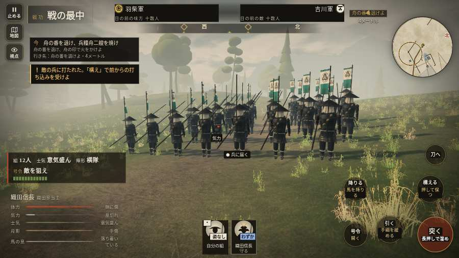

# テストプレイヤーの感想：はじめての中学生

- 人：ハルト（13歳・中学一年）（2720番）
- 変わり目：連打・パソコン 1280×720・信長で出陣・ゆっくり・身分 上・問屋:馬・一人称・感度 鈍い・途中で止める
- 時：2026/10/15 9:57:49（254秒かかった）
- 画面：パソコン 1280×720・鍵盤とマウス・画質 低
- 遊んだ戦：鳥取城の戦い（信長で出陣）（試験の持ち時間で打ち切り）（失敗）
- 機械の混み具合：4（load average）

## ひとこと

> とりあえずやってみた。鳥取城（信長で出陣）（試験の持ち時間で打ち切り）をやった。よく分かんないまま終わった。「字が枠から切れている」のとこ、ふつうに困った。「HUD の札どうしが重なって読めない」のとこ、だるい。「前へ進もうとしても進めない所があった」のとこ、マジで意味わかんない。ぶっちゃけ、ここで一回やめかけた。

## 見つけた問題（6件・困った順）

### 1. 字が枠から切れている
- どこで：鳥取城の戦い（信長で出陣）・開戦
- 何が：#h-units > .uc.ally > .nm「織田信長」
- どれくらい困ったか：★★★ やめたくなった（43回）
- 直し方の目安：枠を広げるか、字を折り返す
- 画面：（その戦の山場の一枚）

### 2. HUD の札どうしが重なって読めない
- どこで：鳥取城の戦い（信長で出陣）・45秒・boats
- 何が：#mobfx と .mk.edge（1280×720）／#mobfx と .plaque（1280×720）
- どれくらい困ったか：★★★ やめたくなった（11回）
- 直し方の目安：置き場所をずらすか、片方を出している間はもう片方を隠す
- 画面：（その戦の山場の一枚）

### 3. 前へ進もうとしても進めない所があった
- どこで：鳥取城の戦い（信長で出陣）・34秒・boats
- 何が：(-45, -13)・段 boats
- どれくらい困ったか：★★ かなり困った（1回）
- 直し方の目安：当たり（柵・建物・地形）と道のつながりを見直す
- 画面：

### 4. 前へ進もうとしても進めない所があった
- どこで：鳥取城の戦い（信長で出陣）・78秒・boats
- 何が：(-63, -30)・段 boats
- どれくらい困ったか：★★ かなり困った（1回）
- 直し方の目安：当たり（柵・建物・地形）と道のつながりを見直す
- 画面：（その戦の山場の一枚）

### 5. 押せる所が小さい（28px 未満）
- どこで：鳥取城の戦い（信長で出陣）・開戦
- 何が：#battle-notices > #objectives > #obj-list：284×20「「今」の任務を進めよう。」
- どれくらい困ったか：★ 少し気になった（1回）
- 直し方の目安：押せる大きさを 28px 以上に
- 画面：（その戦の山場の一枚）

### 6. 戦場が札に食われている（画面の3分の1超）
- どこで：鳥取城の戦い（信長で出陣）・45秒・boats
- 何が：1280×720 で 100%
- どれくらい困ったか：★ 少し気になった（1回）
- 直し方の目安：札を小さくするか、平時は薄く・畳む
- 画面：（その戦の山場の一枚）

## 遊んだ記録

- 鳥取城の戦い（信長で出陣）（試験の持ち時間で打ち切り）（戦の任務とは別に、試験全体の持ち時間が尽きた）：202秒・任務失敗・戦功20・組12/12・討ち取り9・突き201/当たり17・号令0回・指で押した数3942・読み込み5.0秒・戦の前の札108字・1コマ34.7ms（実時間179秒・内訳 brain 0.1・pad 7.4・tf 0.7・upd 26.4・eye 0.2）
  - 任務の流れ：0s 川岸の組へ合流せよ → 2s 舟の番を退け、兵糧舟二艘を焼け
  - 味方の隊：隊13・動いた計240m・味方の討ち取り4・敵を前に20秒止まった28回・本物の味方5人未満0秒
  - 受けた傷：足軽 12・侍 10
  - 開戦：
  - 山場：
