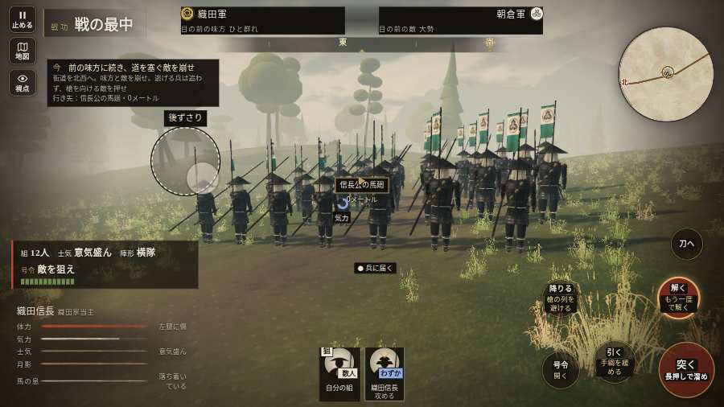

# テストプレイヤーの感想：アクション好き

- 人：ソウタ（24歳・アクションゲーム好き）（2807番）
- 変わり目：連打・パソコン 1280×720・信長で出陣・ゆっくり・身分 上・問屋:刀・槍・具足・三人称・感度 敏感・止めない
- 時：2026/10/15 15:31:33（185秒かかった）
- 画面：パソコン 1280×720・鍵盤とマウス・画質 低
- 遊んだ戦：刀根坂の戦い（信長で出陣）（失敗・倒れた）
- 機械の混み具合：4（load average）

## ひとこと

> とにかく突っ込んだ。4分で2人斬った。5回突いて5回当たり。当たりはいい感じ。HUD の札どうしが重なって読めない、ストレスたまる。字が枠から切れている、ここは爽快感が死んでる。倒れて戦が終わった、もったいない。1回やられた。難しいのはいいけど、何でやられたか分かるようにしてほしい。

## 見つけた問題（6件・困った順）

### 1. HUD の札どうしが重なって読めない
- どこで：刀根坂の戦い（信長で出陣）・5秒・brief
- 何が：.mk.edge と .combat-cue-label（1280×720）／#mobfx と .mk.edge（1280×720）
- どれくらい困ったか：★★ かなり困った（47回）
- 直し方の目安：置き場所をずらすか、片方を出している間はもう片方を隠す
- 画面：（その戦の山場の一枚）

### 2. 字が枠から切れている
- どこで：刀根坂の戦い（信長で出陣）・5秒・brief
- 何が：#h-units > .uc.ally > .nm「織田信長」
- どれくらい困ったか：★★ かなり困った（43回）
- 直し方の目安：枠を広げるか、字を折り返す
- 画面：（その戦の山場の一枚）

### 3. 倒れて戦が終わった
- どこで：刀根坂の戦い（信長で出陣）・238秒・pass
- 何が：221秒で倒れた（受けた傷：足軽 141）
- どれくらい困ったか：★★ かなり困った（1回）
- 直し方の目安：初めの戦は受ける傷を減らす・危ない時に字幕で構えを教える
- 画面：（その戦の山場の一枚）

### 4. 当主（信長）の任務が、家来の下につく形になっている
- どこで：刀根坂の戦い（信長で出陣）・1秒・brief
- 何が：「信長公の馬廻に続け」
- どれくらい困ったか：★ 少し気になった（5回）
- 直し方の目安：lord.js の REP_OBJ か LORD_FIX の rep で任務の文を替える
- 画面：（その戦の山場の一枚）

### 5. 戦場が札に食われている（画面の3分の1超）
- どこで：刀根坂の戦い（信長で出陣）・25秒・chase
- 何が：1280×720 で 100%
- どれくらい困ったか：★ 少し気になった（4回）
- 直し方の目安：札を小さくするか、平時は薄く・畳む
- 画面：（その戦の山場の一枚）

### 6. 斬り合う相手が少なくて退屈
- どこで：刀根坂の戦い（信長で出陣）・238秒・pass
- 何が：4分で2人
- どれくらい困ったか：★ 少し気になった（1回）
- 画面：（その戦の山場の一枚）

## 遊んだ記録

- 刀根坂の戦い（信長で出陣）：221秒・任務失敗（倒れた）・戦功70・組16/22・討ち取り2・突き5/当たり5・号令2回・指で押した数20・読み込み4.8秒・戦の前の札111字・1コマ21ms（実時間132秒・内訳 brain 0.1・pad 0.1・tf 0.5・upd 20.2・eye 0.2）
  - 任務の流れ：0s 信長公の馬廻に続け → 5s 前の味方に続き、道を塞ぐ敵を崩せ → 80s 味方と坂を上り、敵の槍を崩せ → 181s 峠口の敵を崩し、味方と峠へ
  - 味方の隊：隊11・動いた計1063m・味方の討ち取り13・敵を前に20秒止まった4回・本物の味方5人未満0秒
  - 受けた傷：足軽 141
  - 開戦：
  - 山場：
  - 勝ち負けが決まった所：
