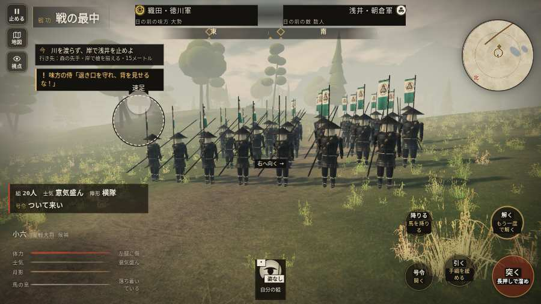

# テストプレイヤーの感想：歴史好きの大人

- 人：ミチオ（62歳・郷土史の会）（2836番）
- 変わり目：走りっぱなし・パソコン 1280×720・新しく始める通し・ふつう・身分 少し上・問屋:買わない・一人称・感度 鈍い・止めない
- 時：2026/10/15 15:28:05（310秒かかった）
- 画面：パソコン 1280×720・鍵盤とマウス・画質 低
- 遊んだ戦：姉川の戦い（試験の持ち時間で打ち切り）（失敗）
- 機械の混み具合：5（load average）

## ひとこと

> 姉川（試験の持ち時間で打ち切り）を、一人称で歩いて見て回りました。務めは果たせませんでしたが、それより気になる所があります。行き先があるのに20秒動かない兵。史実を知る者としては、ここは看過できません。敵が近いのに、まわりの兵の多くが棒立ち。細かい事ですが、こういう所で嘘っぽくなる。字が枠から切れている。史実を知る者としては、ここは看過できません。

## 見つけた問題（4件・困った順）

### 1. 行き先があるのに20秒動かない兵
- どこで：姉川の戦い・186秒・charge
- 何が：敵の足軽：敵の足軽（号令：attack・東へ回る浅井の別手・頭：full/engage・近い敵1m）at (18,126)／敵の侍：敵の侍（号令：attack・東へ回る浅井の別手・頭：full/engage・近い敵1m）at (19,129)
- どれくらい困ったか：★★★ やめたくなった（20回）
- 直し方の目安：道が塞がれていないか、行き先に着いたと見なせているかを見る
- 画面：（その戦の山場の一枚）

### 2. 敵が近いのに、まわりの兵の多くが棒立ち
- どこで：姉川の戦い・220秒・charge
- 何が：220秒：まわり35mの24人のうち12人が止まったまま（段 charge）
- どれくらい困ったか：★★ かなり困った（2回）
- 直し方の目安：敵が30m内に入ったら、構える・にじり寄る・槍を揃えるなど体を動かす
- 画面：（その戦の山場の一枚）

### 3. 字が枠から切れている
- どこで：姉川の戦い・115秒・charge
- 何が：#h-units > .uc.ally > .nm「1 坂井政尚」／#h-units > .uc.ally > .nm「7 柴田勝家」
- どれくらい困ったか：★ 少し気になった（37回）
- 直し方の目安：枠を広げるか、字を折り返す
- 画面：（その戦の山場の一枚）

### 4. 兵が一息で飛んだ（6m 超）
- どこで：姉川の戦い・254秒・charge
- 何が：味方の足軽：味方の足軽：(65,6) → (67,12)
- どれくらい困ったか：★ 少し気になった（1回）
- 直し方の目安：位置を直接書き換えている所を探す（出し直し・押し出し）
- 画面：（その戦の山場の一枚）

## 遊んだ記録

- 姉川の戦い（試験の持ち時間で打ち切り）（戦の任務とは別に、試験全体の持ち時間が尽きた）：330秒・任務失敗・戦功50・組17/20・討ち取り6・突き20/当たり20・号令0回・指で押した数54・読み込み3.2秒・戦の前の札170字・1コマ30.7ms（実時間244秒・内訳 brain 0.2・pad 0.1・tf 0.3・upd 29.8・eye 0.2）
  - 任務の流れ：0s 川を渡らず、岸で浅井を待て → 11s 川を渡らず、岸で浅井を止めよ → 40s 後ろの段へ戻り、浅井を止めよ → 51s 正面の槍列を守れ → 144s 後ろの段へ戻り、浅井を止めよ → 279s 本陣前へ戻り、抜けた敵を止めよ → 304s 味方の槍の後ろへ下がれ
  - 味方の隊：隊17・動いた計1314m・味方の討ち取り23・敵を前に20秒止まった73回・本物の味方5人未満0秒
  - 受けた傷：足軽 44・鉄砲 2・侍 1
  - 開戦：
  - 山場：
  - 一人称で見回す（96秒）：
