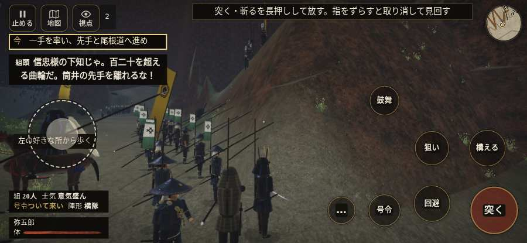

# テストプレイヤーの感想：歴史好きの大人

- 人：ミチオ（62歳・郷土史の会）（2961番）
- 変わり目：台詞を全部読む・iPhone 横 932×430・新しく始める通し・ふつう・身分 上・問屋:刀・槍・具足・三人称・感度 鈍い・途中で止める
- 時：2026/10/15 19:15:19（235秒かかった）
- 画面：iPhone の横向き 932×430・倍率3・指で触る操作（touch.js の釦・棒・なぞり）・画質 低
- 遊んだ戦：信貴山城の戦い（試験の持ち時間で打ち切り）（失敗）
- 機械の混み具合：3（load average）

## ひとこと

> 信貴山城（試験の持ち時間で打ち切り）を、一人称で歩いて見て回りました。務めは果たせませんでしたが、それより気になる所があります。行き先があるのに20秒動かない兵。これでは興が醒めます。前へ進もうとしても進めない所があった。これでは興が醒めます。敵が近いのに、まわりの兵の多くが棒立ち。史実を知る者としては、ここは看過できません。

## 見つけた問題（5件・困った順）

### 1. 行き先があるのに20秒動かない兵
- どこで：信貴山城の戦い・284秒・honmaru
- 何が：味方の足軽：味方の足軽（号令：move・使番・頭：無/―・近い敵81m逃）at (43,4)／味方の足軽：味方の足軽（号令：move・使番・頭：無/―・近い敵46m逃）at (15,-32)
- どれくらい困ったか：★★★ やめたくなった（8回）
- 直し方の目安：道が塞がれていないか、行き先に着いたと見なせているかを見る
- 画面：（その戦の山場の一枚）

### 2. 前へ進もうとしても進めない所があった
- どこで：信貴山城の戦い・33秒・climb
- 何が：(32, -45)・段 climb
- どれくらい困ったか：★★ かなり困った（1回）
- 直し方の目安：当たり（柵・建物・地形）と道のつながりを見直す
- 画面：

### 3. 敵が近いのに、まわりの兵の多くが棒立ち
- どこで：信貴山城の戦い・45秒・climb
- 何が：45秒：まわり35mの60人のうち24人が止まったまま（段 climb）
- どれくらい困ったか：★★ かなり困った（1回）
- 直し方の目安：敵が30m内に入ったら、構える・にじり寄る・槍を揃えるなど体を動かす
- 画面：（その戦の山場の一枚）

### 4. console.error：THREE.WebGLProgram: Shader Error 1282 - VALIDATE_STATUS false

Program Info Log:
- どこで：信貴山城の戦い・開戦
- 何が：—
- どれくらい困ったか：★ 少し気になった（7回）
- 直し方の目安：出どころを突き止める
- 画面：（その戦の山場の一枚）

### 5. 戦う兵が遠景の大軍（影の兵）の中に埋もれている
- どこで：信貴山城の戦い・101秒・climb
- 何が：味方の兵 7人が、遠景の大軍 #2（中心 73,10・44人）の中（68, 0）
- どれくらい困ったか：★ 少し気になった（1回）
- 直し方の目安：遠景の大軍を戦う場所から離す（addDistantArmy の x,z,w,d を見直す）か、兵の行き先を大軍の外にする
- 画面：（その戦の山場の一枚）

## 遊んだ記録

- 信貴山城の戦い（試験の持ち時間で打ち切り）（戦の任務とは別に、試験全体の持ち時間が尽きた）：423秒・任務失敗・戦功85・組16/20・討ち取り9・突き24/当たり24・号令0回・指で押した数57・読み込み3.0秒・戦の前の札136字・1コマ22.3ms（実時間205秒・内訳 brain 0.2・pad 0.1・tf 0.3・upd 21.5・eye 0.1）
  - 任務の流れ：0s 一手を率い、先手と尾根道へ進め → 5s 尾根の松永勢を退け、門の前へ進め → 103s 手の者と門脇に立ち、打ち手を守れ → 123s 手の者と打ち手を守り、門を破れ → 149s 北尾根の下の曲輪へ入り、敵を退けよ → 269s 守りを崩し、味方と本丸を取れ
  - 味方の隊：隊25・動いた計1532m・味方の討ち取り37・敵を前に20秒止まった38回・本物の味方5人未満0秒
  - 受けた傷：足軽 14・弓 9
  - 開戦：
  - 一人称で見回す（45秒）：
